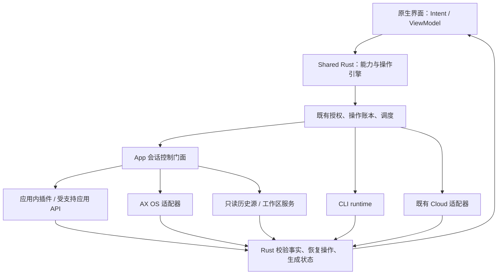
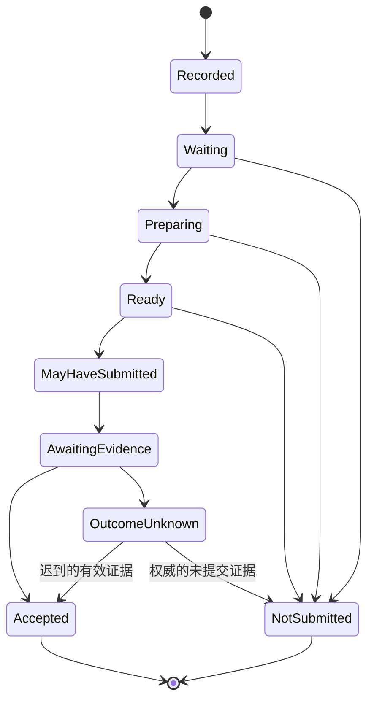

# Agent 操作技术方案：区分 App 与 CLI，按能力选择执行通道

日期：2026-11-02。状态：**讨论稿，尚未实现**。
决策记录：[ADR 0093](adr/0093-app-and-cli-capability-control-design.md)。

本文设计完整的 Agent 操作框架，包括插件、辅助功能（AX）和独立 CLI
会话，目标是降低发送失败、保留已有功能，并让操作结果可确认、可恢复。
本次仅修改文档；合并文档不表示实现、安装或实机验收已经完成。

## 1. 目标、依据与边界

用户反馈多个应用经常发送失败。此次查阅的是主线源码与历史 ADR，未采集
新的现场日志，因此不将某一历史原因认定为本次全部失败的根因。

已确认的设计基础与问题：

- 已有 provider 队列、进程身份检查、精确会话定位、草稿回读、单次提交、
  操作账本与迟到回执恢复；重设计复用这些机制，不从零建立第二套系统。
- `muster-platform::macos::native_app` 同时执行 OS 调用与多阶段发送编排；
  `muster-agent::native_send` 已提取部分策略，仍需形成完整的共享状态机。
- [ADR 0091](adr/0091-prune-conversation-views-only-where-separate.md) 记录了
  Claude 与 Codex 侧栏结构不同导致的回归。应用事实必须留在各自适配器和
  profile，不能把一个应用的优化直接泛化到其他应用。
- [DeepSeek 插件](adr/0074-deepseek-harness-plugin-control.md) 已使用应用内
  服务控制 App 会话，但并未覆盖所有能力，丢失响应仍可能留下未知结果。
- [独立 CLI 适配器](ORCA_ADAPTER.md) 已存在，拥有自己的进程、journal 和
  会话语义；它不是桌面 App 的另一种输入方式。
- 当前 profile 对 AX 和插件互斥，模型选项、队列等能力仍依赖 AX 表结构。

设计目标是保持既有可用功能、明确每项能力的执行者和完成证据，并使故障
恢复有可测试的边界。终端、浏览器、网络、文件服务继续使用已有基础设施；
不借此次重设计改写其协议，不恢复架构迁移表中已删除的控制代码。

## 2. App、CLI、Cloud 是不同会话域

`domain`、`provider`、`mode` 和 `adapter` 必须分开：同为 Codex 或 Claude
不能证明是同一会话，App 中的 Code 模式也不等于 Muster 管理的 CLI 会话。

| 项目 | App 会话 | CLI 会话 | 已有 Cloud 会话 |
| --- | --- | --- | --- |
| 所有者 | 目标桌面应用 | Muster 的 Rust CLI runtime | 提供方云服务 |
| 创建 | 应用支持的创建入口；能力与调用范围单独声明 | 明确创建独立 CLI 会话 | 保持现有云 API 能力边界 |
| 执行 | 应用内插件、受支持应用 API 或 AX | 已绑定的 app-server / stream-json 子进程 | 云 API |
| 身份 | 应用身份、安装/配置命名空间、原生会话 ID | runtime 实例、原生会话 ID | 账户命名空间、远端会话 ID |
| 生命周期 | 应用退出使控制绑定失效，历史仍可读 | runtime 管理启动、退出、恢复 | 云服务决定 |
| 并发保护 | 应用队列；必要时桌面占用和 Locked Use | 会话串行、子进程 generation/fence | 云请求与账本规则 |
| 授权 | 对应 `agents:<provider>` 或 Chat scope，加既有本地策略 | 保持 `agents:orca`，不继承 App 授权 | 保持现有云能力与 provider scope |
| 锁屏 | 沿用 App 的现有 Locked Use 规则，插件不绕过 | 沿用独立 CLI 的策略，不借用 AX 解锁流程 | 沿用既有云规则 |
| 故障恢复 | 恢复同一 App 会话绑定、查询原操作 | 原 runtime/journal 下显式恢复 | 查询原云操作/记录 |

App 的应用身份使用实际 bundle/签名与配置命名空间，不能把展示用的 provider
名称当作应用标识。例如一个宿主里的 Chat 与 Code 可共享应用互斥资源，却仍有
不同 mode、会话和 scope；同名 CLI provider 不属于这把 App 控制锁。

App 可在其内部使用 CLI，但只要会话由 App 所有，就仍属于 App。不能因进程名、
工作目录、标题或 transcript 相同，将它接管为 Muster CLI。

Rust 内部使用类型化 `SessionRef`：`host + domain + owner_namespace + native_id`。
稳定会话身份与易变绑定分离：`Binding` 包含 verified process/runtime identity、
launch generation、adapter instance/epoch。历史可以跨进程启动保留；旧绑定不能
向新进程发出写操作。平台只持有 Rust 返回的不透明句柄及展示字段。

App 与 CLI 永不自动互转。以后若提供“在 CLI 中继续”，必须显式创建新会话，
展示上下文复制范围和新身份，不能带走旧审批、未知操作或权限。该功能不在本方案
首期范围。Cloud 继续独立，不能作为 App 失败后的自动替代路线。

## 3. 分层与代码职责

| 模块 | 设计职责 |
| --- | --- |
| `muster-agent` | 会话域、能力、绑定、路由、App 操作状态机、各操作的完成证据；复用 CLI runtime |
| `musterd` | RPC 授权与能力检查、provider/桌面调度、Locked Use 组合、生命周期管理 |
| `muster-store` / 现有 ledger | 扩展原操作记录的阶段、路由和证据；不增加第二个权威操作账本 |
| `muster-platform` / OS shim | 返回 AX/进程/输入事实，执行 Rust 请求的有界 OS 动作 |
| `muster-app-core` / `muster-proto` | 类型化状态与 Intent、恢复查询、能力和原因投影；先改 Rust/协议再接 UI |
| 应用内插件 | 转译宿主接口、返回宿主事实；不决定 Muster 授权、重试或业务状态 |

App 仍只有一个逻辑控制门面。门面可以按能力委派多个适配器，但一个写操作
始终只有一个执行者。CLI 保留独立控制器；不增加常驻桥接进程、公共 HTTP
入口或第二套设备连接。

## 4. 能力契约与完整功能覆盖

能力不再由“有没有 AX 表”推断。每项能力包含 `id/version`、输入/输出类型、
约束、完成证据类型、候选实现及当前可用性。可用性使用明确枚举：
`Available`、`TemporarilyUnavailable(reason)`、`Unsupported(reason)`。
权限拒绝独立表达，不把“不授权”解释成“插件未安装”。

实际能力取已编译允许集合、验证后的适配器声明、宿主版本/会话上下文与
当前策略的交集。插件返回的 JSON 和 enabled 布尔值不能授予权限。
Rust 对每次操作重新校验；UI 中可用不构成执行授权。

下表是覆盖清单，不是所有应用已实现或应立即具备的能力承诺。每个“provider ×
domain × mode”都必须有一份实例化清单，逐项记录现有实现、目标路由、缺口与验收。

| 能力组 | 需要保留/定义的操作 | 语义与验收边界 |
| --- | --- | --- |
| 会话目录 | list/watch、打开、新建、项目关联、子 Agent/子会话 | 新建 App 与新建 CLI 分开；保持现有 local-only 创建范围，不借统一协议扩权 |
| 历史与输出 | 分页、订阅、消息更新、工具调用/结果、差异、usage | 记录 ID 和 revision 去重；缺失内容/指标不能填成已知状态 |
| 生命周期 | 正在运行、等待审批、空闲、未知、退出 | 进程存活不等于该会话正在运行；CLI 子进程与 App 主进程分开 |
| 发送 | 文本、排队、steer（若支持） | 模式显式声明；普通 send 不静默改成 steer；接收与本轮完成分开 |
| 队列 | 列表、立即发送、删除；编辑仅在实际支持时开放 | 对队列项 ID/revision 操作；不能把中断当删除，不能伪造提供方队列 |
| 中断 | 指定会话/turn 的中断请求及结果 | 命令已接收与实际停止分开；旧 turn 的中断不得命中新 turn |
| 审批 | 原始选项、选择、失效、已由其他端处理 | 只允许提供方给出的选项，绑定 interaction/revision，首个有效答案获胜 |
| 问答 | 单选、多选、自定义文本、多页题、提交 | 按题目 ID 校验；部分填写不是整表已提交 |
| 输入辅助 | 补全/建议、显式及自动 compact | 读取补全不能误发；自动 compact 保留 opt-in、空草稿及既有独立授权限制 |
| 附件 | file-reference、native-attachment、structured-image | 三种独立能力，保留现有数量/字节限制；不宣称文件路径等于模型已读取图片 |
| 设置与模式 | 模型、推理强度、Chat/Code 切换与选项读取 | 返回实际选项和选择结果；设置请求不因 UI 点击成功就算生效 |
| 工作区 | 文件列表/读取、Git 历史与差异 | 复用 Rust 工作区服务和既有路径/权限检查，非插件必经路径 |
| 操作恢复 | 状态查询、迟到回执、显式重发、忽略提示 | 迟到结果不能清空新草稿；忽略不等于已送达 |
| 安全与诊断 | 本地/远端授权、锁屏控制、取消、阶段与错误 | 同一语义供所有客户端展示；适配器不绕过原有 gate |

当前特殊情况必须保留在迁移基线：

- DeepSeek 插件支持发送、中断、状态、审批和问答；模型选择、队列编辑、
  原生附件/图片等不能因为有插件就标为支持。
- 既有 Agent 附件是 daemon 上传后生成文件引用，详见
  [AGENT_INTERFACE](AGENT_INTERFACE.md#composer-attachments-2026-09-28)。
  不把它升级描述为原生附件卡片或结构化图像输入。
- CLI 的现有能力和缺口以 [ORCA_ADAPTER](ORCA_ADAPTER.md) 为基线；不从
  同名 App profile 继承模型选择、文件或附件支持。
- 暂未证实 Codex/Claude 的受支持插件接口能控制已有桌面会话。立项调查必须
  验证真实会话 ID、写接口、回执、审批与版本兼容；仅有工具、hooks 或提示词
  插件不足以判定可接管 App 操作。

## 5. 路由、身份和冲突控制

一个 App 可由插件发送、只读源提供历史、AX 设置模型；但组合必须有共享的、
验证过的原生会话身份。标题、路径和消息内容只能辅助观察，不能单独建立绑定。
应用特定映射（例如桌面 ID 与 transcript ID）由 Rust 适配器验证并保留来源。

路由在副作用前确定并写入 ledger：能力版本、adapter ID/version、绑定 epoch、
会话与请求摘要。优先采用已验收且证据更完整的实现，不在每次调用中竞速多个
写入者。同一 App 的跨能力操作仍共享会话/应用冲突管理，例如发送期间不能
同时切换会话模式或修改相关模型设置。

插件断线时，可在**新操作开始前**选择已验收的 AX 能力，但必须重新验证身份、
授权和可用性。原操作未结束或已进入提交边界时禁止自动换路线。重连、升级或
卸载不改变正在执行的 route；旧绑定只可进行受限的只读结果恢复。

远端客户端不能指定任意 adapter 绕过 gate。操作的 domain、session、能力、
正文/附件摘要和授权主体由 Rust 绑定；服务端选出的 route 写入原记录。继续
使用既有签名域和校验规则，若新增语义无法由旧授权消息完整绑定，必须升级
该消息并拒绝旧格式执行新操作，不能依赖客户端附带的字符串补足权限。

读源也要去重：优先以原生 record ID/revision 合并；无映射时指定单一权威历史源，
不能把插件与文件中同样的文字拼成两条消息。控制连接失效不清除历史，历史存在
也不能恢复写权限。

## 6. 插件协议草案

以下是语义草案，不是已发布的 wire schema。首个通用版本与现有 DSH 协议分开
协商，先通过 Rust DSH 适配器保留兼容；不直接让旧插件解释新方法。

### 6.1 安装、握手与权限

首期插件随审查过的适配包交付，由用户安装到宿主支持的插件目录/profile。
manifest 只描述宿主、协议版本、能力和兼容范围，不包含任意启动命令、shell、
任意回调 URL 或可自行扩张的权限。不是通用代码热加载市场。

插件通过私有本地 IPC 接受 musterd 请求；macOS/Linux 使用受限目录和 socket
权限，Windows 后续使用等价的受限管道。沿用 peer UID/PID、签名、启动代际验证；
若宿主使用辅助进程，需要单独证明其归属，不能接受插件自行报告的 PID。
同 UID 攻击仍遵守现有威胁模型，不宣称 socket 权限隔离了同 UID 恶意进程。

`hello` 返回 protocol major/minor、host/adapter version、instance epoch、
typed capabilities、消息大小/分页/事件限制及恢复契约。主版本不兼容拒绝；未知
可选字段忽略，未知操作拒绝。可声明的能力仍受编译期允许集合约束。兼容范围
之外的写能力先标 unavailable，读取与诊断不被误判成写能力验收通过。

### 6.2 方法、事件和操作关联

| 方法族 | 内容 |
| --- | --- |
| `hello`, `health` | 身份绑定后的协商和活性；不代表会话可写 |
| `sessions.list`, `session.snapshot`, `events.subscribe` | 有界分页、快照、按 epoch/sequence 恢复事件 |
| `operation.execute` | 类型化动作、session、operation ID、请求摘要、期望 revision、相对 deadline |
| `operation.lookup` | 只读查询原 operation ID + binding + 摘要，不触发任何重放 |
| `operation.cancel` | 尽力撤销尚未提交的工作；不能撤回已经接受的消息 |

动作类型覆盖 §4；某类能力只有声明并验收后才可 execute。正文、附件引用、选项
和模式必须计入请求摘要。同 ID 不同 body 返回冲突。附件传输复用认证 RPC 和
daemon 私有存储，插件拿到的是受限引用，不接受远端指定的任意宿主路径。

事件包含 `epoch, sequence, session, revision, kind`，涉及操作时附 operation ID
和宿主 receipt ID。乱序/重复按 ID 与 revision 处理，序号缺口触发快照恢复。
重启更换 epoch；旧事件不得更新新绑定。队列和缓冲有界，慢消费者得到 resync
而不是无限积压。事件、回复和快照均校验长度、类型和归属，不能替代授权。

### 6.3 回执、幂等与崩溃空隙

区分 `Received`（插件收到）、`Accepted`（宿主接受）、`RejectedBeforeSubmit`、
`OutcomeUnknown` 和动作特有的完成结果。`Accepted` 至少关联原生会话、操作
摘要和宿主证据；不能由 socket 写入、HTTP 200、AXPress 返回值或模型开始输出
单独推断。发送已接受与模型本轮成功/失败是两套状态。

适配器需声明去重/恢复范围：宿主是否原生支持请求 ID、保留期、跨重启是否有效、
lookup 是否能返回权威结果。公共引擎首期**不自动重放未知 mutation**；优先 lookup。
以后只有原生去重契约与保留期都被验证，才可另行启用同 ID 的安全重试策略。

插件本地 journal 不是跨系统事务：宿主已执行、插件尚未写回执就崩溃时，若宿主
无法查询，结果仍为 unknown。不得承诺 exactly-once。清理过期记录后返回
`Forgotten/Unknown`，不能返回“从未执行”。ledger 保留去重 tombstone；实现阶段
须确定保留期和磁盘预算，未确定前不得自动删除未决操作或其证据。

## 7. 共享操作状态机与持久化

先完成必要的身份、scope、请求与能力校验，再持久化 `Recorded`；它必须发生在
导航、清空编辑框等副作用之前。无权限请求不因记录而获得任何执行资格。
`NotSubmitted` 只表示业务动作未提交，不表示没有切换过窗口或改过草稿。

持久化字段包括 operation ID、认证主体/网络/host/domain/session、请求摘要、
能力与 route snapshot、binding generation、状态/revision、提交边界、回执引用、
草稿修改标记和阶段计时。复用现有 ledger 和 client pending journal；恢复所需
的内容沿用既有私有存储机制，不把提示词、附件内容或凭据写入诊断日志。

提交前持久化 `MayHaveSubmitted`，成功落盘才允许调用宿主提交接口。若在落盘后、
调用前崩溃，保守地视为 unknown；多一次待确认优于重复执行。写盘失败时不提交。
程序重启不自动重放未完成流程，包括曾改过草稿但尚未提交的操作；先做只读
核对，恢复写入需新的授权/绑定及明确策略。

结果与清理并行记录：`cleanup = none_required | pending | secured | failed`。
消息已被接受，但重新锁屏尚未确认时，UI 可以显示“已发送，正在恢复锁屏”；
不得抹掉接受事实或把整个操作标为安全完成。清理失败沿用 watchdog/cover
恢复机制，不能为了返回结果提前揭开遮罩。

取消在提交前停止后续动作并等待 OS worker 排空；提交后取消只结束等待或请求
支持的取消动作，不证明未发送。权限撤销立即停止新动作和对外事件，内部保留
必要的清理与原结果记录。所有恢复查询重新授权，不能借旧操作 ID 读取被撤销数据。

每类动作定义自己的后置条件：发送看接受/入队证据；审批看该 interaction 被消费；
设置看目标值/revision；中断看对应 turn 的停止状态；新建看新会话 ID。只完成
部分题目填写时记录进度，不返回整个问答已完成。

## 8. AX 执行与桌面调度

AX 执行步骤为：等待可操作 → 精确定位 → 准备编辑器 → 写入并回读 → 最终校验
→ 单次提交 → 释放桌面并确认回执。事件通知仅用于唤醒有界局部观察；保留
轮询兜底。缓存、坐标或不完整 AX 树都不能作为新的提交授权。

| 失败位置 | 可做的恢复 | 禁止的行为 |
| --- | --- | --- |
| 尚未改动 UI | 有界重查身份/控件、等待用户静默 | 无限等待、延长既有解锁期限 |
| 已导航/焦点变化 | 核对当前会话与输入代际；必要时停止 | 直接重放整段导航脚本 |
| 已清空/写草稿 | 重新读取同一编辑器状态；按阶段策略决定下一步 | 在不确定的文档状态上重复追加或清空 |
| 本地用户介入 | 停止自动动作，保留可恢复状态 | 自动覆盖用户新输入或强抢焦点 |
| 提交可能发生 | 只读回执恢复 | 重按 Send、换插件重发或切 CLI |

显式发送沿用现有替换草稿政策；自动 compact/补全沿用保留用户草稿规则。
区分编辑器原草稿、Muster 写入草稿和外部变化，失败时准确报告残留。
不默认自动回滚原草稿：用户可能已接管，回滚本身也会破坏新输入。

进程身份、输入代际、session、composer 与 submit 关系，以及精确草稿均在
动作前核验。编辑器或按钮重建时只重新解析目标，不靠旧 element 继续提交。
旁栏布局、语言、共享 Send/Stop 槽位等留在应用 profile，新增事实用 fixture
证明，不能扩大一个应用的规则到所有应用。

调度采用统一 Rust admission coordinator 组合资源：

- 所有 App 写操作先进入既有应用 FIFO；同一会话的配置/发送/审批冲突显式定义。
- 需要前台焦点、键盘或导航的工作还要申请 host 桌面占用；不同应用也不能互相
  抢焦点。纯插件操作无需焦点，但不能绕过相同 App 的冲突和锁屏授权。
- coordinator 将应用、桌面和既有 Locked Use owner 视为一组准入条件；等待时
  不持有部分资源，不在拿着 provider mutex 时再等待被另一请求占有的 console。
  既有 lease 队列也经该 coordinator 分派，避免两套嵌套锁形成反向等待。
- 授权过期、取消或 owner 关闭时从等待队列移除；授予执行前再次校验授权。
  普通操作与自动 compact 使用同一冲突规则，自动操作不抢占人工操作。
- OS worker 排空前不释放占用。提交阶段完成后，回执只读等待不再持有桌面；
  未决写入仍保留会话语义屏障，不能让下一次发送覆盖未确认状态。

分别记录排队、准备、桌面占用、提交和回执等待时间。每个阶段有上限，且受
总 deadline/既有 lease 剩余时间约束；增加阶段不能累加延长解锁窗口。
插件的本地 deadline 只是执行上限，不构成授权证明。

App 插件首期保持 [ADR 0074](adr/0074-deepseek-harness-plugin-control.md) 的
锁屏政策，即便技术上不用 AX，也不自行取消临时解锁链。未来若希望插件直接
在锁屏下执行，必须另立授权和实机验收决策；本方案不通过 capability 标志放行。

## 9. 客户端、兼容与诊断

UI 显式标记 `App · provider`、`CLI · provider`，Cloud 保持自身标签。App 的
“插件/辅助功能”是操作实现信息，不作为 CLI 类别。新建入口分别命名和展示
归属，不能用一个模糊的“Codex 会话”隐去生命周期区别。

共享 Rust 投影操作阶段、结果、清理状态和可用动作。用户看到等待、准备、已发送、
未发送、结果待确认；不会把回执超时直接翻译成未发送。保留当前重试/忽略入口的
意图：显式重发创建新操作，并关联被释放的旧操作；unknown 情况显示可能重复的
含义。忽略只隐藏提示，不改 ledger 事实，迟到结果不清空新草稿或恢复已忽略提示。

协议采用新增字段/消息和能力版本协商，不能改旧 protobuf tag。老客户端仍可使用
原有可表达的操作；未知域或不能无损表达的能力显式 unavailable，不降级成 AX。
老 daemon 的 pending 操作保留原路由/恢复规则，禁止升级时重放。底层不引入并行
legacy 控制引擎；滚动升级所需兼容仅限 wire 表达和数据迁移。

诊断记录 operation 关联 ID、domain、能力/adapter 版本、阶段、耗时、错误码、
是否越过提交边界和清理结果，不记录正文、原始 AX 文本、账户或私有路径。
会话标识对公开导出匿名化，UI 展示和私有诊断权限分开。错误码至少区分
`PermissionDenied`、`CapabilityUnavailable`、`BindingChanged`、`Busy`、
`TargetAmbiguous`、`DraftUnverified`、`UserIntervened`、`OutcomeUnknown`、
`CleanupPending/Failed`；客户端不解析英文错误字符串决定业务行为。

## 10. 分阶段迁移与删除

| 阶段 | 交付内容 | 退出条件与删除 |
| --- | --- | --- |
| D0 能力基线 | 为现有 App/CLI/Cloud 建立 §4 实例矩阵；当前失败样本归类；验证插件入口 | 所有已有能力都有归属、限制与验收状态；不承诺未验证的 SDK |
| D1 类型与账本 | domain/SessionRef、能力及 route 类型、共享状态机、ledger 迁移 | 现有路由包入同一契约，重启不重放；删除重复的客户端结果推断 |
| D2 插件参考实现 | DSH 版本协商、lookup/事件、宿主证据适配及契约测试 | DSH 已有能力无回归；删除被替代的 DSH 专用轮询/请求路径，宿主事实映射保留 |
| D3 AX 迁移 | Rust 执行器、桌面协调、应用 profile/fixture、异常恢复 | 每个 App 单独通过实机矩阵后切换；删除对应平台编排、重试和重复扫描策略 |
| D4 完整能力对齐 | 队列、模型、附件模式、补全、compact、创建及 Chat 模式逐项迁移 | 现有支持项不得降级；新能力必须单独验收，未支持项明确原因 |
| D5 CLI 对齐与收尾 | 独立 CLI 映射同一公共能力/UI 契约，保留 runtime 所有权和 scope | App/CLI 隔离测试通过；删除旧布尔能力推断与已替代接口，更新架构/协议文档 |

每个阶段用独立实现 ADR 和 PR，记录变更、删除项及测试。切换以能力为单位，
不对 mutation 双跑；只读影子比较也必须有预算，不能干扰桌面。回退只影响后续
操作，保留原 ledger 和未决路由；不通过清空状态恢复“可发送”。不能让旧二进制
读取它不理解的新 ledger 后重放，格式不兼容必须明确拒绝或走验证过的迁移。

## 11. 验证与验收门槛

自动测试使用现有 Rust 测试、合成 AX fixtures、fake plugin 和 CLI 子进程 fixture，
不新增测试框架。设备测试使用专用合成会话，不向真实业务会话重复投递。

| 范围 | 必测场景 | 必须成立 |
| --- | --- | --- |
| 域与授权 | 同 provider 的 App/CLI 同名、同路径、不同 scope | 不串会话、不继承权限、不跨域恢复 |
| 能力/路由 | 不兼容版本、能力撤回、插件失联、旧 UI、route 升级 | 不谎报支持；在途操作不切换执行者 |
| 状态机/持久化 | 每个持久化点与 OS/宿主调用前后崩溃、写盘失败 | 提交前有记录；unknown 不重放，旧结果不改新草稿 |
| 插件 | 回复丢失、事件重复/缺口、epoch 变化、宿主接受后插件崩溃 | lookup 不写；传输 ACK 不算接受；无法证明时保持 unknown |
| AX | 可见/隐藏会话、长历史、重复/销毁控件、已有草稿、不同布局 | 目标唯一、草稿精确、每次尝试最多一次提交 |
| 并发 | 两客户端、两 App、设置与发送、自动 compact、用户接管 | 无焦点竞争/死锁；取消后等待 worker 排空 |
| 审批/问答 | 两端抢答、过期 revision、部分填写、未知选项 | 只消费当前有效交互，不伪造整表完成 |
| 附件/设置 | 引用与原生附件差异、字节限制、选项变化 | 无语义偷换；结果有对应证据 |
| 锁屏/清理 | 锁屏开始、撤销、断线、超时、cover/watchdog 异常 | 沿用原授权；确认锁屏后才揭罩，清理结果独立报告 |
| CLI | 子进程重启、fence 失效、协议断流、旧审批 | 仅恢复原 CLI 语义，不触碰 App 控件 |

每个 App 的插件/AX 通道、CLI provider、解锁/锁屏情形分别记录结果。建议首轮
正常发送验收为每条候选通道至少 50 次专用会话发送，包含当前可见与需导航会话、
空闲与正在运行状态；报告样本数、接受率、unknown 比例及各阶段 p50/p95。
正常场景任何未解释失败都阻止该能力替换旧路径；故障注入允许预期拒绝/unknown，
不允许误发、重复自动提交、虚假成功、跨域执行或未确认锁屏就揭罩。
这些是发布门槛，不是总体可靠性的统计保证，也不是已经取得的结果。

文档、单元/集成测试、应用构建、签名/公证、安装、运行与手机到宿主端到端验收
分别记录。发布时继续遵守 macOS/iOS 配对发布规则；本次设计不发布任何构建。

## 12. 实施前待验证项目

1. 各目标 App 的受支持插件/API 能否操作原会话，且提供足够的回执与恢复接口。
2. DSH request ID 的去重保留期、跨重启语义与权威 lookup 能力；不能从“幂等”一词
   推断无限期或跨进程保证。
3. 当前现场失败的阶段分布、剩余 lease 时间和 UI/回执耗时基线。
4. ledger schema 迁移、未决记录/tombstone 保留与磁盘预算，事件/IPC 的具体上限。
5. 各 App 的身份映射与设置/队列/附件能力矩阵；缺口决定实现阶段范围，不能降格
   为泛化 `send` 就声称功能齐全。

以上项目不会阻止评审本技术方案，但相关实现与发布必须满足对应退出条件。
