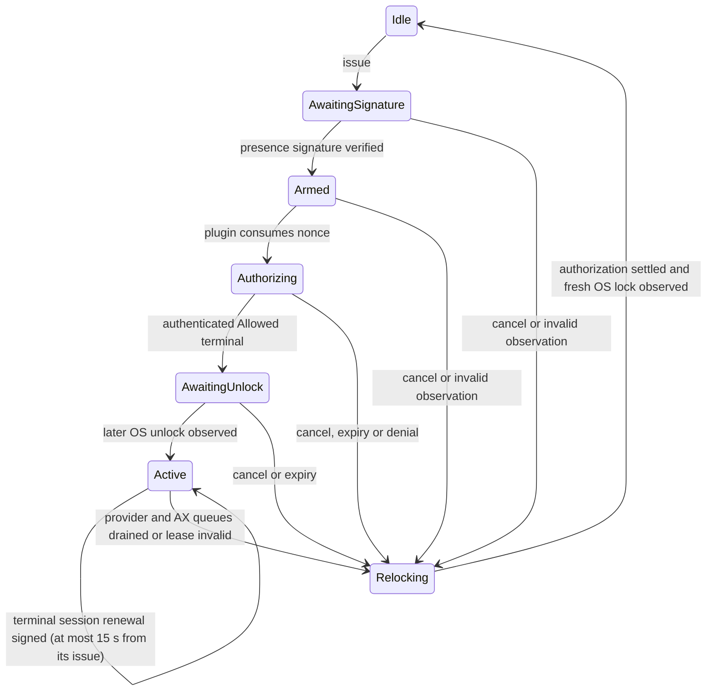

# Locked Use: Short-Lived Authorization and Temporary Unlock

> Privacy note: operational identities in this record are anonymized examples; see [public content policy](PUBLIC_CONTENT.md). Technical outcomes and acceptance limits are unchanged.

2026-09-26. Continues the direction last confirmed in the Claude chat "Mac 和 iOS 开发" (Mac and iOS development): a signed capability
for a remote turn → local daemon verification → Unix socket → AuthorizationPlugin → temporary unlock,
display cover → execution → relock. This document replaces the interpretation that a privacy cover alone constitutes Locked Use.

**Implementation status**: Shared Rust wires challenges, signature verification, one-time consumption, operation binding, daemon
exclusive console ownership, a plugin-only socket, an independent Mac cover/watchdog, and iOS/macOS
Presence signing and cancellation. The native plugin has been compiled separately and Developer ID signed. Actual system temporary
unlock, plugin terminal-state ordering, physical input, and multiple-display behavior still require device acceptance; a build is not acceptance.

## 1. Confirmed Direction and Choices for This Phase

### 2026-10-21: desktop enrollment and console-based routing

This decision supersedes the October 10 requirement that an already unlocked
Mac enable temporary unlocking for ordinary remote sends and Chat operations.
The target's Shared Rust handler authorizes the provider request and chooses:

1. Existing live Locked Use: enqueue only under the same requester's compatible
   provider/manual lease; keep its cover and lifetime. Foreign, closing or
   expired owners do not authorize the operation.
2. Locked console without a reusable lease: require the enabled local policy,
   locked.control and a signed operation; execute under cover, drain OS work,
   then relock and release.
3. Unlocked console without an owner: execute through ordinary provider grants
   and local service policy, without creating a temporary-unlock lease or
   requiring the Locked Use switch.

Desktop callers use native Presence signatures and the admin-approved public
key [enrollment](PRESENCE_ENROLLMENT.md). Phones retain their existing signing
flow. A lost receipt stays unknown; these routing choices never replay it.

### 2026-10-16: provider serialization survives RPC cancellation

Multiple Muster clients targeting the same provider on the same Mac share the
daemon's FIFO queue across sessions and Chat/Code modes. The lock covers one
desktop operation: selecting the session, entering or choosing the response,
submitting it, and checking delivery. It does not wait for the model to finish
its answer. Different providers retain independent queues, and existing queue
timeouts and local-input checks still apply.

Cancelling an RPC can drop its async handler while a blocking AX worker still
runs. Previously that also released the provider guard, allowing the next
operation to enter too early. Ordinary RPCs now register OS work in the same
Rust-owned lifetime tracker used by Locked Use. Dropping the provider guard
retains both its FIFO permit and cross-process file lock until its last worker
finishes. The file lock retains its existing crash-recovery TTL.

Regression tests cover independent RPC clients addressing different sessions,
normal completion, cancellation while OS work is blocked, and retention of both
lock layers. These tests use a controlled native-controller substitute; they do
not establish physical macOS/iPhone card acceptance or a new installed release.

### 2026-10-10: Chat loading and sending require the local switch

Remote desktop Chat catalogs, opening a conversation, reading/changing model
and effort, and native sends require the target's `allow_locked_control` policy,
including when its console is already unlocked. Provider grants still apply.
Cloud sessions and cached transcript reads retain their existing authorization.
While locked, host probes report the signed app process and typed local catalog
without inspecting AX windows; desktop traversal begins after authorization.

On a locked Mac, desktop history traversal, opening and model/effort operations
use the same signed Locked Use continuation as sending. The operation binds its
request ID, provider/session and complete selection payload. The owner checks
authorization before unlock and during execution, uses the guarded OS worker,
and returns the typed response after cleanup and relock. Foreground phones sign
with their enrolled key; desktop requesters use presence authentication. An
already unlocked Mac uses ordinary authorized execution with the switch enabled.

The `agent.chat.locked.v1` service marks support. Clients reject older hosts for
Chat loading, native remote sends and model/effort control. Cancellation/backgrounding ends pending
loading, and stale authorization responses cannot restart it. This is an
operation-scoped continuation, not a persistent Chat-view unlock lease.

### 2026-10-04: terminal sessions for Ghostty

At the user's request, a phone can keep a locked Mac unlocked under the cover
for as long as it shows a Ghostty terminal. Ghostty offers its screen only
through accessibility, which shows no windows while the console is locked
(see ARCHITECTURE.md §3.6.3).

- **What is signed.** `LockedUseOperation.terminal` (`TerminalLeaseRequest`: op_id, terminal id) is a lease kind of its own.
  - It needs `locked.control`, Terminal control and `allow_locked_control`.
  - The Gate re-checks these at every observation.
  - It authorizes no agent operation, and agent leases cannot be renewed.
- **First window.** It unlocks the console exactly like an operation: challenge, signature, plugin consumption, plugin Allow, a later unlock observation, then Active.
- **Renewal.** Each next window is a fresh renewal challenge: same epoch, console, requester, turn and operation, with a new nonce.
  - The phone gets it with `LockedUseRenew` (naming the first nonce), checks it in Rust (`signing_message_for`) and signs it with its device key (no prompt; the user chose no Face ID).
  - It returns the signature with `LockedUseExtend`.
  - The Gate verifies it with the same live checks as an action: membership, grants, console, local input, cover and watchdog.
  - The deadline moves to the renewal's issue time plus 15 s, never further, and never from the signing time.
  - The independent watchdog's deadline moves too. A forward-only `x` frame on its private pipe sets it at most 15 s from now and renews the display-awake assertion. A failed extension stops the session.
- **Ending.** The phone renews every 8 s while the terminal is shown.
  - Leaving the terminal, the background or any renewal failure withdraws the session (`LockedUseCancel`). Otherwise the window lapses within 15 s.
  - Ten minutes without terminal input from the requester ends it (`StopReason::Idle`), even while it keeps renewing.
  - Local input, a lost cover or watchdog, a changed console, or a changed grant end it as for any lease.
- **Terminal I/O.** While the session is open, the requester's terminal requests for that terminal pass the console-write barrier that the owner holds.
  - They hold the session's I/O barrier, and the cover is released only after they let go.
  - An attach stream ends within 200 ms of the session ending.
  - On a locked Mac, Ghostty reads and writes without a session answer `LockedUseRequired`. Requests from another requester while any lease holds the console are refused.
  - Listing Ghostty's terminals needs no session: its AppleScript answers on a locked Mac.
- **Requesters.** Only a phone opens terminal sessions. A desktop would need Presence for every renewal.

Gate, owner and core regressions cover renewal, idleness, refusal of foreign and stale renewals, local input, and the I/O barrier. The OS behavior has not been accepted on a device yet: the watchdog extension, accessibility under the cover, Ghostty focus and the one-time Automation consent on the Mac.

### 2026-10-02: phone operation authorization and controller lifetime

At the user's request, foreground mobile agent operations (send, answer and
interrupt) sign the target-issued Locked Use challenge with the enrolled phone
device key, without a Face ID/Touch ID prompt for each message. Shared Rust
validates the network, target, requester, operation digest and turn before
signing. The target accepts this key only for a roster member of kind Phone
with the existing provider and locked.control grants and enabled local policy.
Presence signatures remain accepted for older clients and required for desktop
requesters, browser control and network administration. Both clients and target
daemons need this version for prompt-free mobile operation. The 15-second bound,
one-time nonce, cover/watchdog, local-input checks, revocation and relock remain.

Controllers created during Locked Use now run their observers on the durable
AgentService runtime. The per-operation owner runtime ends after relock; it
must not own an observer expected to detect a later app restart. Preparation
reattaches only after a confirmed process exit, preserving live or temporarily
unobservable controllers and their unknown-delivery state.

The October 1 22:10–October 2 09:27 CST investigation found seven morning
rejections for stale app processes: three Mac-B answer operations and four
Mac-C sends. Mac-C's Claude PID changed from 2490 to 57945; Mac-B's from
12553 to 77603. Mac-A had two applied ledger entries and a pre-ledger sidebar
selection timeout, plus prolonged relay/DNS failures. Earlier Mac-B answer
timeouts and question-card conflicts are separate from process reattachment.
Ledger outcomes alone do not prove physical-device delivery or absence of
duplicates in provider transcripts.

Phone backgrounding cancels display subscriptions and suppresses view encoding;
foregrounding restores subscriptions and catches up from history. Repeated
relay failures back off to 60 seconds (network changes wake them immediately).
These reduce avoidable work; iPhone thermal improvement still requires an
on-device energy/temperature comparison.

Mac-C logs at 2026-10-01 11:37 CST showed that the plugin's Allow terminal
arrived, but the owner had a 534 ms heartbeat gap in AwaitingUnlock, beyond the
watchdog's 350 ms limit. The independent watchdog then stopped authorization and
relocked. The owner never observed the intermediate Unlocked state and therefore
kept protection in place. Later sends were rejected by the closed queue; they
were not handed to the model.

The fix runs the owner on its own single-threaded Tokio runtime (with its own
timer driver), so synchronous work such as directory scans and AX observers on
the shared executor cannot delay the safety heartbeat. Heartbeat, observation
freshness and authorization TTL are not extended. A regression verifies that the
owner keeps pulsing while the RPC executor is blocked synchronously for 550 ms;
OS observations taking more than 100 ms are logged to separate scheduling delay
from OS call latency. Queue rejections distinguish another requester from an
owner that is still relocking. A machine already stuck in the old protection
state still needs a local logout and login; deleting the marker, killing the
watchdog or observing Locked once cannot revoke an authorization that might
still take effect.

While Codex is working, the empty composer's Stop can become Queue or Steer,
rather than Send, once text is entered. After the exact draft echo, the send
adapter looks up Send/Queue/Steer again inside the current composer branch and
excludes queued-message rows (Delete queued message, or the row's Queued
message actions menu). Stop is never a send control; multiple candidates, an
incomplete AX traversal or a mismatched draft never submit.

2026-09-30 repair: Mac-C passed Presence, but the authorization field did not
appear within four seconds of the power wake; an ordinary display wake did not
show it either. When no field exists after 400 ms, the adapter posts one
private-source / Session-tap Shift down/up to reveal the lock screen, only
after finding the unique `login` window of a genuine Apple loginwindow and only
while the continuation is still valid. Shift produces no text, submits no
authentication and replaces neither Presence nor plugin consumption; no HID tap
is used, the input baseline is not reset and nothing is posted twice. A single
Return still requires the unique writable field, confirmed focus and an empty
value. Every step stays inside the same four-second wait and the original
authorization deadline; an unavailable field fails explicitly. The local
unauthorized probe and the phone end-to-end result need separate verification.

Mac-C measurement (21:17:23 CST): the new reveal was posted and the
authorization field appeared after 750 ms; the unauthorized `unlock-probe`
submitted Return after about 1011 ms with input generation 328414 before and
after, and the OS stayed Locked. The old build timed out after four seconds on
the same machine, and an ordinary display wake did not show the field. This
proves lock-screen UI reveal and the input-counter boundary, not a complete
phone-signed send. The repair package was installed and strictly verified on
Mac-C/Mac-B, daemon SHA-256
`012d5fbf5ac77162f3a760b5ab16c3cacc335182cad2219c5d6840c1854f248f`; both
daemons, Relay and vnet recovered, Accessibility was granted and both stayed
locked. 97 Rust regressions passed with 2 existing skips, Clippy passed, and
the Release/Developer ID signed build passed; no new notarization. A real phone
operation and provider receipt still require separate confirmation.

Phone feedback at 21:22–21:24 CST corrected that verification scope: three
covered operations on Mac-C still did not find the authorization field. On
Mac-B the first attempt matched and pressed the correct sidebar target, but
lost the owner heartbeat during the 804 ms session switch; the second attempt,
with the target already open, sent successfully. An unauthorized control on
Mac-C then also failed, so the failures cannot be attributed to the cover
alone.

The fix runs the complete native operation, both its synchronous AX calls and
its async waits, on a blocking worker that inherits the live check and
WorkQueue. The owner still observes every 50 ms and the watchdog's 350 ms
heartbeat deadline is unchanged. Cancellation ends the worker's async waits; a
synchronous AX call must still drain before the cover is released.
Single-threaded runtime regressions cover timers continuing during blocked IPC,
revocation visible across awaits, and the queue still holding OS work after the
caller aborts; the existing cancellation, deadline and receipt-retention tests
also pass. Logs add the owner pulse delay and the Gate stop directive.

Mac-C's reveal now posts a single Left arrow directly to the verified Apple
loginwindow PID instead of relying on a global Session-tap Shift wake. It
produces no text and submits no authentication; a Return still requires the
unique writable field, focus, an empty value and a live continuation. The input
baseline, Presence, one-time plugin consumption and deadlines are unchanged.
This change needs separate verification by the unauthorized probe, the covered
probe and a real phone operation; a successful build alone does not resolve
the lock-screen problem.

The covered, unauthorized Mac-C control at 21:37 CST passed: the field was
initially absent, a usable authorization field appeared 722 ms after the
targeted reveal, and one Return was submitted at 976 ms; input generation was
328414 before and after, and the OS stayed Locked throughout. The old Shift
build timed out on the same covered probe. This verifies the input path, not
the phone Presence to provider receipt end to end. 98 Rust regressions passed
with 2 existing skips; Clippy and the Developer ID signed build passed, with no
new notarization. Repaired daemon SHA-256:
`82858d6b6cd792da1932ed980c63b8cf035f774110cd73e8aad7d3db3a40cb1a`.

The user-requested capability has a 5–15-second TTL and one-time nonce, binds the remote turn and devices,
observes local input, and relocks on completion. Business decisions belong only in Shared Rust; Swift/ObjC adapt
system capabilities without a separate authorization state machine.

`DeviceSetCover` / `DeviceState.covered` remain the existing privacy-cover feature.
Currently, `covered=true` is only the target state recorded by the daemon; it does not prove the displays are covered.
It is neither a system lock nor evidence that Locked Use execution prerequisites are satisfied.

This phase uses these conservative boundaries. The only longer unlock is a terminal session made of signed 15-second windows (see 2026-10-04 above):

- A console admits only one challenge at a time. New requests include `provider_queue` in the signed digest;
  one authorization may cover multiple independent Agent operations for the same requester device, target host, and provider.
  Legacy requests with an empty scope still permit only one explicit operation.
- Signing, plugin consumption, and execution share a 5–15-second monotonic deadline starting when the target issues the challenge.
  Late Face ID, network retries, and plugin receipts do not renew it. At the deadline, stop input and request locking.
  Queuing does not renew it either: unexecuted requests are explicitly rejected at expiry, in-flight requests without confirmed receipts
  return Unknown, and confirmed results remain. No window is longer than 15 s; a terminal session only chains renewed ones.
- Current authorization requires both `locked.control` and Agents permission for the operation's session provider
  (the `agents` switch plus `agents:<provider>`; legacy `agent.control` still counts as all providers),
  with target policy enabling `offer_agent` and `allow_locked_control`. The challenge binds the provider,
  with continuous rechecks during the execution window. The Presence Key comes from the currently valid roster.
  Agent operations cannot borrow another kind of authorization, and no other CUA capability may reuse theirs.
  Terminal sessions are their own lease kind (below).
- The cover and independent watchdog must be confirmed ready before the plugin can consume authorization. Preparing covers for
  all displays while the session is locked requires macOS P0 verification; failed confirmation denies access.

## 2. Signed Content

Signatures use ECDSA-P256-SHA256, supported by the existing `HwSigner`, in DER format.
The signed message is `MUSTER-LOCKED-USE-V1`, one zero byte, then `Challenge::encode()`.
It is not interchangeable with the ordinary RPC `MUSTER-PRESENCE-V1` signature.

| Field | Meaning |
|---|---|
| version | Currently 1; reject all other versions |
| epoch | 32 bytes generated from OS randomness at Gate creation; restart does not restore old authorization |
| nonce | Independently generated 32-byte value for each challenge; consumption can succeed only once |
| network | Network id from the current signed roster |
| target / requester | Target DeviceId and link-authenticated caller DeviceId |
| console | Target console UID and OS audit-session id; comparing only usernames is insufficient |
| turn | Bounded turn id without control characters |
| operation | SHA-256 of the first complete canonical operation, including operation type, agent session/interaction, op_id, payload, and optional provider_queue scope |
| ttl_ms | 5000–15000 milliseconds; the target's stored monotonic deadline is authoritative |

Challenges are at most 512 bytes. Encoding uses the existing `canonical::Writer/Reader`, fixed field order,
big-endian integers, and length-prefixed strings; truncated or trailing data is rejected. Signing does not depend on JSON serialization order.
After receiving a challenge, the phone calls Rust's `signing_message_for()` to verify the network, both devices, turn, and request digest, then uses local authentication and the Presence Key
to sign. The platform neither reconstructs the message nor decides whether to allow the operation.

`arm` requires the entire received Challenge to match the target's stored challenge exactly, then verifies the signature and current
transport principal. Even a caller that re-signs cannot change the target, turn, operation, or deadline.
`consume` burns the nonce before returning success; exclusive Rust access must be protected by the same lock in the daemon.
Nonces are not persisted: after the old process exits, no Gate is recoverable, and the new epoch and pending nonce differ.
This prevents authorization replay only; it **does not replace actual lock recovery after a process crash**.

## 3. Rust Lifecycle



`poll` supplies instructions such as prepare cover/watchdog, wait for unlock, ready to execute, or keep covered and lock.
Only a successful `take_action(requester, turn, operation, …)` consumes one execution right;
`poll` state, RPC 200, plugin `Allow`, `DeviceState`, or an empty error must not be treated as execution authority.
`take_action` revalidates the operation and current authorization. The executor must keep checking the Gate during the action;
a successful call cannot let arbitrarily long-running code escape the deadline.

Every check revalidates active membership, both scopes, local policy, network id, and Presence Key.
Observations must come from the target OS/local runtime, be no older than 250 ms, and neither regress nor come from the future.
Mismatched console identity, unknown lock state, missing or changed input observation, controller disconnection, lost cover, or watchdog
loss revokes permission. Cover/watchdog confirmation binds this nonce; confirmation from a previous round cannot be reused.

During cleanup, `LockAndKeepCovered` is an instruction that must be repeated. A successful lock API call does not establish
locked state; only a fresh OS lock observation for the same console completes cleanup. Consumed authorization also requires a trusted
plugin terminal state. For `Allowed`, unlock and subsequent relock must both have been observed, preventing this sequence:

1. The nonce is consumed, but the system has not actually unlocked;
2. The remote caller cancels while the current sample still shows locked;
3. Cleanup mistakenly considers itself complete and removes the cover;
4. Late authorization unlocks the desktop.

Plugin socket disconnection, timeout, and deactivate must not masquerade as `Denied`. If the terminal state is uncertain, remain
Relocking, continuously request locking, and keep the cover; do not automatically issue a new challenge. Production recovery requires trusted console
observations and a locally authenticated recovery flow, not clearing state after waiting out the TTL.

### AX Work Completion and Cover (2026-09-30)

Each signed authorization creates its own Rust provider FIFO and AX work queue. Blocking AX tasks register before enqueueing and inherit
the same live authorization checks; the asynchronous caller returning or being canceled does not mean blocking work has ended. Normal completion
waits for that queue to drain before relocking. Cancellation, timeout, or cover loss still immediately revoke input and request locking,
but while the queue has not drained, the cover stays, console ownership remains held, and no final operation receipt is sent.
The existing 15-second authorization deadline is not extended by queuing. The first request and provider scope are signed together;
subsequent requests from the same authenticated requester device for the same provider enter this window, each with its own
`op_id` and complete payload in the operation ledger. Requests from other devices, providers, or capabilities cannot borrow it.
The queue accepts at most 32 requests; action admission and subsequent writes keep checking permissions, console, cover, and deadline.
Cleanup and new-request enqueueing share an exclusion barrier so an accepted request cannot be missed when testing for an empty queue.
After all operations and AX subtasks finish, relock, remove the cover, and return each request's result. Legacy single-operation signatures
do not automatically become queue authorization. Clients retain each request's session/draft or question-and-answer source so old receipts after page
switches do not modify the current draft. Both the new client and target Mac must be upgraded; an old target that does not understand the new
scope gets a signature-digest mismatch and rejects it before authentication.

During temporary unlock, the watchdog repeatedly brings existing nonactivating covers to the front and rechecks coverage without stealing
focus from the target application. System authorization starts only when covers are ready; covers are removed only after confirmed relock and AX work exit.
Failure reasons are reported through the private heartbeat pipe as deadline, heartbeat, console, local-input, or cover anomalies.
Regressions cover blocking work still running after async cancellation, normal draining, canceled draining, cover loss, and cover not ready;
actual display coverage and the complete phone-initiated operation path still require device acceptance.

### Delivery Boundary, Heartbeat Timing and Diagnostics (2026-10-01)

Desktop 1.0.20 lost the owner runtime and blocking AX worker above (see
DESKTOP_UPDATES.md). On Mac-C at 20:19:17 CST the owner heartbeat was lost
right after a sidebar session switch, as on Mac-B on 2026-09-30; the stopped
send's ledger row stayed `pending` although no draft had been written. Two
other sends (Mac-C 19:36:21, Mac-B 20:20:07) were rejected after the 2 s
draft echo deadline, and on Mac-C the background scan attached a second
controller to the session being sent. None of these left an ERROR line.

- **Heartbeat timing.** The watchdog ages the newest owner heartbeat as of its
  pipe read, not after its own console sample and cover check, so a slow
  sample can no longer stop a healthy owner. A stalled owner writes nothing
  and is still caught; the 350 ms limit is unchanged.
- **Delivery boundary.** Shared Rust tracks each ledgered agent operation
  (`control_guard::Delivery`). AgentService records when a controller method
  starts, and controllers that report delivery mark every press that may
  submit a send, answer, queued "Send now" or interrupt before its final live
  check. When Locked Use stops an operation, the owner waits for its OS work
  to drain, then answers "not started; retry is safe" (Rejected, ledger row
  rejected) only if nothing could have been submitted; otherwise the result
  stays unknown. Terminal input keeps its previous semantics.
- **Draft echo.** The echo deadline is 4 s (2 s for the submit control after
  it), still inside the 15 s lease. Each change in how the composer value
  differs from the draft is traced as unreadable/empty/partial/whitespace/
  different with character counts and composer replacements, never content.
- **Controllers.** `AgentService::attach_native` keeps a controller whose app
  process is still running, so a scan cannot replace an operation's
  controller and its unknown-outcome replay guard. The scan also skips a
  provider while an operation holds that provider's queue.
- **Logs.** Ledger outcomes are logged with kind, op_id and target prefix.
  Every Gate phase transition logs its stop cause, a rejected presence
  signature is logged, and a requester's cancel carries a reason from a fixed
  vocabulary (user, authentication, expired, busy, background, terminating),
  logged by the target and never used for a decision.

Rust and Swift tests cover these paths; device acceptance with a real phone
Presence, including a session switch under Locked Use, is still required.

## 4. System Implementation and Acceptance Boundaries

The following boundaries are wired; OS-dependent behavior requires individual device verification:

| Boundary | Integration requirement |
|---|---|
| `musterd` RPC and operation ledger | Target issues challenge; remote signs; bind the complete request hash; Gate and request share one owner; disconnect/cancel triggers stop; every remote write to the same console passes through the active Gate, preventing another ordinary AgentSend from slipping into the temporary-unlock window |
| Plugin-only Unix socket | Do not reuse the existing 0600 RPC socket that treats all local requests as `Principal::Local`; both sides verify peer credentials, code identity, and console identity; bounded protocol and timeouts; nonce correlates consume with terminal state; never accept plugin receipts from remote JSON |
| AuthorizationPlugin | New name/path and thin OS adaptation; deny this branch by default while preserving normal login; never read or handle passwords; verify callback/destroy ordering relative to actual unlock on the real system |
| Mac cover | Actual confirmation for all displays, Spaces, hotplug, and main-thread blocking; nonce-bound receipts and continuous observation; a single `covered` boolean is insufficient |
| Independent watchdog | Ready before consumption; stop actions and lock on daemon/cover-process death, heartbeat loss, timeout, or local input; crash recovery retains unfinished transaction records, and restart cannot immediately begin another transaction |
| Local input and lock adapters | Trusted audit-session id; actual lock observations/actions; complete physical-input observation including mouse movement; distinguishing synthetic from physical input requires device verification |
| iOS / macOS App | Rust Intent/Effect carries challenge, Presence signing, and phase; render only Rust state; cancellation, backgrounding, and disconnection must not lose cleanup responsibility |

Do not directly reuse the configuration or trust roots of the old `AgentHaloLockedUse.bundle`. Its source lives in another
`AgentHalo` checkout and contains an independent Swift authorization state machine and file-based grant/receipt protocol.
Only its deny-first and late-receipt handling inform this work; do not bring that old business layer into the new platform shell.

Apple's [Authorization Plug-ins documentation](https://developer.apple.com/documentation/security/authorization-plug-ins)
allows plugins to participate in system authorization; [SetResult documentation](https://developer.apple.com/documentation/security/authorizationcallbacks/setresult)
describes how a mechanism submits its result. These API documents alone do not prove the current macOS login window will consume
the new plugin's result as expected, nor that all-display covering, temporary unlock, or watchdog behavior works.

## 5. Verification and Next Steps

Offline gates:

```sh
cd src/muster
cargo test -p muster-core --offline
cargo clippy -p muster-core --all-targets --offline -- -D warnings
```

Tests cover signature/domain/principal/every bound field tampering, 5–15-second boundaries, double consumption, restart replay,
wrong operations, roster revocation/scope removal/local policy changes, stale/regressing/future observations, local input,
disconnection, cover/watchdog failure, late Allow before and after cancellation, missing terminal states, keeping the cover until confirmed lock,
and arbitrary-byte parsing property tests.

Additional checks:

```sh
cargo test -p muster-proto -p muster-agent -p musterd -p muster-app-core --offline
cargo clippy -p muster-core -p muster-proto -p muster-agent -p muster-platform -p musterd -p muster-app-core --all-targets --offline -- -D warnings
python3 -m unittest discover -s ../native/apple/MusterLockedUse -p 'test_*.py'
```

Daemon tests drive independent tasks, command queues, and a simulated OS: failed action confirmation still relocks, and a late Allow after cancellation
does not remove the cover based on an earlier locked sample. Platform input counts include mouse movement and
dragging. Before each AX write/click, the executor checks scoped live admission; cancellation invalidates it first,
then waits for the executing task to finish before requesting lock. Sessions with a `none` controller do not fall back to owned CLI.

Cancellation, deadline expiry, and daemon exit also terminate and await the OS unlock-request task, ensuring no late AX submission occurs
after cover removal or console-owner release. Clients correlate completion receipts by target device and nonce;
cancellation receipts or other operation results from a previous round cannot clear a new authorization or its expiry-cancellation task.

## 6. Installation and Recovery

The default macOS installer `MusterApp/scripts/install-mac.sh` replaces the App without invoking sudo
or a pkg installer. The App contains the signed plugin, installation adapter script, and root helper;
it registers `dev.linsheng.muster.helper` through `SMAppService.daemon`. Initial system approval
remains managed by macOS; existing approval is reused without collecting an administrator password. Installation eligibility, retries, and results
are managed by Rust musterd; development directories and custom state directories do not trigger system installation.

The helper's `install-locked-use` XPC operation accepts no path, command, or UID. It verifies the fixed team,
`dev.linsheng.musterd` identifier, and installed path using the kernel audit token, and derives the socket from that UID's system
account home. The helper first copies the App to a root-private temporary directory, verifies the complete signature,
executes only the installation adapter script in that snapshot, then removes the snapshot. Installation failures return explicitly, without false success.
This process does not change `screenUnlockMode`, automatically enable Locked Use policy, or grant remote devices permission.

`dev.linsheng.muster.helper` is an App-managed root helper that reuses the existing network helper's
OS implementation and adds a restricted plugin-installation operation. The old manually installed `dev.linsheng.muster.nethelper`
lacks this operation and is not stopped by this installation, avoiding disruption to old network connections. The new operation uses separate
fixed signature verification and does not inherit the old configuration's bridge or ad-hoc fallback allowances.

`src/native/apple/MusterLockedUse/build.sh` builds the plugin; signing occurs only when `SIGN_IDENTITY` is set.
`install.py BUNDLE SOCKET UID` is read-only by default: it generates a plan and verifies Developer ID and current rules.
Installation requires explicit `--install` and execution as root. Only known OR rules retaining `use-login-window-ui`
are accepted; unknown or stronger policies are never weakened. The installer saves original authorization rules, not old binaries;
after writing, it reads rules back for verification and restores the preinstallation rules on error. It obtains no passwords and invokes no Keychain-unlock command.

The plugin and daemon verify code signatures and UID through kernel audit tokens. The fixed protocol carries only consume
requests, a 32-byte nonce, and terminal states; it accepts no platform-reconstructed business state. The daemon does not interpret EOF, timeout,
or Deactivate as denial; without a successful Destroy receipt, isolation remains in place.

The watchdog starts from the same signed musterd executable and creates AppKit covers on the main thread. Communication uses inherited
pipes; no public endpoint lets external processes remove covers. Heartbeat loss, expiry, or local input locks the screen and keeps the cover.
`locked-use.pending` records unfinished transactions; a daemon restart within the same audit session cannot issue
another authorization. If late authorization cannot be proven finished, the local user must log out and back in; only a new audit session
can clear this record. Deleting files or restarting the daemon cannot substitute for safe recovery.

Canceling a challenge not consumed by the plugin withdraws its own cover without requesting locking, preventing unsigned challenges from affecting
an unlocked local user. Consumed authorization must complete cleanup using the terminal states and OS observations above.

Report compilation, tests, signing/notarization, installation, runtime, and end-to-end acceptance separately; no stage substitutes for the next.

## 7. Device Deployment Record, 2026-09-28

The first device deployment and the fixes found during it (through 2026-10-02)
are recorded in [LOCKED-USE-DEPLOYMENT-2026-09-28.md](validation/LOCKED-USE-DEPLOYMENT-2026-09-28.md).

## Manual device cover (2026-10-10)

The mobile device list offers a separate Locked Use switch. Its explicit
`DeviceLeaseRequest` is included in the signed operation digest: only this scope
lets the host maintain the cover until the owner cancels, local input takes over,
policy/membership changes, the console changes, or cover/watchdog health fails.
Phone backgrounding and idle time do not cancel this explicit device lease.
The host checks live authority and observations continuously, extends the
independent watchdog at most 15 seconds at a time, and cannot revive an expired
lease. Restart/update still requires the existing console reservation to drain.

Accessibility remains an independent OS permission. On an already unlocked Mac,
the signed device lease becomes active only after nonce-bound all-display cover
and watchdog readiness; it does not fabricate a plugin receipt. On a locked Mac,
the existing plugin unlock flow remains required (the current macOS adapter uses
Accessibility to submit that flow). Native chat control still requires
Accessibility even when manual Locked Use is active.

Subsequent native operations are serialized, ledgered and checked against their
own provider grants and the authenticated owner. Each receipt returns while the
cover stays up. Cloud sessions do not enter the console queue. Ghostty requests
hold the existing I/O drain barrier and recheck their own grants. Cancellation
revokes admission first, locks, and keeps the cover until queued OS work and
terminal I/O have drained. Display-only state/nonce fields never authorize work
or cancellation; cancellation still requires the original transport principal.

Codex now enters drafts with focused selection replacement (`AXSelectedText`),
which uses the editor's input command rather than only replacing its DOM value.
Logs from 1.0.49 repeatedly showed a successful value write followed by a stale
placeholder echo until timeout, then the exact draft on a subsequent attempt.
Both Code and Chat use the shared profile input strategy, recheck authority
between editing calls, and retain exact fresh-draft confirmation before submit.
No unconfirmed send is automatically retried.
