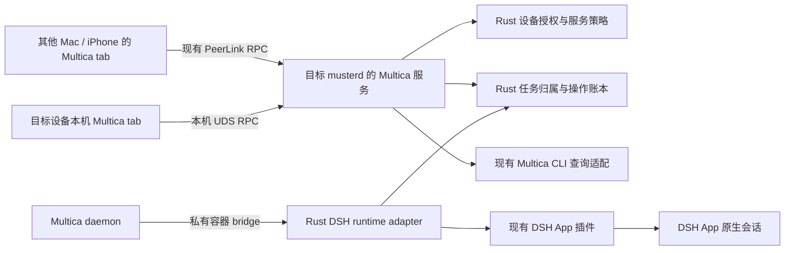

# Multica 独立工作台、DSH App bridge 与跨设备服务设计

日期：2026-11-05。状态：方案设计，尚未实现或完成设备验收。
决策记录：[ADR 0141](adr/0141-multica-service-and-dsh-app-bridge-design.md)。

## 1. 目标与范围

1. Multica 调度的会话归属 Multica，在 Muster 的 Multica tab 中展示，
   不再混入 Agents tab；普通 Codex、Claude、DSH 会话不受影响。
2. Multica 能通过 Muster bridge 使用设备上已有的 DSH **桌面应用**。
   新任务在该应用内创建会话；续跑恢复同一会话；已有会话只有经明确绑定后
   才能归入任务，不自动选择当前窗口、最近会话或同目录会话。
3. 安装 Multica 的设备可以主动开放服务。其他已连接、已授权的 Muster
   设备可以展示 Multica tab，查看任务及其会话，并按权限进行会话操作。

本设计不改变 DSH 自己的会话列表，也不把应用中的个人会话全部搬入 Multica。
不增加独立网络端口、浏览器工作台或第二套设备身份。
任务创建、分派、评论、Multica 升级、远程安装与登录不在首轮范围；
本轮仅交付设计文档，不安装插件、不发送测试任务、不发布应用。

## 2. 已核对的基础与缺口

基于 `origin/main` 的 `0449b62`，相关代码的当前事实如下。

| 已有实现 | 需要补齐 |
|---|---|
| `musterd/src/multica/bridge.rs` 私有容器桥；仅接受 `codex`、`claude` | DSH 专用协议适配、App 能力协商与任务执行接入 |
| `muster-acp/src/native_host.rs` 持久化任务会话绑定、未知结果不重放、任务凭据 launcher | 跨 provider 的权威归属索引，覆盖 DSH，供目录与授权共同查询 |
| DSH 插件支持 prompt/cancel/approve/answer、原生 request ID 回执查询 | App 原生创建接口、创建结果恢复、会话身份与目录证明、终态事件适配 |
| `musterd/src/native_create.rs` 创建校验只接受 Codex/Claude，走 AX 路径 | DSH 走插件创建；不得简单放宽 provider 字符串后送入 AX |
| `MulticaBrowse` 为本机只读查询，复用已登录容器 CLI | 面向远端的最小投影、独立授权与能力撤销 |
| app-core 的 Multica 查询只用 local backend，embedded 客户端提前返回 | 按设备选择 backend，手机入口、请求代次、断线与权限状态 |
| `AgentSession` 有 provider、parent、device 等字段 | 独立的会话归属；provider 仍然是实际执行者 |

上游 [Multica DSH runtime](https://github.com/multica-ai/dsh-multica-runtime)
使用 `dsh --profile multica --stdio` 和版本化 JSONL，提供 probe、模型发现、
事件流与恢复；这是独立 runtime，不等于现有 DSH App 会话接入。
实现前固定并核对所部署 Multica 的协议版本；不能把这套协议当成任意 ACP。
上游 headless 的审批默认值也不能搬到桌面 App bridge。

## 3. 组件与职责

所有归属、任务调度准入、协议转换、授权、重试规则、持久化及 UI 可用性
由 Shared Rust 决定。插件只转发已绑定的宿主调用与事实；Swift 等平台只渲染
ViewModel 和提交 Intent。DSH socket 和容器 bridge 均不向其他设备直接暴露。
远端请求不能借本机 UDS 被重新解释成 local owner。

| 组件 | 计划改动 |
|---|---|
| `muster-core` | Multica 权限、目标本机服务策略、任务运行授权与操作边界 |
| `muster-store` | 任务归属、run/session 关联、迁移版本与持久化恢复 |
| `musterd::multica` / handler | 查询、能力、归属、远端 RPC、撤销、事件投影 |
| `muster-acp` | 复用 Host 抽象，新增 DSH stdio adapter；不改变已有 Codex/Claude 协议 |
| `muster-agent` / DSH 插件 | App 创建、证明、事件与回执的薄适配；沿用现有插件实例绑定 |
| `muster-app-core` | 两类目录投影、设备选择、导航、缓存隔离、手机工作台 |
| `muster-proto` / 平台生成绑定 | 增量消息与 ViewModel；字段编号在实现时分配，不重用已有编号 |

## 4. 会话归属：独立于 provider 与显示分组

归属使用 Rust 私有持久化记录，概念字段如下；这不是可直接提交的 wire schema：

| 记录 | 关键字段 |
|---|---|
| TaskKey | 执行设备身份、Multica 服务实例身份、workspace ID、task ID |
| RunBinding | TaskKey、上游 run/attempt 身份、runtime profile、binding generation、状态 |
| SessionBinding | RunBinding、角色、provider、provider 原生 session ID、DSH profile/store 身份、规范目录、归属证明 |
| Operation | caller principal、binding generation、op ID、请求摘要、provider request ID、已持久化结果 |

服务实例身份应绑定目标端实际登录的 Multica 服务与账户，不以可变 URL、任务
标题或会话标题作身份；远端只得到目标端签发的不透明引用。身份无法核实时
暂停绑定。唯一键必须区分不同设备、workspace、run 和 DSH profile 中相同的 ID。

- **新会话**：先持久化任务预留，再创建 App 会话。收到原生会话 ID、profile、
  cwd 及关联创建回执后，原子提交归属。创建未知时保留预留，只查回执，不重建。
- **已有会话**：首轮只允许目标设备本机用户显式绑定。显示将归入的任务、
  provider 和目录；拒绝运行中、有未决操作、已属其他任务或身份不完整的会话。
  复用前验证原生 registry 的精确身份与目录；不能从 UI 选择直接授予调度权。
- **生命周期**：`reserved → bound → ended`；未知结果进入 `unconfirmed`，
  冲突进入 `conflict`。应用不在线仅改变可用性，不删除归属。结束任务仍保留
  Multica 历史。首轮不提供自动转回 Agents 或跨任务改绑。
- **一次归属**：同一原生会话只归一个任务。允许同任务重试明确续用该会话，
  但必须验证 run 关系并持有唯一执行权；不同 run 不并发提交。
- **子会话**：仅沿 provider 已证明的 parent 关系继承展示归属。
  展示继承不授予独立控制权；原有只读子代理限制保留。

Agents 目录、搜索、Pin、watch 更新、相关会话与通知路由都使用同一归属查询。
过滤在 daemon 与 app-core 内完成，不能只在 Swift 列表中隐藏。任务会话的
直接消息、文件、git、回执等读取也要查归属，避免持有旧 ID 绕过 Multica 权限。
创建回执与 provider 目录事件可能乱序：由创建适配携带的原生 request 证据
关联暂存记录，归属事务提交后才发布新增任务会话。没有关联证据的创建结果
保持待核对，不能先作为普通 Agent 广播；P0 必须验证此发布屏障可实现。
已有会话被绑定时同步发出目录移除/归属变更，清理新客户端已有的普通会话缓存。

Multica tab 引用原有会话渲染器，保留对话、Trace、审批和子会话展示，不复制
转录或另造消息数据库。返回导航仍留在 Multica 任务；通知深链携带设备和
不透明 binding 引用，由 Rust 重新验证后打开。

### 历史绑定迁移

仅迁移已有 daemon 所有的任务 binding 文件中能证明的记录。校验 provider、
规范目录、原生 session ID、任务与服务身份后，事务写入索引并记录迁移版本。
现有 task root 的哈希不能反解 workspace/task；缺少完整证明时列入本机
“待确认归属”，不得猜测补齐。已知受管理但身份冲突的会话暂不进入普通 Agents，
在本机 Multica 的异常入口可见；完全没有归属证据的会话保留原目录。
迁移可重复，不能改写 provider 的文件或触发 prompt。

## 5. DSH App bridge

### 5.1 能力发现与执行路径

保留现有私有容器网关与 bridge token 握手，将 DSH 注册为独立 executor。
Multica 的 DSH launcher 只转发版本化 stdio，Rust adapter 转换为 Host 操作。
执行目标固定为 `dsh_app`，provider/profile/session 身份贯穿整个生命周期。
App 缺失、插件不兼容或原始 profile 不可达时返回不可用，不退化为 CLI。

复用 [ADR 0094](adr/0094-local-plugin-contract-and-receipt-recovery.md) 的
App domain、实例 epoch、验证后的进程身份、operation/session 绑定与
`prompt.lookup`。新增方法必须协商独立能力版本。当前插件的写请求要求已有
session ID，因此创建需要单独的、绑定 operation 与目录的请求/回执协议，
不能伪造 session ID 来绕过原校验。

实现前在隔离 profile 验证以下宿主契约；缺一项，不宣告完整 DSH runtime：

1. 新建会话返回真实原生 ID，并可验证 profile/store 身份、规范 cwd、空初始状态。
2. 创建前写入的稳定 request ID 可关联宿主持久事实。若宿主不能恢复创建回执，
   丢失回复保持未知、要求人工核对，绝不再创建；首个交付可只开放显式绑定模式。
3. prompt 的原生 request ID 可查接受状态，完成事件可明确关联本次 turn。
   “已接受”“正在运行”“等待审批”“完成”“失败”“取消”分别投影；
   socket 返回、模型输出、idle 或断线均不独立证明任务完成。
4. 模型/思考强度若上游会指定，必须能验证实际生效设置；否则只提供继承 App
   当前配置的能力，并拒绝无法满足的指定配置，不伪造模型目录。
5. Multica 任务凭据在 App 的实际工具执行环境可用，并可限时撤销；验证 sandbox
   路径、命令调用与服务端任务归属，不能仅检查 launcher 文件存在。

### 5.2 创建、续跑与调度权

新建顺序为：验证上游任务上下文 → 预留 run 与操作 → 绑定 App 实例 →
创建或查创建回执 → 原子记录 session 归属 → 发送 prompt → 查原生接收回执 →
订阅关联 turn 的事件 → 记录终态并撤销凭据。
调度消息、普通远端操作和本机操作共用 provider/session 执行互斥。

续跑必须命中同一 TaskKey 和绑定代次；恢复原会话后再验证 profile、cwd 与
执行授权。应用重启重新验证实例 epoch，但保留持久会话身份。
相同操作 ID 与相同请求返回已有记录；相同 ID 不同内容冲突。
丢失回复后只能读账本/宿主证据，不换 ID 重发。

bridge token 只认证私有传输来源，`MULTICA_TASK_ID` 也不是执行授权。
目标本机需另行启用所选 workspace 的 DSH App runtime；Rust 为已经验证的
调度任务建立不可转授的 task/run/session 授权，约束目录、provider、可执行
动作、期限与资源上限。任务凭据/上游任务接口无法证明这些信息时拒绝调度。

现有 [ADR 0097](adr/0097-task-scoped-scheduler-grant-for-locked-use.md)
grant 只适配 Codex/Claude、单任务及固定配额；不直接把 Multica 任务套进它，
也不放宽其既有边界。实现需复用核心 reservation/lease 原语，以独立的
Multica grant 类型承载上述约束，完成单独审查及失败路径测试。
持续运行的上限、超时和并发默认值须在该实现 ADR 中明确并被测试，未定义前
不开放无人值守调度。

锁屏执行沿用目标本机策略、App allowlist、执行互斥、Locked Use 的 cover、
watchdog 与 relock；插件通道不自动获得绕过许可。
远端 `locked.control` 按 [ADR 0120](adr/0120-locked-control-without-a-per-operation-signature.md)
执行，不恢复已取消的逐操作 Presence 签名。网络管理授权仍按现行规则。
本机 scheduler grant 不能被远端调用者创建、借用或转成远端授权。

### 5.3 凭据、审批与并发

- 复用任务级受限 callback/launcher 思路，但须验证 DSH 工具环境的可达性。
  不写入 App 全局环境、个人 profile 或用户消息；消息可以带不含秘密的
  launcher 引用。任务 token 不通过设备 RPC、日志或 ViewModel 返回。
- token/launcher 按 run/turn 绑定；完成、取消、过期与启动恢复时撤销。
  无法撤销或无法证明任务归属时拒绝后续执行，不借用个人登录 token。
- 审批和问题卡使用现有 DSH App 流程；窗口、本机和远端第一份有效回答生效，
  后来的回答返回已处理。Multica 的 headless 自动批准模式不参与。
- 调度器持有活动 turn 时，远端普通 prompt 被拒绝为 busy；不静默排队或 steer。
  获准用户仍可回答该 turn 的审批或中断。中断先记录操作，再请求取消；
  UI 与调度器都等真实终态，不把断开连接当作取消成功。

## 6. 设备开放、权限和协议

目标设置增加“向已授权设备开放 Multica”，默认关闭，独立于 keep-alive。
首次开放选择可共享 workspace；不默认暴露登录账户全部 workspace。
安装/登录/目录迁移/配置/runtime 注册/已有会话绑定始终为本机管理。
共享使用目标端已有 Multica 身份，接收方可以看到的内容须在开放页明确显示。
Muster 权限只收窄该身份的权限，不能绕过 Multica 服务端访问控制。

计划引入明确的 `multica.view`、`multica.control` 权限，默认不授予；
control 必须同时有 view。它们不从 Agents、network.admin 或连接成功继承。
远端执行还要满足已有 provider 的控制权限（例如 `agents` + `agents:deepseek`）、
`offer_agent` 与 App 控制策略。UI 展示“可查看 / 可操作”及缺少条件；
Agents tab 不显示任务会话，不等于废除底层 provider 控制授权。

| 请求 | 目标端必须检查 |
|---|---|
| 最小服务描述 | 活跃 roster 成员；仅返回能力版本和当前是否向该成员提供服务 |
| workspace/任务/历史/状态/订阅 | offer_multica + view + workspace 允许集合 + 当前服务可用性 |
| prompt/interrupt/approve/answer | 上述条件 + control + provider 权限及本机控制策略 + 精确 binding/turn |
| 锁屏写入 | 上述条件 + locked.control + 现有 Locked Use 准入 |
| 本机安装、登录、配置、开关、绑定 | 可信本机 UDS owner；绝不因远端 control 开放 |

权限统一进入 `muster-core::policy`，不在 UI 或旁路 HTTP 服务做授权。
请求授权与响应发送前均校验策略代次；长期订阅监听权限、归属与开关变化。
关服务或撤权立即终止相关订阅、阻止新写入和后续数据输出；已接收的 provider
操作不能假装回滚，继续本机记账与安全收尾。远端撤权不等于停止独立调度任务。

建议新增概念 RPC：`MulticaCapability`、`MulticaTaskSessions`、
`MulticaSessionWatch`、`MulticaSessionOperate`、`MulticaOperationStatus`；
保留本机 `MulticaRequest`。`MulticaBrowse` 可复用既有固定 CLI 查询适配，
但必须添加 workspace 过滤与请求者授权。接口名和字段仍待实现时定稿。
不转发任意 CLI 字符串、socket、shell 或原始环境。

操作使用 daemon 签发的不透明 binding 引用；引用本身不授予权限。
账本键绑定 requester、目标设备、binding generation 和 op ID，避免跨设备
重复 ID 的碰撞；状态查询也验证原主体与请求摘要。
共享 ViewModel 不复用含数据目录、登录命令、安装日志的 `MulticaStatus`。

### 版本兼容是发布前置条件

当前 `Scope` 是严格解析且按枚举顺序规范编码的签名 roster 字段。
新增权限不能直接假定旧设备会忽略：必须追加枚举、保留原有排序与字节编码，
并实测旧版对未知权限的行为。

采用两阶段网络升级：先让该网络全部 roster 消费者支持新 scope 的解析和
规范编码（包括不提供 Multica UI 的设备），再允许管理端签发含新权限的
Update。离线旧设备也须纳入升级检查；无法证明全部兼容时禁止签发新 scope，
保持本机功能可用，不改造已签名历史，不偷偷映射成旧 Agent 权限。
若不能接受该部署限制，须另立 ADR 设计可兼容的授权承载方式后再实施。

旧服务端不返回新能力即不可远程访问；旧客户端收到不支持消息必须安全拒绝。
即使旧客户端缓存了 provider session ID，也不能经旧 Agent API 访问已经归属
Multica 的会话；新服务端必须按归属拒绝该路径，内部适配使用保留原主体的
受检上下文，不能借 local owner 兜底。原有个人 Agent 能力继续工作。

## 7. 界面与跨设备状态

目标本机安装后保留 Multica tab，登录失败/未运行等状态在页内说明。
其他设备首次获得目标端实时能力且满足查看授权后显示 tab；手机不需要本地
Multica 安装。多个目标以设备选择器区分，设备内再选择 workspace、任务、run。
聚合模式也保留设备身份，不按同名任务去重。
工作区查询可能返回由别的 runtime 执行的任务；目标端只提供有本机绑定证据的
会话入口。无本机会话时显示任务元数据及原因，不猜测另一设备或自动转发控制。

任务详情包含“概览 / 会话 / 运行记录”；会话显示真实 provider、run、当前状态。
普通 DSH 会话仍在 Agents；已归属任务的会话、搜索结果和通知在 Multica 打开。
源应用仍可正常展示、操作自己的会话，Muster 不修改其分组。

| 远端状态 | UI 行为 |
|---|---|
| 从未发现或不兼容 | 不展示该设备的 Multica 入口；设备详情可显示升级原因 |
| 已开放、已连接、有查看权限 | 展示 tab 和该设备可用 workspace |
| 运行停止/登录失效 | 保留已知入口，显示不可用；不启动服务或远程要求登录凭据 |
| 临时断线 | 保留已知入口并标注离线；所有操作禁用，重连后重新授权和拉取 |
| 确认关闭开放/撤权/移除成员 | 清除该目标内容与缓存，关闭相关详情/订阅；无其他目标则移除远端 tab |

首轮远端内容仅驻留内存，不新增持久离线副本；既有通用会话缓存也必须排除
远端 Multica 内容。断线清空内容，可保留最小设备入口；无法通过网络收回用户
在授权期间已经看见或自行保存的信息。
每次切换设备/workspace/账户或权限代次递增请求 generation，丢弃迟到响应。
本机与远端使用同一 Rust 导航状态，不由 Swift 根据 installed 布尔值判定入口。

## 8. 分阶段实现与验收

| 阶段 | 交付 | 必须通过的验收 |
|---|---|---|
| P0：契约探测 | 固定 Multica/DSH 协议版本；隔离 App profile 探测创建、回执、终态与任务凭据 | 明确支持版本和缺失能力；不触碰个人会话；确定 grant 限额及 scope 升级路线 |
| P1：归属与本机工作台 | 持久化 binding、可信历史迁移、Agents 全路径过滤、任务会话入口 | 同名/同 ID/不同目录/不同 profile 不混绑；崩溃恢复；搜索/Pin/通知无重复或遗漏 |
| P2：DSH App bridge | 协议 adapter、创建/绑定/恢复、审批、取消、任务授权 | 真正的 App 新建和续跑回执、一次真实 Multica 任务及任务级 callback；不以 CLI 成功代替 |
| P3：跨设备只读 | 两阶段 scope 升级、目标开放、workspace 过滤、远端目录与订阅、手机 UI | Mac→Mac 与 iPhone→Mac；直连/Relay；断线、切目标、撤权、迟到响应和旧客户端拒绝 |
| P4：跨设备操作 | prompt、审批/问题、interrupt、状态恢复与执行互斥 | 锁屏与未锁屏、调度并发拒绝、双方抢答、未知结果不重放、撤权过程中已接受操作的收尾 |

P3 是完整方案的中间交付，不将“远端可查看”描述为远端控制已完成。
P0 发现不支持 App 创建时，可先完成 P1/P3 并明确标注 DSH 仅绑定现有会话；
不能把这种降级宣称为新任务调度已验收。

采用既有 Rust、Node、real-link 测试体系，不引入新测试框架。重点矩阵：

- 归属迁移幂等、预留与 receipt 之间崩溃、索引冲突隔离、未知创建恢复。
- 相同 op 重复、不同 body 冲突、断开在提交前/后、App epoch 改变、host 回执缺失。
- Agents/view/control/provider/locked scope 的组合；仅有网络连接不暴露任务。
- 猜 session ID、旧搜索 cursor、旧 watch、文件/git、回执、子会话与深链均不能旁路。
- 服务关闭、workspace 移除、账户切换、成员撤销后的流终止、缓存清理与结果隔离。
- 历史 roster 编码字节不变；新权限升级前禁止签发；兼容/不兼容旧节点混合网络。
- App 缺失/插件版本不匹配/凭据路径不可达/目标离线均明确失败，不切 CLI，不重放。

证据分开记录：源码与测试、平台构建、签名/公证、发布、安装、App 实机操作、
Multica 调度回执、跨设备端到端。未来发布 macOS 更新时按仓库规则同时发布 iOS；
本设计文档合并不代表其中任一实现或部署已完成。
