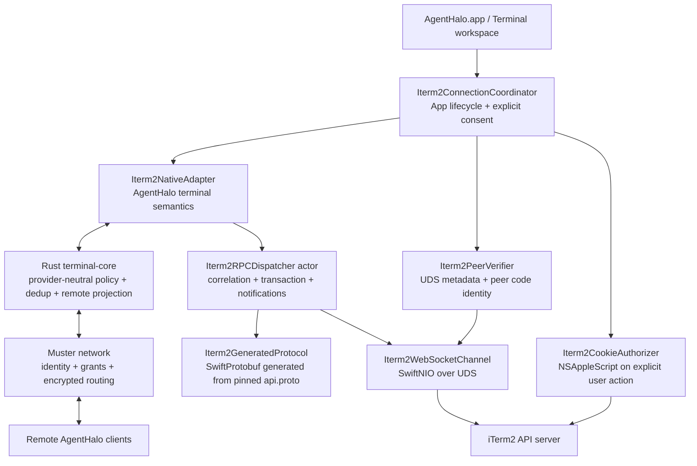
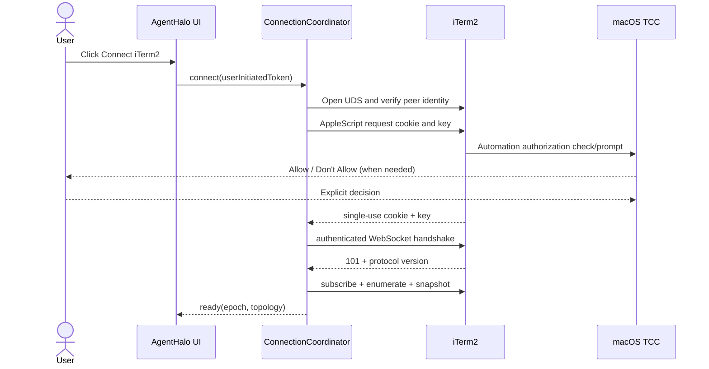
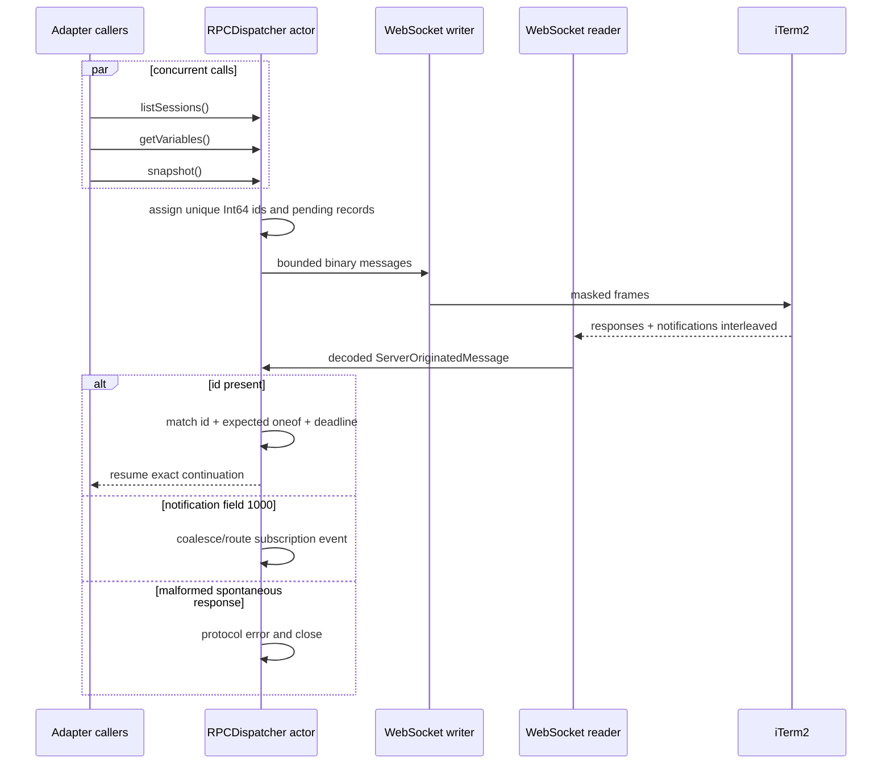
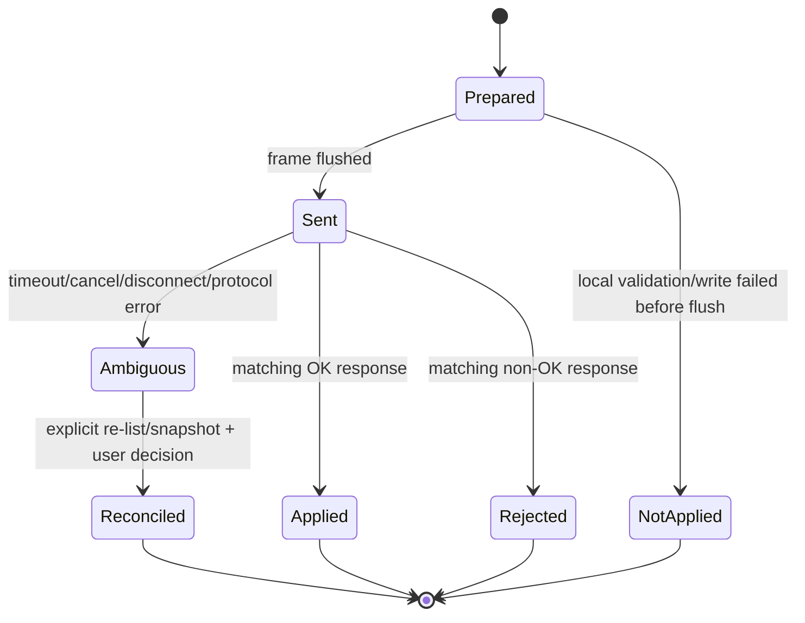
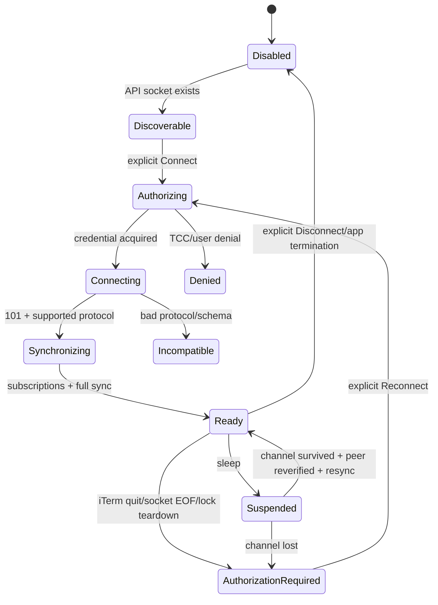
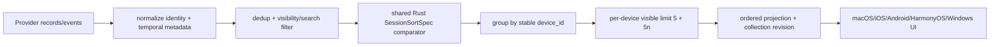

# AgentHalo Terminal native iTerm2 integration architecture

**Status:** Design complete; native source cutover landed on 2026-08-31. The iTerm2 product path in `AgentHalo.app` uses a SwiftNIO WebSocket + SwiftProtobuf client. The old Python bridge, fixtures, runtime locator, builder, and packaging targets were removed; native package and macOS App tests passed. This document does not establish completed legal review, Developer ID signing, notarization, installation, or real iTerm2 E2E.

**Baseline:** Initial draft on 2026-08-29 against Muster `master` at `e06ddc9d0d3898c916ace32ef300d88a671bd133`; the session-sorting addition reviewed `8e55f2fccaea7bd599f113a5e28be57b9c82c855` read-only that day. Unrelated parallel macOS build/entitlements WIP was already present and was neither modified nor staged here.

## 1. Decision summary

1. **AgentHalo is the only user App.** Terminal is an AgentHalo feature; Muster provides device identity, authorization, encrypted networking, routing, and remote projection, without a separate Muster GUI.
2. **The iTerm2 wire client belongs in the Apple Platform Layer.** It uses Swift, SwiftNIO, and SwiftProtobuf to run RFC 6455 WebSocket/protobuf directly over the local iTerm2 Unix domain socket. iTerm2 schema, headers, sockets, and AppleScript authorization semantics must not enter Shared Muster Core.
3. **The final App contains no Python.** `AgentHalo.app` neither ships nor invokes CPython, Python stdlib, PyPI `iterm2`, Python protobuf/websockets, `.py` bridges, or Python subprocesses, and does not depend on user-installed Python.
4. **No fallback path.** No ScriptingBridge iTerm2 fallback, Accessibility/UI automation, `osascript` helper, external process, or list/send-only product mode. Cut over only after native implementation covers existing capabilities and the lifecycle, notification, transaction, and recovery semantics defined here.
5. **iTerm2 authorization is an explicit user action.** External apps must send an Apple Event to obtain a one-time cookie/key, subject to Automation/TCC. App launch, background refresh, remote requests, and automatic reconnect must never trigger it.
6. **Do not weaken iTerm2 security settings.** Do not disable cookie requirements, create `disable-automation-auth`, enable “Allow all apps to connect,” or modify settings. Users explicitly enable Python API in iTerm2 and select Connect/Reconnect in AgentHalo.
7. **Pin schema before generation.** Target: `proto/api.proto` from iTerm2 `v3.7.0beta8`, SHA-256 `6f1a4e753e9c150d29454e9f83dfe91cc8d49465dde5f5aa3bda75cbd4482e31`. It matches `v3.7.0beta11` and 2026-08-28 master, with protobuf backward compatibility for reading 3.6.11.
8. **Separate legal gate before release.** The iTerm2 repository `LICENSE` says GPLv2, its current README says GPLv3, and Python SDK setup declares GPLv2/GPLv2+. Legal review must determine applicable versions/obligations for generating and distributing Swift from official `api.proto`. Design completion is not distribution permission.

## 2. Current implementation and verified facts

### 2.0 Historical development checkpoint: 2026-08-29

The following is the historical checkpoint from 2026-08-29; section 2.1 records current implementation:

- Shared Rust `agenthalo-domain` provider-neutral temporal metadata, default recency comparator,
  optional Terminal sort specs, Unicode title keys, stable device grouping, and per-device limits;
- Vendored iTerm2 `v3.7.0beta8` `api.proto`, upstream manifest/license, deterministic SwiftProtobuf 1.38.1
  generated code, and bounded codec;
- Pinned SwiftNIO 2.101.3 dependency and iTerm2 handshake header/subprotocol/protocol-version checks;
- Fixed socket-path owner/mode/inode checks, `LOCAL_PEERPID`, Security.framework designated
  requirement verification, and descriptor ownership transfer;
- SwiftNIO UDS WebSocket channel, five-second handshake timeout, client masking, binary/continuation assembly,
  ping/pong/close, 16 MiB message/frame limits, and bounded inbound backpressure;
- Separate unwired `AgentHaloIterm2Authorization` target: 30-second single-use local action tokens, running-App
  SecCode verification, fixed `NSAppleScript` against verified bundle paths, TCC error mapping, serialized authorization, and single-use attempts;
- Separate unwired `AgentHaloIterm2Client` target: single-epoch state machine from explicit authorization to WebSocket/dispatcher,
  read-only discoverability updates, sleep/full-resync gates, stale-epoch rejection, and transport-termination observation;
- Non-encodable/non-describable visible-ASCII credentials, consumed once with backing bytes actively overwritten; physical zeroing
  limitations after HTTP header String creation remain subject to security review under section 7.3;
- Concurrent RPC dispatcher with request-ID correlation, out-of-order responses, notification streams,
  timeout/cancellation, and pending-request limits.

At that point, an in-process real AF_UNIX fake server tested full Upgrade and bidirectional binary frames, with injectable
AppleScript/TCC authorization and connection-lifecycle unit tests. None are official iTerm2 runtime E2E. Subsequent source
cutover does not change this evidence boundary; schema/generated code remain subject to section 16 legal gates before release.

### 2.1 Current repository implementation

The sole iTerm2 path in `AgentHaloTerminalAdapters` is now:

```text
AgentHaloWorkspaceModel
  -> Iterm2AdapterLifecycle
  -> Iterm2Adapter
  -> Iterm2ConnectionCoordinator / Iterm2RPCDispatcher
  -> SwiftNIO WebSocket over verified iTerm2 UDS
  -> SwiftProtobuf generated from pinned proto/api.proto
```

The native adapter implements window/tab/split/minimized/buried-session enumeration, variables/title/cwd/grid,
transaction-consistent trailing scrollback snapshots, send text, resize, create, and close. The dispatcher supports concurrent
correlation, notification routing, exclusive transaction gates, and byte/time/pending limits. The coordinator establishes initial
topology and new/terminate/layout/screen-update subscriptions. `stream_id + sequence` and operation receipts are valid only within
the current connection epoch; uncertain mutations never replay automatically. The App still renders text through snapshot refreshes;
notifications maintain connection-state consistency, but real notification-driven iTerm2 UI refresh and all mutation E2E remain section 21 gates.

The repository no longer contains product or test paths for iTerm2 Python helpers/runtimes. Removing history is not signed-release completion;
current evidence covers source wiring, fake/golden/unit tests, and Swift package/macOS App tests only.

### 2.2 Official wire facts

These facts come from official iTerm2 `v3.6.11`, `v3.7.0beta8`, `v3.7.0beta11`, and 2026-08-28 master source:

- Default socket: `~/Library/Application Support/iTerm2/private/socket`; `IT2_SUITE` is for development/test suites only, never a Release environment-injection interface.
- Send HTTP/1.1 `GET /` upgrade over UDS first. Required values: `Upgrade: websocket`, `Connection: Upgrade`, `Sec-WebSocket-Protocol: api.iterm2.com`; required nonempty headers: `Sec-WebSocket-Key`, `Sec-WebSocket-Version`, `Host`, `Origin`.
- `Host` must be `localhost`, `127.0.0.1`, or `[::1]` (optional port); `Origin` host must be `localhost`; WebSocket version is at least 13.
- Clients also send `x-iterm2-library-version`, `x-iterm2-advisory-name`, `x-iterm2-disable-auth-ui: true`, `x-iterm2-cookie`, and `x-iterm2-key`. Success requires 101 with `Sec-WebSocket-Protocol: api.iterm2.com` and `X-iTerm2-Protocol-Version`.
- Official current Swift `it2` uses `x-iterm2-library-version: swift 1.0`. AgentHalo uses that library family, but advisory name must be `AgentHalo`, never impersonating a Python bridge.
- WebSocket client frames must be masked; protobuf uses binary messages, as do server `ServerOriginatedMessage`s. Text messages, invalid RSV/control frames, and incorrect masking/fragmentation are protocol errors.
- `ClientOriginatedMessage.id` correlates RPCs with `ServerOriginatedMessage.id`; notifications are the only spontaneous ID-less `ServerOriginatedMessage`, at field 1000.
- 3.6.11 reports iTerm2 protocol `1.11`; current 3.7 beta/master report `1.17`.
- Read-only signature inspection of installed `/Applications/iTerm.app` observed bundle ID
  `com.googlecode.iterm2`, Team ID `H7V7XYVQ7D`, Hardened Runtime, and a stapled ticket; current implementation fails closed against its
  designated requirement. One-machine observation does not replace stable/beta/nightly compatibility or release-allowlist review.
- On the same machine, read-only inspection found the default `private` directory owned by current uid with `0700`, socket with `0600`;
  no socket connection, credentials, Apple Event, or TCC was triggered. This establishes expected filesystem shape only.

### 2.3 Authorization facts

The official security model requires external programs to request cookies through AppleScript, letting macOS Automation govern App-to-iTerm2 authorization. Pinned SDK 2.20 actually does:

1. If `ITERM2_COOKIE` is absent, call `tell application "iTerm2" to request cookie and key for app named "…"`;
2. Receive space-separated cookie/key;
3. Put them in WebSocket headers;
4. On 401, clear cookie/key and request once again;
5. iTerm2 consumes the cookie in the handshake; it is a one-time credential.

The removed historical bridge actively cleared inherited `ITERM2_COOKIE`/`ITERM2_KEY`, so it did not bypass Automation; it took the AppleScript request path above. Old `authorization_attempted=false` diagnostics only prove the diagnostic command did not connect to the API, not that historical bridge connections avoided Apple Events. The native client likewise requires explicit Connect to obtain a one-time cookie/key.

## 3. Target layers and responsibilities



### 3.1 Swift owns

- iTerm2 bundle/process/socket discovery；
- Automation/TCC triggering and AppleScript cookie/key requests;
- UDS peer verification；
- HTTP upgrade、WebSocket framing、protobuf encode/decode；
- iTerm2 RPC、transactions、subscriptions、layout tree、session metadata、buffer decoding；
- macOS App/lock/sleep/wake/iTerm2 lifecycle；
- Converting vendor-specific responses into provider-neutral AgentHalo DTOs.

Swift is appropriate because these responsibilities bind macOS frameworks, App identity, TCC, SwiftUI lifecycle, and iTerm2-specific schema. Putting them in Shared Rust Core would force a cross-platform core to understand Apple Events, iTerm2 headers, and `api.proto`, violating Muster network-layer boundaries.

### 3.2 Rust owns

- Existing provider-neutral `terminal-core` capability/session/snapshot/input/event/error contracts;
- AgentHalo host operation ledgers, `stream_id/sequence` verification, and epoch/continuity enforcement;
- Remote Terminal scopes, device authorization, request limits, audit, and Muster projection;
- No dependency on/generated iTerm2 protobuf, cookie/key retention, or iTerm2 socket access.

Rust does not implement iTerm2 wire a second time. Swift sends normalized results through the existing Apple native connector/typed boundary; remote clients see only AgentHalo Terminal protocol.

## 4. Modules, types, and API

The target Swift package retains the `AgentHaloTerminalAdapters` product and divides responsibilities into six targets:

```text
AgentHaloTerminalDomain
  TerminalProvider protocol and provider-neutral Swift DTOs

AgentHaloIterm2Protocol
  Vendor/api.proto
  Vendor/UPSTREAM.json
  Generated/Iterm2Api.pb.swift
  Iterm2ProtocolCapabilities.swift

AgentHaloIterm2Transport
  Iterm2UnixSocketEndpoint.swift
  Iterm2PeerVerifier.swift
  Iterm2WebSocketChannel.swift
  Iterm2RPCDispatcher.swift
  Iterm2TransactionCoordinator.swift

AgentHaloIterm2Authorization
  Iterm2CookieAuthorizer.swift
  Iterm2UserInitiatedAuthorizationToken
  Iterm2AuthorizedConnectionAttempt

AgentHaloIterm2Client
  Iterm2ConnectionCoordinator.swift
  Iterm2ConnectionIdentity / Iterm2ConnectionEpoch
  Iterm2NativeAdapter.swift
  Iterm2SessionProjector.swift

AgentHaloTerminalAdapters
  Ghostty existing adapter
```

Core interfaces:

```swift
public protocol Iterm2CookieAuthorizing: Sendable {
    func requestSingleUseCredential(for target: Iterm2Target) async throws
        -> Iterm2EphemeralCredential
}

public actor Iterm2RPCDispatcher {
    func connect(_ attempt: Iterm2AuthorizedConnectionAttempt) async throws
        -> Iterm2ConnectionIdentity
    func call<Request, Response>(_ request: Request,
                                 policy: Iterm2RPCPolicy<Response>) async throws -> Response
    func withTransaction<T: Sendable>(
        _ body: @Sendable (Iterm2Transaction) async throws -> T
    ) async throws -> T
    func notifications() -> AsyncThrowingStream<Iterm2NotificationEvent, Error>
    func close(reason: Iterm2LocalCloseReason) async
}

public actor Iterm2NativeAdapter: NativeTerminalAdapter {
    func topology() async throws -> TerminalTopology
    func sessionMetadata(_ ids: [TerminalSessionIdentity]) async throws
        -> [TerminalSessionMetadata]
    func snapshot(_ request: TerminalSnapshotRequest) async throws -> TerminalSnapshot
    func sendInput(_ frame: NativeInputFrame) async throws -> NativeMutationReceipt
    func resize(_ request: NativeResizeRequest) async throws -> NativeMutationReceipt
    func create(_ request: NativeCreateRequest) async throws -> NativeCreateResult
    func close(_ request: NativeCloseRequest) async throws -> NativeMutationReceipt
    func setTitle(_ request: NativeSetTitleRequest) async throws -> NativeMutationReceipt
    func getVariables(_ request: NativeVariableRequest) async throws -> [String: JSONValue]
}
```

Key identities:

```text
TerminalSessionIdentity = device_id + provider_id + native_session_uuid
Iterm2ConnectionIdentity = socket_identity + peer_code_identity + protocol_version + epoch
TerminalObjectIdentity = epoch + kind(window|tab|session) + native_id
MutationIdentity = client_id + operation_id OR stream_id + sequence
```

`native_session_uuid` stabilizes selection throughout an iTerm2 session lifetime and across reconnects. `epoch` is excluded from the user-visible session primary key, but included in all caches, receipts, subscriptions, and dedup continuity. A UUID whose enumerated continuity breaks across epochs must be treated as a new object.

## 5. UDS WebSocket transport

### 5.1 Socket discovery and peer verification

Release resolves only the current console user’s fixed path:

```text
~/Library/Application Support/iTerm2/private/socket
```

Development builds may inject suite/path through explicit test constructors; Release does not trust `IT2_SUITE`, `IT2_APP_PATH`, or arbitrary environment variables as authority.

Before and after connecting, perform these steps in order:

1. `lstat` the path; reject symlinks, non-sockets, non-current-uid owners, and unexpected directory ownership/modes;
2. Establish an AF_UNIX stream;
3. Obtain peer pid with macOS `LOCAL_PEERPID`;
4. Use Security.framework to verify the peer is the selected running iTerm2 bundle, bundle ID `com.googlecode.iterm2`, satisfying the Release code-identity allowlist;
5. Self-built/nightly iTerm2 requires an explicit local development trust record; never silently relax public Release checks;
6. Request cookies/send credential headers only after peer verification.

This prevents a same-user process impersonating the fixed socket from stealing one-time cookies. If peer identity cannot be reliably obtained/verified, Release fails closed.

### 5.2 HTTP upgrade

Use SwiftNIO `ClientBootstrap` over UDS with `NIOHTTP1` + `NIOWebSocket`. No TLS, HTTP/2, or permessage-deflate. Fixed request:

```http
GET / HTTP/1.1
Host: localhost
Origin: http://localhost
Upgrade: websocket
Connection: Upgrade
Sec-WebSocket-Version: 13
Sec-WebSocket-Key: <16 random bytes, base64>
Sec-WebSocket-Protocol: api.iterm2.com
x-iterm2-library-version: swift 1.0
x-iterm2-advisory-name: AgentHalo
x-iterm2-disable-auth-ui: true
x-iterm2-cookie: <single-use credential>
x-iterm2-key: <connection key>
```

Validate every aspect of 101: status, `Upgrade`, `Connection`, `Sec-WebSocket-Accept`, the sole subprotocol `api.iterm2.com`, and parseable `X-iTerm2-Protocol-Version`. Reject redirects, proxies, TCP fallback, and 101 without a subprotocol.

HTTP semantics:

- 401: missing/unauthorized/invalid credentials; destroy the attempt and enter `authorizationRequired`, without another background request;
- 406: library compatibility rejected; enter `incompatibleClient`;
- 400/other: malformed/unsupported handshake; record a redacted reason and close;
- Total handshake headers at most 32 KiB; five-second timeout.

### 5.3 Frame semantics

- Mask all outbound binary/text/control frames with random 32-bit masks per RFC 6455; send only binary protobuf;
- Accept only binary inbound application messages; masked server frames are protocol errors and close the connection;
- Reassemble continuation frames correctly; forbid interleaved fragmented messages, RSV bits, and unnegotiated extensions;
- Pong immediately on the control queue for ping; pong only updates liveness; control payloads are at most 125 bytes and require FIN;
- Parse close codes/UTF-8 reasons, reply with close, then wait a bounded time; EOF without close is abnormal closure;
- Normal local close uses 1000, protocol violations 1002, oversized messages 1009; close reasons never contain credentials;
- Single frames/reassembled messages are capped at 16 MiB and 128 fragments; inbound streams buffer at most
  512 complete messages by default. Any buffer drop closes with 1011 rather than silently losing data. Reject byte overflow before protobuf decoding.

## 6. Protobuf schema and version governance

### 6.1 Pinning and generation

`Vendor/UPSTREAM.json` must record:

```json
{
  "repository": "https://github.com/gnachman/iTerm2",
  "tag": "v3.7.0beta8",
  "commit": "88af3edcc9b49c19a5d75ce29fc8455e3ae5b664",
  "path": "proto/api.proto",
  "sha256": "6f1a4e753e9c150d29454e9f83dfe91cc8d49465dde5f5aa3bda75cbd4482e31",
  "iterm2_protocol": "1.17",
  "python_sdk_reference": "2.20"
}
```

Generation rules:

- Use pinned `protoc`/`protoc-gen-swift` versions and record both in the generation manifest;
- Check generated output in; ordinary builds neither access the network nor generate code temporarily;
- CI regenerates and requires a byte-for-byte clean diff;
- Generated targets import only SwiftProtobuf, not Python/Objective-C iTerm2 generated code;
- Never hand-edit `Iterm2Api.pb.swift`; put AgentHalo extensions in separate sources.

### 6.2 Compatibility matrix

| iTerm2 lane | Official snapshot | Server protocol | Schema SHA | Target status | Notes |
|---|---|---:|---|---|---|
| 3.6 stable | 3.6.11 | 1.11 | `858545…fe87` | Required tested support | Required list/buffer/variable/send/create/resize/close/transaction/notification RPCs exist; use only shared fields from the 3.7 schema |
| 3.7 beta locked reference | 3.7.0beta7/8 | 1.17 | `6f1a4e…82e31` | Required tested support | beta7/8 ship Python SDK 2.20, the nearest official reference to the pinned bridge |
| 3.7 current beta | 3.7.0beta11 | 1.17 | `6f1a4e…82e31` | Required tested support | Same schema as beta8; SDK 2.21 |
| upstream master snapshot | `095009a…` (2026-08-28) | 1.17 | `6f1a4e…82e31` | Observe; no release commitment | SDK 2.22; a release tag plus CI/E2E is required before supported status |
| 3.6.0–3.6.10 / future >1.17 | Not checked individually | unknown | unknown | No support claim | Explicit incompatible state, without reduced/guessed modes |

`X-iTerm2-Protocol-Version` advertises server capabilities; it is not bilateral schema negotiation. Clients feature-gate by the matrix. Connections accept only configured supported versions. Missing headers, non-`major.minor` values, versions below the minimum or above the reviewed maximum all fail closed. Parseable unknown fields do not automatically support new servers.

### 6.3 Unknown fields and new RPCs

- Preserve SwiftProtobuf unknown fields through decode/re-encode;
- New optional fields in known responses may be ignored, but remain part of size accounting;
- Unknown oneof in a correlated response returns `unsupportedServerResponse(fieldNumber)`; mutations become ambiguous;
- Count and ignore unknown notifications without crashing the reader; disconnect if notification storms exceed limits;
- Expose new RPCs only after schema diff, threat modeling, capability mapping, golden/fake-server tests, and live E2E on both versions;
- Field renumbering/type changes/required fields (if introduced) are breaking; no heuristic decoding.

## 7. Cookie/key, Automation, and security model

### 7.1 User flow



UI actions synchronously create single-use `userInitiatedToken`s that cannot be reused after expiry. App launch, iTerm2 launch/restart, socket appearance, wake, remote calls, timers, notifications, and network reconnect may only enter `authorizationRequired`; none may request cookies.

### 7.2 AppleScript implementation

- Run fixed templates with Foundation `NSAppleScript` on a dedicated serial executor; no `/usr/bin/osascript`, ScriptingBridge, or helper process;
- Fixed command semantics: `request cookie and key for app named "AgentHalo"`; target comes from the verified running iTerm2 bundle URL. Strictly AppleScript-quote dynamic strings;
- Do not call wildcard `AEDeterminePermissionToAutomateTarget`; the actual cookie request is the permission-related event;
- Map `-1743` to denied, `-1744`/interaction unavailable to consent unavailable, and target-not-running separately;
- No reusable cookies, inherited `ITERM2_COOKIE`/`ITERM2_KEY`, or environment override;
- `NSAppleEventsUsageDescription` must state that AgentHalo sends Automation events only when the user connects to iTerm2/Ghostty.

### 7.3 Credential lifecycle

- Credentials exist only within one `AuthorizedConnectionAttempt`; destroy the cookie immediately after successful handshake and the key no later than connection close;
- Never write credentials to UserDefaults, Keychain, files, crash reports, traces, metrics, clipboard, or Muster messages;
- Credential types do not conform to `Codable`, `CustomStringConvertible`, or `Equatable`; logging APIs cannot accept them;
- Validate length/ASCII/format and use zeroable buffers. Temporary String copies from AppleScript/Foundation cannot be guaranteed physically zeroed; record this platform limitation in security review;
- Clear buffers on 401, cancel, timeout, peer change, or sleep/lock teardown; never retry with old cookies;
- Never execute `security unlock-keychain`; Developer ID signing Keychain state is unrelated to iTerm2 cookies.

### 7.4 Threat model

| Threat | Control |
|---|---|
| Malicious local process impersonates socket | `lstat` + owner/mode + `LOCAL_PEERPID` + SecCode bundle/designated requirement verification before authentication |
| Arbitrary remote device triggers TCC prompt | Remote API lacks userInitiatedToken and returns `localConsentRequired` |
| Cookie/key leakage | Single-use, memory-only, sensitive types, logging compile/test guards, no environment/persistence |
| Cookie requirement disabled | Product/tests must not inspect/create `disable-automation-auth`; acceptance requires the setting stay enabled |
| Unauthorized terminal control | Local TCC + iTerm2 cookie + AgentHalo terminal grant + per-operation scope must all pass |
| Replay/duplicate mutation | Rust/Swift operation ledgers + stream sequence; no automatic replay after wire ambiguity |
| Notification/response DoS | Frame/message/pending/queue/decoded-cell/time limits and coalescing |
| Protobuf parser abuse | Pre-decode byte bounds, recursion/collection/cell limits, fuzz/golden corpus |
| Sensitive terminal data in logs | Content, cwd, title, commands, and variables are unlogged by default; only hashed opaque IDs and counts |

## 8. Dispatcher, concurrency, transactions, and backpressure

### 8.1 correlation dispatcher



- Request IDs are positive `Int64`s increasing monotonically within a connection epoch; rotate epochs before exhaustion, never wrap;
- Pending map at most 128; writer queue at most 4 MiB. Return `backpressure` at the limit instead of awaiting indefinitely;
- Each pending record contains expected response oneof, read/mutation class, deadline, cancellation state, and request fingerprint;
- Cancellation does not prove server nonexecution. Reads leave bounded tombstones for late replies; mutation cancellation immediately returns ambiguous and closes the connection;
- Unknown IDs may be ignored only in bounded tombstone/recent-completed sets; otherwise they violate correlation;
- The reader runs independently and cannot block notifications while waiting for an RPC.

### 8.2 Transactions

iTerm2 `TransactionRequest(begin=true)` freezes the App main loop, so transactions must be extremely short and cannot be arbitrarily held by remote callers:

- Only internal adapter `withTransaction` can call it; at most one transaction per connection;
- Maximum 250 ms and 32 internal RPCs; no user interaction or network/Muster awaits;
- Snapshot combines metadata/line-range/buffer reads in a transaction for one consistent logical instant;
- Send `begin=false` whether body succeeds, throws, or cancels. If the end response is uncertain, immediately close the socket so iTerm2 teardown releases the transaction;
- Ordinary callers queue during transactions but count toward limits; continue reading/coalescing notifications, projecting only after transaction end;
- Mutations inside transactions retain ambiguity rules; transactions do not permit automatic replay.

### 8.3 Limits

| Resource | Default hard limit |
|---|---:|
| handshake bytes / time | 32 KiB / 5 s |
| outbound protobuf | 1 MiB; text input 256 KiB |
| inbound/reassembled WebSocket message | 16 MiB |
| decoded snapshot UTF-8 | 8 MiB |
| snapshot requested lines | 10,000; UI default 2,000 |
| decoded cells/code points | 2,000,000 per snapshot |
| pending RPC | 128 |
| queued outbound bytes | 4 MiB |
| raw notification queue | 1,024; screen updates coalesced to one per session |
| active input streams | 256 per provider epoch |
| operation receipts | 4,096 bounded LRU + durable host ledger policy |
| list/metadata RPC | 5 s |
| snapshot | 10 s |
| mutation | 10 s |
| close handshake | 1 s |

Enforce limits independently in local UI and remote projection. Smaller grant-specific remote quotas may tighten, never relax, host hard limits.

## 9. iTerm2 objects and feature semantics

### 9.1 Topology and buried sessions

`ListSessionsResponse` projects completely as:

```text
TerminalTopology
  windows[] { window_id, number, frame, tabs[] }
  tabs[] { tab_id, tmux ids, split tree, minimized_sessions[] }
  sessions[] { uuid, frame?, grid?, title?, placement }
  buried_sessions[] { uuid, title, placement=.buried, frame=nil, grid=nil }
```

Preserve split-tree order and vertical flags; flat lists are not topology truth. Buried sessions are first-class objects with the same UUID, supporting variables/buffer reads, send text, unbury property, and close. Missing window/tab/frame/grid is valid; never fabricate placeholder IDs.

Layout notifications containing list responses can project immediately after same-epoch checks, then fetch variables asynchronously. Deduplicate notifications by canonical topology hash.

### 9.2 Variables, title, cwd, and grid

- `VariableRequest` supports app/window/tab/session scopes; JSON-string results are limited to 256 KiB/value and 1 MiB/response;
- Read `session.name`/`session.path` by default. Title priority: explicit variable, `SessionSummary.title`, then UUID. cwd accepts only string/null, never arbitrary JSON stringification;
- Set window/tab titles through official `InvokeFunctionRequest` functions `window.set_title` / `tab.set_title`, and session names through `session.set_name`; use structured invocation encoders, not script concatenation;
- Prefer visible-summary `grid_size`, otherwise `GetPropertyRequest(name="grid_size")`; width/height range 1...1000;
- Resize with `SetPropertyRequest(name="grid_size")`, mapping `OK/DEFERRED/IMPOSSIBLE/FAILED`. `DEFERRED` is not applied; refresh to verify, without retry loops;
- Subscribe metadata refresh to `session.name`/`session.path` variable changes; batch-fill after layout changes.

### 9.3 Visible and scrollback snapshots

Snapshot output retains both structure and the plain UTF-8 needed by current UI:

```text
TerminalSnapshot
  identity, epoch, revision
  grid, cursor
  visible: TerminalBufferSlice
  scrollbackTail: TerminalBufferSlice
  plainText
  truncated: bool
```

Execution order:

1. Begin transaction;
2. `GetBufferRequest(screen_contents_only=true, include_styles=true)` obtains visible content;
3. `GetBufferRequest(trailing_lines=N, include_styles=true)` obtains scrollback tail;
4. Parse `LineContents.text`, hard/soft EOL, `code_points_per_cell`, RLE styles, cursor, and absolute/windowed ranges;
5. Read required metadata/grid;
6. End transaction;
7. Compute SHA-256 of canonical structure; unchanged content keeps revision, otherwise increment epoch-local revision.

Plain-text joining respects continuation: hard EOL adds newline; soft EOL does not force one. Array-element count alone is insufficient. Image cells become structured placeholders; do not extract binary images or log them. Deduplicate visible regions included in trailing slices so UI never displays them twice.

Screen-update notifications only mark sessions dirty: debounce 50 ms, maximum latency 250 ms, then fetch a coalesced snapshot. Explicit refresh is permitted without subscriptions; permanent fixed 250 ms polling is removed.

### 9.4 input

- Declare only UTF-8 `text_input` via `SendTextRequest`, not raw PTY bytes;
- Fix `suppress_broadcast=true` so iTerm2 broadcast cannot spread remote input to other sessions;
- Composer newline policy is explicit in UI requests; adapters never append `\n` unconditionally;
- Payloads are valid UTF-8, at most 256 KiB; control characters are allowed but UI must identify the operation type;
- Receipts contain `stream_id`, `sequence`, epoch, wire request ID, disposition, and ambiguity. Only `SendTextResponse.OK` means applied.

### 9.5 create

Native APIs cover all operations:

- `createWindow(profile, title?, cwd?)`: leave `CreateTabRequest.window_id` unset;
- `createTab(window_id, profile, title?, cwd?)`;
- `splitSession(session_id, direction, before, profile, title?, cwd?)`;
- JSON-encode custom profile properties using official keys `Name`, `Custom Directory="Yes"`, `Working Directory`; no deprecated command field;
- After response returns the new session UUID, perform requested grid resize and metadata refresh.

Create + resize is a composite mutation. If create succeeds but resize fails, return `partiallyApplied(createdSessionID, actualGrid, failedStep)`, retain the session, and never automatically close/recreate. Lost create responses are `ambiguous`; after reconnect, show topology deltas for user reconciliation without replay.

### 9.6 close

Use native `CloseRequest` for sessions/tabs/windows, default `force=false`. Map `OK/NOT_FOUND/USER_DECLINED` per target. Multi-target close requires explicit UI presentation of targets; return individual statuses without presenting partial success as complete. Timeout/disconnection remains ambiguous, with no automatic replay even if closing again is usually safe.

## 10. AgentHalo epoch, deduplication, and ambiguous mutations

### 10.1 Two continuity layers

1. **Wire epoch**: random 128-bit epoch after each successful WebSocket handshake; change on any socket/peer/protocol change.
2. **AgentHalo host continuity**: Rust terminal providers record wire epoch, operation ledger, and sequence history per `(session, stream_id)`.

Swift does not assume iTerm2 understands AgentHalo operation IDs. Host ledgers only prevent redispatch of the same request with a known outcome; they cannot make a wire mutation idempotent after its response is lost.

### 10.2 Sequence rules

- Clients explicitly create streams; sequence starts at 1 and increments contiguously;
- Same epoch/stream/sequence/payload hash with an existing definitive receipt means duplicate;
- Same sequence with a different payload: `sequenceConflict`; skipped sequence: `sequenceGap`;
- Epoch changes invalidate old continuity. Remote/local clients must create new streams and obtain fresh snapshots;
- Selecting sessions must not clear durable host receipts merely on view switches, though composer streams may be recreated.

### 10.3 ambiguity



Once a mutation frame may have flushed, never return an ordinary retryable error. `AmbiguousMutationError` must include operation kind, opaque target-ID hash, old epoch, request ID, and reconciliation hint, without terminal content. Then:

1. Close the old connection;
2. Enter `authorizationRequired`;
3. Explicit user Reconnect obtains a new credential/epoch;
4. Fully re-list, refresh metadata, and snapshot the selection;
5. UI shows “Outcome uncertain,” letting users accept current state or initiate a new mutation.

No layer—Swift, Rust, Muster, or remote UI—may automatically replay ambiguous mutations.

## 11. Notifications and refresh

After connection, execute in order:

1. subscribe global new session；
2. subscribe global terminate session；
3. subscribe global layout change；
4. initial full topology；
5. Subscribe screen updates for projected sessions;
6. Monitor `session.name` and `session.path` variables;
7. Publish ready snapshot.

Subscription RPCs also require correlation/status checks. `ALREADY_SUBSCRIBED` is idempotent only if this epoch’s ledger records the subscription; otherwise record a state mismatch. All subscriptions invalidate on disconnection and must be rebuilt in a new epoch.

Refresh policy:

- Screen updates: per-session dirty bit + debounced snapshots;
- New/terminate: re-list after short debounce;
- Layout change: project attached topology, then reconcile metadata;
- Variable change: update only matching scope/name; invalid JSON refreshes that object’s metadata;
- Duplicate notifications: deduplicate by canonical hash/revision;
- Notification overflow: retain a full-sync-required flag, discard fine-grained queue, and re-list/snapshot; never silently lose state.

## 12. App, iTerm2, and system lifecycle

### 12.1 connection state machine



### 12.2 Specific events

- **App launch:** inspect running app/socket and prior nonsensitive preferences only; no connection or Apple Event.
- **iTerm2 absent/socket missing:** show unavailable; AgentHalo does not automatically launch iTerm2.
- **iTerm2 restart/socket inode change:** terminate old epoch, classify pending mutations, clear credentials/subscriptions/caches, and show Reconnect.
- **AgentHalo background:** connection may remain; reduce snapshots for unselected sessions while continuing bounded notifications, never unbounded accumulation.
- **Lock/fast user switch:** proactively close iTerm connection and suspend remote Terminal projection by default. Locked Use needs separate scope/product design; Terminal grants cannot implicitly cross the lock screen.
- **Sleep:** suspend new mutations and mark inflight ones. Wake checks channel/peer first; surviving channels still fully re-list. Lost channels never request credentials automatically.
- **Network/Muster changes:** do not affect local iTerm wire. Host ledgers handle remote-stream loss; it cannot trigger iTerm reconnection or TCC.
- **App termination/update:** best-effort unsubscribe/close and credential clearing. Signed updates retain bundle ID/Developer ID team; changes require TCC reauthorization, not erroneous bypass.

## 13. Remote AgentHalo projection

Remote links project provider-neutral protocol only:

```text
Remote AgentHalo
  -> Muster encrypted route + owner-signed capability
  -> local AgentHalo terminal service
  -> Rust terminal-core validation/dedup
  -> Swift Iterm2NativeAdapter
  -> iTerm2
```

Remote messages must not contain iTerm2 cookie/key, socket paths, WebSocket headers, protobuf bytes, or AppleScript. Minimum scopes:

- `agenthalo.terminal.read`: topology/metadata/snapshot;
- `agenthalo.terminal.input`: send text;
- `agenthalo.terminal.manage`: create/resize/title/close;
- Locked Use has a separate scope, never inferred from these three.

The current shared owner directory can issue only implemented shared scopes. Until these terminal scopes enter shared Rust authority, remote Terminal must fail closed. Native-adapter completion in a design document does not establish remote grants/E2E.

Remote requests never trigger Connect/Reconnect. If local connection is not ready, return `localConsentRequired`. Remote snapshots carry `device_id/provider_id/session_id/epoch/revision/truncated`; Muster transports/authorizes without interpreting iTerm2 topology.

## 14. Session time, default sorting, and cross-platform projection

This is a unified product contract for every Agent Provider, not a local Terminal UI rule. Codex, Claude,
Terminal, and future provider session collections must default to descending `lastUpdatedAt` when callers
supply no explicit sort override, putting the most recent visible state changes first. Terminal allows other sorts,
but unset/corrupt settings and unknown enum values all return to the same `recencyDescending` default.

Current macOS `AgentWorkspaceSession` only has unnormalized `updated_at`/`last_reply_at` strings,
`agentSessionDeviceGroups` takes `prefix(limit)` before sorting, and `terminal-core::TerminalSession`
has no time fields. These describe current state, not the final contract; replace them with the unified domain model below.

### 14.1 Provider-neutral temporal model

The shared AgentHalo session domain (neither Muster network core nor iTerm2 wire target) defines:

```text
SessionTemporalMetadata
  createdAt: Instant?
  lastUpdatedAt: Instant?
  lastUpdatedAtSource: UpdatedAtSource
  sourcePrecision: TimestampPrecision
  activityOrdinal: UInt64?

Instant
  unixMicrosecondsUTC: Int64

UpdatedAtSource
  providerAuthoritative | providerEvent | hostObservedMutation |
  hostObservedActivity | filesystemFallback | createdAtFallback | unknown

TimestampPrecision
  microseconds | milliseconds | seconds | unknown
```

`lastUpdatedAt` means the last actual change in user-visible/actionable session state: new messages/turns,
terminal screen content, title/cwd/grid/layout/active changes, and confirmed create/input/resize/close.
It is **not** the time catalogs are read, snapshots fetched, apps woken, connections rebuilt, remote projections received,
or UI rendered. Read-only refresh must never mark every session “just updated.”

Source priority: authoritative provider update time; provider-sequenced event time; host observation of confirmed mutation/activity;
constrained persistent-file mtime fallback; `createdAt` fallback; then missing. Adapters must
report the source and never disguise fallback as authoritative provider time. `last_reply_at` can directly become
`lastUpdatedAt` only when the provider defines it to cover all visible updates; otherwise choose the latest trustworthy candidate
alongside metadata/activity timestamps.

Canonical values are signed Unix epoch microseconds UTC, never floating point. Preserve input precision from RFC 3339/ISO-8601
before converting to UTC; client locale/time-zone formatting happens only for display. Sorting never compares formatted
strings. Without an explicit fixed documented provider time-zone contract, offsetless times are invalid/missing
with nonsensitive diagnostics, never guessed from current device time zone. Second-resolution sources retain
`sourcePrecision=seconds`, without claiming microsecond precision.

Within one `(device_id, provider_id, native_session_id, authority_generation)`, accept only nondecreasing
`lastUpdatedAt` high-water marks. Only explicit provider identity-generation/reset starts a new timeline;
ordinary reconnect/full listing cannot move time backward. `activityOrdinal` is a provider/host-persisted monotonic number
for accepted actual updates, used only to order equal timestamps. Enumeration, snapshot reads, and reconnect allocate none.

iTerm2 schema currently supplies no reliable session update time, so Terminal uses these complete semantics:

- Successful AgentHalo session creation records `createdAt` using host UTC time; only confirmed creation records
  `lastUpdatedAt`/`hostObservedMutation`;
- Screen/layout/focus/variable/metadata notifications update host UTC time and monotonic
  `activityOrdinal` only after actual change is confirmed. Mutations update only when explicitly applied or their effects observed in later resync;
- Ambiguous mutations do not guess update time; re-enumeration/read-only snapshots do not update it;
- For preexisting iTerm2 sessions with no same-identity persisted recency record,
  `lastUpdatedAt=nil` until a real event/change. Never fabricate activity from first-seen time;
- Persist a nonsensitive recency index by stable identity, retain disappeared objects for a bounded time, then clean up;
  never include cookie/key, terminal content, titles, cwd, or variable values in that index.

### 14.2 Single default comparator and stable tie-breaks

`recencyDescending` is every Provider’s default `SessionSortSpec`, defining a strict total order:

1. Non-null `lastUpdatedAt` first, descending `unixMicrosecondsUTC`; missing values last;
2. For equal values, non-null `activityOrdinal` first, descending;
3. Then non-null `createdAt` first, descending;
4. Finally canonical UTF-8 bytes of `(device_id, provider_id, native_session_id)`, ascending.

The fourth key must use protocol-stable identity, never title, array index, locale collation, discovery order, socket epoch,
or current refresh time. Equal second-resolution timestamps, all-missing times, input permutations, and reconnect therefore cannot randomly reorder rows.
Every optional sort also uses this comparator as its final fallback, maintaining a deterministic strict total order.

### 14.3 Optional Terminal sorts and preferences

Terminal projections accept versioned `SessionSortSpec`:

| Sort key | Primary comparison | Missing/equal values |
|---|---|---|
| `recencyDescending` | `lastUpdatedAt` newest first | Section 14.2; product default |
| `createdDescending` | `createdAt` newest first | Missing last, then default comparator |
| `titleAscending` | UTF-8 bytes after shared Rust Unicode normalization/case-fold | Empty titles last, then default comparator |
| `hostDeviceAscending` | Stable host/device display sort key, then `device_id` | Then default comparator |
| `activityDescending` | Provider-neutral active rank (foreground/running/buried/inactive/closed) | Then default comparator |

UI only submits sort specs/displays selection, without its own comparator. Future keys require versioning, unknown-value
default fallback, and cross-language golden tests; they cannot change existing `recencyDescending` meaning. Active ranks come from provider
topology/state events, not current UI selection. Pinned shared Rust implements title/host comparison, avoiding differing
Foundation, Kotlin, and ArkTS locale ordering.

Preference scope is `(owner_profile_id, client_installation_id, terminal_workspace)`: the same client’s Terminal workspace
retains it across restarts and uses one consistent spec across multiple Terminal Providers; it does not alter
defaults for Codex/Claude or other Agent Providers. Preferences are nonsensitive local settings in native platform stores,
not Muster directories/grants, and do not sync across devices by default. New installs, other clients, Owner switches, decoding failure,
or unknown versions use `recencyDescending`. Future sync requires a separate owner-signed preference schema,
never covert propagation through session catalogs.

### 14.4 Sorting, grouping, pagination, and live-update pipeline

The sole sorting implementation lives in the shared Rust `AgentHaloSessionProjection` domain, exposed through stable FFI/IPC to
macOS, iOS, Android, HarmonyOS, and Windows, outside Shared Muster Core. Swift iTerm2 adapters produce normalized
records only, Muster routes them, and platform UIs consume `ProjectedSessionCollection`:



Sort before device pagination. Grouped views retain the selected order within each device group; ungrouped Terminal views
use the same comparator over all records. Device groups retain shared stable device ordering rather than implicitly
reordering by their first session’s time. Apply search/archive filters first, then sort, then take each device’s first `5 + 5n`.

Each device’s `Show more` limit is independent. Ordinary events, incremental refresh, and same-authority reconnect preserve limits,
collapse state, selection, and scroll anchors, using stable-identity keyed diffs. Changes in sort keys may move rows deterministically.
When new sessions enter the first five, visible count keeps the current limit and tail rows may leave the slice;
never append to old arrays and create duplicates. Search, owner/config/data-source identity changes, and user sort changes
reset affected device limits to five; reconnect alone does not.

Remote projections carry `collection_revision`, normalized time/precision/source, activity ordinal, current sort spec,
and ordered stable identities. `Show more` recomputes `limit + 5` against current revision; if changed,
return a new projection instead of blindly appending with old offsets/cursors. Reconnect fully re-enumerates/syncs before reapplying
persistent sorting and existing same-device view state; it neither refreshes `lastUpdatedAt` nor automatically replays mutations.

### 14.5 Sorting state machine and acceptance

```mermaid
stateDiagram-v2
    [*] --> DefaultRecency: no valid preference
    DefaultRecency --> AlternateSort: user selects Terminal sort
    AlternateSort --> AlternateSort: event/reconnect; preserve preference
    AlternateSort --> DefaultRecency: user selects Recent or preference invalid
    DefaultRecency --> DefaultRecency: event/reconnect
    DefaultRecency --> DefaultRecency: provider without timestamp; stable identity tie-break
```

In addition to the full section 18 matrix, add:

- Unit: provider-source precedence, RFC 3339 offset/UTC conversion, precision, invalid/missing values, high-water
  marks, no iTerm2 time updates on reads/reconnect, and updates only for definitive mutations/events;
- Comparator unit: every sort key, nil placement, activity rank, Unicode titles, stable-identity tie-breaks;
- Property tests: input-permutation invariance, totality/antisymmetry/transitivity, idempotent repeated refresh,
  duplicate-free pagination prefixes, and independent per-device limits;
- Cross-platform golden: identical normalized fixtures produce exactly the same ordered stable IDs in Rust and
  macOS/iOS/Android/HarmonyOS bindings; UI tests verify projection consumption without copying sorting logic;
- Realtime/fault: repeated same-timestamp updates, missing-to-known values, clock rollback, notification bursts/reconnect,
  session insertion, selection/scroll retention across movement, retained expansion, and sort changes resetting only relevant pagination;
- Remote: `Show more` neither duplicates nor omits records across collection-revision changes; reconnect does not mark all sessions newest;
  ambiguous mutations neither replay automatically nor prematurely update recency.

Real acceptance separately records macOS host, iOS, Android, and HarmonyOS projections. Unit/golden success does not replace signed installation,
notification timeliness, or actual multi-device UI acceptance.

## 15. App Sandbox, Hardened Runtime, signing, and packaging

### 15.1 Distribution model

Developer ID distribution choices:

- Hardened Runtime **enabled**;
- App Sandbox **disabled**. AgentHalo connects to another App’s UDS in user Application Support and requests explicit iTerm2/Ghostty capabilities through Apple Events. App Sandbox is not mandatory for Developer ID notarization; do not claim support without proving reliable sandbox UDS/Apple Events operation;
- Retain entitlement `com.apple.security.automation.apple-events = true`;
- `NSAppleEventsUsageDescription` describes both iTerm2 cookie authorization and Ghostty connections;
- No JIT, unsigned executable memory, disabled library validation, or Python-related entitlements.

Future Mac App Store/App Sandbox requirements need a separate architecture review proving access to fixed external UDS, approval of Apple Events target exceptions, and actual installed E2E. Temporary exceptions/private entitlements cannot mark this design complete.

### 15.2 Dependency closure

Only these new dependencies are permitted in final `AgentHalo.app`:

- SwiftProtobuf runtime；
- SwiftNIO `NIOCore`, `NIOPosix`, `NIOHTTP1`, `NIOWebSocket`, and explicitly identified transitive Swift packages;
- generated iTerm2 Swift protobuf code。

No `NIOTransportServices`/TLS without separate future justification. Pin SwiftPM revision/version and `Package.resolved`; Release builds must reproduce offline.

### 15.3 release gates

Each public artifact must independently pass:

1. `swift test` / Rust scoped tests；
2. Release app build；
3. Package inventory rejecting `python*`, `libpython*`, `site-packages`, `.py/.pyc`, PyPI metadata, old `agenthalo_iterm2_bridge.py`, and Python protobuf/websockets;
4. Mach-O/dylib closure checks without Homebrew/developer-machine absolute paths;
5. Developer ID nested/main signing and Hardened Runtime entitlement checks;
6. `codesign --verify --deep --strict`；
7. notarization + stapling；
8. clean machine copy/install/launch；
9. Real iTerm2 E2E after explicit user authorization.

These are independent states: tests do not replace signing, signing does not replace installation, and installation does not replace real E2E.

## 16. Licensing and update governance

| Component | Current source/license facts | Governance |
|---|---|---|
| iTerm2 `proto/api.proto` | Official `LICENSE` says GPLv2, current README GPLv3; schema lacks a separate permissive header | Legal confirmation of applicable version/generated-code obligations before generation/distribution; retain upstream commit/hash/license/source-offer requirements where applicable |
| Existing PyPI `iterm2` 2.20 | Setup declares GPLv2/GPLv2+ | Remove from runtime, build targets, SBOM, and Python-only notices after cutover; retain historical notices for older releases under their original obligations |
| SwiftProtobuf | Apache-2.0 | Pin versions, include LICENSE/NOTICE, quarterly security updates |
| SwiftNIO | Apache-2.0 | Pin versions/transitives, include LICENSE/NOTICE, track security advisories |
| RFC 6455 / protobuf wire | Open standards/interface facts | Independent implementation/tests; do not copy iTerm2 Swift/Objective-C implementation source |

Special constraint: the existing upstream-master Swift `it2` WebSocket client is a protocol reference only and cannot be copied into AgentHalo. Reviews mark code provenance; WebSocket uses SwiftNIO public APIs, and vendor schema enters only through deterministic generation.

Update cadence: inspect stable/beta iTerm2 tags and protocol headers monthly; automatically generate semantic schema diffs; update dependencies quarterly and respond immediately to security advisories. Every update enters fake/golden/3.6/3.7 E2E matrices before changing pins.

## 17. Error model and observability

Unified errors:

```text
Iterm2IntegrationError
  discovery(targetNotRunning, socketMissing, invalidSocketMetadata)
  peerVerification(untrustedPeer, peerChanged)
  authorization(tccDenied, interactionUnavailable, malformedCredential)
  handshake(httpStatus, badAccept, badSubprotocol, unsupportedProtocol)
  websocket(protocolViolation, tooLarge, abnormalClose)
  protobuf(malformed, unknownCorrelatedResponse, sizeLimit)
  rpc(timeout, rejectedStatus, correlationViolation, backpressure)
  transaction(alreadyOpen, deadlineExceeded, endAmbiguous)
  domain(sessionNotFound, invalidDimensions, unsupportedCapability)
  mutation(notApplied, rejected, partiallyApplied, ambiguous)
  lifecycle(suspended, authorizationRequired)
```

Each error carries stable code, layer, retry class, `mutationOutcome`, nonsensitive epoch/request ID, and actionable guidance. Only definitive local `notApplied` failures are safely retryable; `ambiguous` never retries automatically.

Allowed logs: state transitions, protocol versions, frame/message byte counts, pending/queue lengths, RPC kind, latency, status enums, hashed opaque IDs, notification coalesce/drop counts, and peer signing-requirement digests.

Forbidden logs: cookie/key, full headers, AppleScript results, terminal text, input, titles, cwd, variable values, raw session UUIDs, and Muster grant secrets. Debug builds obey too; canary credentials/content scan unified logs, crash reports, and artifacts in tests.

Metrics contain no user content, e.g. `connect_result`, `rpc_latency{kind}`, `notification_coalesced`, `snapshot_bytes_bucket`, `ambiguous_mutation_count`, `protocol_version`. Do not upload session cardinality or paths.

## 18. Acceptance matrix

| Layer | Required coverage | Completion evidence |
|---|---|---|
| Swift unit | Header construction/checks, mask/fragment/ping/pong/close, limits, credential parser, state machine, EOL/cell/style decoding | deterministic tests |
| Protobuf golden | 3.6.11/3.7 beta request/response/notification bytes, unknown fields/oneof, malformed corpus | checked-in non-sensitive fixtures + hash |
| Fake UDS server | real AF_UNIX + HTTP upgrade + interleaved concurrent responses/notifications；out-of-order、late/unknown id | full dispatcher tests |
| Compatibility | protocol 1.11/1.17、common field use、`swift 1.0` header acceptance、schema pin reproducibility | CI lanes + live versions |
| Functional fake | window/tab/split/buried topology；variables/title/cwd/grid；visible/scrollback；input/resize/create/close | adapter contract tests |
| Transaction | begin/body/end, cancel, deadline, automatic release on disconnect, notification coalescing | fake server assertions |
| Fault injection | disconnect before/after mutation apply/response; partial create+resize; sleep/wake; socket inode/peer change | outcome classification, no automatic replay |
| Backpressure/fuzz | frame/message/pending/notification flood、protobuf fuzz、cell count bomb、ping flood | bounded memory/CPU/fd |
| Security | Fake sockets, symlinks, wrong uid/signed peer, TCC allow/deny/revoke, no remote-triggered prompts, log canaries | fail-closed reports |
| Rust/domain | stream sequence、operation ledger、epoch loss、remote scopes、locked fail-closed | scoped Rust tests |
| Package | No Python closure; license inventory; offline deterministic build | artifact manifest/SBOM |
| Signing | Developer ID + Hardened Runtime + exact entitlements + strict verify | codesign records |
| Notarization | submit/accept/staple | notarization record |
| Install/launch | Clean macOS-user installation, no launch prompt, prompts only on explicit Connect | screen/runtime evidence |
| Real iTerm2 3.6.11 | Full topology/buried sessions, metadata, both snapshots, notifications, all mutations, restart/sleep | signed installed app E2E |
| Real iTerm2 3.7 beta | Same, plus 1.17/unknown-field behavior | signed installed app E2E |
| Remote AgentHalo | owner-signed scopes、read/input/manage、disconnect/ambiguity、lock denial | real device + Muster relay E2E |

Real E2E scenarios include at least:

1. Clean TCC user clicks Connect -> Allow;
2. Don’t Allow yields no retry or false authorization;
3. Explicit failure after revocation in System Settings;
4. Cookie requirement remains enabled; Allow all apps to connect remains disabled;
5. Multiple iTerm2 windows/tabs/splits/minimized/buried sessions;
6. Nullable cwd/title with and without shell integration;
7. Snapshots containing wide/combining/emoji, soft wrap, hard EOL, image placeholders, and large scrollback;
8. input suppress broadcast、resize deferred/impossible、create partial、close declined；
9. Notification-driven refresh without fixed polling;
10. iTerm2 quit/restart, socket changes, AgentHalo sleep/wake, and lock screen;
11. Each mutation disconnected at three points: before flush, after server apply but before response, and after response but before client delivery;
12. Remote-client loss and host-wire loss validated separately, without automatic mutation replay.

## 19. Single-cutover implementation order

Development may build the full native stack on feature branches/unwired modules, but any distributable AgentHalo must contain exactly one iTerm2 implementation. Sequence:

1. **Legal/protocol gate:** confirm `api.proto`/generated-code distribution policy, supported versions, iTerm2 peer-signing allowlist, and Swift dependency versions.
2. **Native protocol target:** vendored pin/manifest, deterministic SwiftProtobuf generation, golden/unknown-field tests.
3. **native transport：** UDS peer verify、NIO HTTP/WebSocket、dispatcher、limits、close/error/fuzz。
4. **Authorization/lifecycle:** explicit NSAppleScript cookie requests, TCC state, lock/sleep/restart state machines.
5. **Complete adapter:** topology/buried sessions, metadata, snapshot, input, resize, window/tab/split creation, session/tab/window closure, titles, transactions, notifications.
6. **AgentHalo/Rust projection:** typed boundary, epoch/stream/operation ledger, remote scopes/limits. Incomplete scopes fail closed remotely, without reducing local native features.
7. **Full pre-cutover acceptance matrix:** fake/golden/compat/fault/security + signed test App + real 3.6/3.7 E2E.
8. **One product cutover:** wire `AgentHaloWorkspaceModel` to `Iterm2NativeAdapter` in one release change, without runtime flags/fallback.
9. **Delete in the same change:** `Iterm2BridgeProcess.swift`, `src/native/apple/iterm2-bridge/`, Python fixtures/tests, runtime locator, portable/dev builder, `iterm2-runtime` resource logic, `apple-macos-app-release-internal` Python target, Python package lock, and dedicated internal GPL notice.
10. **Update in the same change:** capabilities/UI errors, Info.plist, entitlement notes, SBOM, license notices, all architecture/README docs; add package audits rejecting Python regressions.
11. **Final release acceptance:** separately record Developer ID, notarization, stapling, clean install/launch, real iTerm2, and real remote-device/Muster E2E.

If step 7 fails, do not perform steps 8/9. If post-cutover source is coherent but signing/installation fails, commit source under repository rules and report each gate truthfully; never restore Python fallback as a release plan.

**2026-08-31 source cutover record:** Steps 8–10 source wiring and Python-only file/target deletion are complete, and both
Swift test layers passed. Step 1 legal review, step 7 full pre-cutover matrix, and step 11 release acceptance remain incomplete.
This commit is therefore a native-only source baseline, not evidence of distributability or real iTerm2 availability.

## 20. Documentation/source factual corrections

| Location | Corrected old statement | Current conclusion/status |
|---|---|---|
| `docs/architecture/agenthalo-cross-platform.md` iTerm2 Native Adapter | “Only connects to socket, no Apple Events or Automation requests” | External-app cookie/key retrieval is TCC-controlled and triggered only by explicit Connect |
| Same document’s macOS Automation gate | “iTerm2 does not enter Automation gating” | iTerm2 cookie authorization and Ghostty control both have target-specific Automation semantics |
| `docs/architecture/agenthalo-macos-ui.md` runtime diagnostics | “Python API is not Apple Events/TCC permission” | API settings, read-only diagnose, and actual cookie requests are distinguished |
| `AgentHaloTerminalAdapters/README.md` / removed `iterm2-bridge/README.md` | “Bridge sends no Apple Events” | README is native-only; cookie requests remain Automation/TCC-controlled |
| `Iterm2AdapterLifecycle.swift` comment/deprecation | “no macOS Automation/TCC gate” | Only `userInitiated=true` creates single-use authorization tokens/connects native clients; provider selection only preflights |
| `Info.plist` usage description | Ghostty only | Describes explicit iTerm2/Ghostty connections; system presentation after signed install still needs acceptance |
| Old live E2E narrative | `authorization_attempted=false` treated as a connection fact | Only proves diagnose did not authorize; repeat TCC evidence under the new signed App |

## 21. Still requiring live testing or legal review

Not completed during design:

- Actual `swift 1.0` header handshake acceptance on signed 3.6.11/3.7 beta Apps;
- Exact `LOCAL_PEERPID` + SecCode designated-requirement allowlist for stable/beta/nightly iTerm2;
- Developer ID/notarization with non-sandboxed App + Hardened Runtime;
- Clean TCC allow/deny/revoke and one-time iTerm2 cookie lifecycle;
- Real transaction/snapshot consistency, buried-session grid/variables, notification storms, and sleep/wake;
- Disconnect ambiguity fault injection for every mutation;
- Shared authority for remote terminal scopes and real Muster relay/device E2E;
- Legal advice on distributing iTerm2 `api.proto`/generated Swift and final notice/source-offer policy where applicable.

## 22. Official source snapshots

- [iTerm2 Python API Security](https://iterm2.com/python-api-auth.html)
- [iTerm2 `api.proto` master](https://github.com/gnachman/iTerm2/blob/master/proto/api.proto)
- [iTerm2 `v3.6.11` `api.proto`](https://github.com/gnachman/iTerm2/blob/v3.6.11/proto/api.proto)
- [iTerm2 `v3.7.0beta8` `api.proto`](https://github.com/gnachman/iTerm2/blob/v3.7.0beta8/proto/api.proto)
- [SDK 2.20 `connection.py`](https://github.com/gnachman/iTerm2/blob/v3.7.0beta8/api/library/python/iterm2/iterm2/connection.py)
- [SDK 2.20 `auth.py`](https://github.com/gnachman/iTerm2/blob/v3.7.0beta8/api/library/python/iterm2/iterm2/auth.py)
- [iTerm2 WebSocket server 3.7 beta](https://github.com/gnachman/iTerm2/blob/v3.7.0beta8/sources/API/iTermWebSocketConnection.m)
- [iTerm2 current Swift WebSocket client](https://github.com/gnachman/iTerm2/blob/master/it2cli/Sources/it2core/Transport/WebSocketClient.swift)
- [SwiftProtobuf](https://github.com/apple/swift-protobuf)
- [SwiftNIO](https://github.com/apple/swift-nio)
