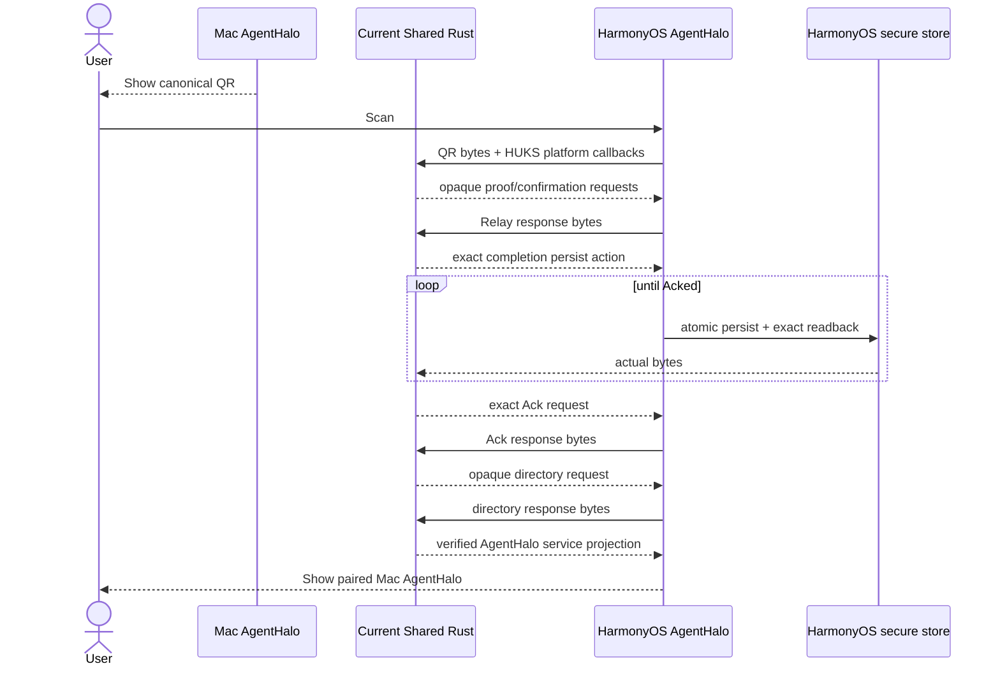

# Muster Security Protocol V2

Status: **Normative security migration standard; implementation and production deployment are incomplete**.

This document defines V2 security boundaries for Muster Network and AgentHalo remote capabilities.
It supersedes V1 pairing, relay-generated SAS, unbound activation, generic `tunnel` admission, and
port-only forwarding authorization. V1 data must not silently acquire V2 write permissions;
migration requires explicit revocation and reauthorization.

“MUST,” “MUST NOT,” and “SHOULD” express security requirements. Code, tests, artifacts/signing,
installation/runtime, production relay, and real multi-device E2E are six independent acceptance
layers; success in one cannot substitute for another.

## Goals and Non-Goals

V2 MUST guarantee all of the following:

- A compromised Rendezvous Relay may observe metadata, delay/drop traffic, and deny service, but cannot
  replace pairing subjects, authority sets, client grants, service scopes, targets, or SPKI pins;
- An ordinary remote client may use only explicitly granted services/scopes/targets and cannot inherit
  Terminal, Computer Use, Locked Use, or Muster admin;
- One compromised authority key cannot independently expand or take over an existing multi-authority set;
- Accepted authority operations, grants, revocations, pairings, rotations, and checkpoints append
  monotonically and cannot be rolled back by an older, fully valid signed document;
- Grant, authority, and device-key revocation affects handshakes, every stream, and existing sessions,
  and produces target ACKs;
- Shared Rust implements all signing bytes, security state machines, and authorization decisions;
  platforms must not duplicate encoding or assemble security documents in Swift/Kotlin/ArkTS;
- Production builds are traceable from source commit, toolchain, and lockfile to final signed artifacts.

The protocol does not promise:

- Traffic-metadata anonymity from relay; V2 guarantees inner-content and authorization integrity only,
  unless recipient encryption is separately enabled;
- That endpoint root, same-UID malware, or complete local compromise of an unlocked device cannot use
  authorized capabilities; privileged operations still need separate keys, scopes, and local authentication
  to reduce impact;
- That SSH, raw TCP, static peers, or relay admin interfaces may replace product transport or E2E acceptance.

## Threat Model and Trust Roots

V2 treats these participants as potentially malicious:

- Rendezvous Relay, owner-directory HTTP, relay persistence, logs, and backups;
- Unauthorized internet clients and compromised clients holding ordinary remote-client grants;
- One compromised active authority;
- Attackers replaying old messages, activations, protected-state backups, or creating network forks;
- Local attackers modifying user-writable helpers, `PATH`, unpinned dependencies, or unsigned build inputs.

V2 trust roots:

- Device/agent: SPKI SHA-256 of a hardware-protected P-256 key;
- Owner/authority: separate hardware-protected P-256 owner key and explicitly out-of-band accepted anchor;
- Federation: append-only authority operation log verified by accepted trust anchors;
- Authorization: owner-signed grants/revocations projected through authority policy and target-agent local ledger;
- Freshness: short-lived freshness receipts from active-authority quorum or explicit independent recovery
  witnesses, each independently retaining an append-only latest-head journal for the subject device;
- Transport: TLS 1.3 inner channel, exact agent SPKI pin, and agent verification of client SPKI/active grant.

WebPKI protects only the outer connection to relay, not final owner/authority/device/service identity.

## Rust-First Implementation Ownership

All V2 security semantics MUST reside in Rust. Suggested module boundaries:

```text
src/rust/crates/muster-transport/
  pairing_v2.rs          PairingTranscript/Proof/SAS canonical bytes
  authorization.rs       GrantV2/RevocationV2/scope/target validation
  federation.rs          operation/quorum/keyring/recovery policy
  activation_v2.rs       signed activation envelope create/validate
  protected_state.rs     append-only reconcile/checkpoint/atomic state
  freshness_v2.rs        witness requests/receipts/quorum journal/short lease
  backend_state_v2.rs    authenticated boot-bound opaque runtime readiness
  interaction_v2.rs      server-owned interaction ownership ledger
  management.rs          authenticated management messages/state machine
  mst2.rs                service-scoped stream header and limits

src/rust/crates/agenthalo-ffi/
  Rust state machines and thin C ABI for Apple/Android/HarmonyOS

src/rust/crates/agenthalo-backend/
  authenticated principal, route capability policy, local/remote API split

src/rust/crates/muster-relay/       new
  V2 rendezvous/owner-directory HTTP and persistence implementation
```

`muster-relay` SHOULD implement security-interpreting V2 endpoints with a Rust TLS/HTTP runtime and
bounded storage. Existing Go rendezvous/owner-directory is V1 read-only compatibility only; it must
not issue security documents, compute SAS, interpret federation, decide quorum, or authorize services.
PairingTransportV2’s blind mailbox is an explicit exception: it may run on the existing Go rendezvous
face, storing only capability hashes, routing metadata, and opaque Rust-signed bodies. Rust retains all
canonical/signature/SAS/FirstPair/Grant/Activation verification. Delete V1 write endpoints after migration.

Platforms provide only:

- Hardware-key generation/use;
- `ThisDeviceOnly` secure storage and atomic callbacks;
- HTTPS/WebSocket and OS lifecycle;
- Local authentication and UI;
- Byte-exact persistence/restoration of complete Rust-returned opaque state.

Platforms MUST NOT generate SAS, canonical bytes, operations, activations, grants, scope projections,
or rollback decisions themselves.

## Protocol Versions and Domain Separation

V2 uses new schemas/domain separators; V1 signatures MUST NOT be valid in V2:

```text
MUSTER-PAIRING-TRANSCRIPT-V2
MUSTER-INVITATION-PROOF-V2
MUSTER-PAIRING-SAS-V2
MUSTER-FIRST-PAIR-CONSUMER-CONFIRMATION-V2
MUSTER-FIRST-PAIR-ACCEPTANCE-V2
MUSTER-PAIRING-TRANSPORT-PROOF-V2
MUSTER-PAIRING-TRANSPORT-DELIVERY-V2
MUSTER-OWNER-CLIENT-GRANT-V2
MUSTER-OWNER-CLIENT-GRANT-REVOCATION-V2
MUSTER-AUTHORITY-OPERATION-V2
MUSTER-CONSUMER-ACTIVATION-V2
MUSTER-AUTHORITY-MANAGEMENT-V2
MUSTER-RENDEZVOUS-TICKET-V2
MUSTER-FRESHNESS-SEALED-HEAD-V2
MUSTER-FRESHNESS-WITNESS-REQUEST-V2
MUSTER-FRESHNESS-WITNESS-RECEIPT-V2
MUSTER-FRESHNESS-LEASE-V2
MUSTER-BACKEND-STATE-LEASE-V2
MUSTER-INTERACTION-BINDING-V2
MUSTER-TLS-CERTIFICATE-AUTHORIZATION-V2
```

Rust implements every canonical encoding: fixed field order, UTF-8, big-endian lengths/integers,
sorted sets, duplicate rejection, and strict size limits. JSON/CBOR is transport representation,
not signing encoding.

## Pairing V2 and Local SAS

### PairingTranscriptV2

Owner locally generates and signs the transcript:

```text
schema_version = 2
invitation_id
owner_id
owner_key_id
owner_public_key_sec1
directory_endpoint
challenge[32]
invitation_nonce[32]
issued_at_unix_seconds
expires_at_unix_seconds
requested_scope_template
owner_signature_der
```

Requirements:

- `directory_endpoint` is an HTTPS origin without credentials/query/fragment/extra path;
- Invitation lifetime is at most 15 minutes;
- Nonce/challenge use CSPRNG;
- Scope template describes candidate permissions the owner permits confirmation of, not the final grant;
- Relay cannot alter any field; clients first verify using the transcript’s owner anchor and out-of-band confirmation.

### InvitationProofV2

Consumer hardware key signs this canonical content:

```text
schema_version = 2
pairing_transcript_sha256
invitation_id
subject_device_id
subject_spki_sha256
device_nonce[32]
device_name
platform
issued_at_unix_seconds
```

`subject_device_id` MUST equal `spki:<subject_spki_sha256>` exactly. Relay may check PoP to filter
junk, but its result is not the owner’s trust source; owner MUST verify again through Shared Rust.

### Pairing Entry Points by Device Type

Explicit user requirement, 2026-09-12: Mac/PC-to-Mac/PC pairing must not use QR codes, screenshot import, or user-carried invitation text. QR is only for desktop-to-mobile pairing. The scanning ceremony below describes mobile entry, not desktop product requirements.

Desktop directly sends/receives pairing requests, then both sides compare Shared-derived SAS, complete system authentication, and explicitly confirm. Discovery, addresses, display names, old rosters, and old tunnels provide only unverified connection hints, never V2 trust or a replacement for both signatures. ABI 1.87 adds the signed desktop exchange below; Mac adapts Bonjour/direct TCP. Real-device migration still needs separate validation. Hidden copying of QR content, SSH injection, or platform-assembled trust state does not complete desktop pairing.

Platforms adapt only discovery/network I/O, hardware signing, system authentication, and UI. Shared Rust owns candidate binding, request lifetime, replay protection, SAS, Grant/Activation/ACK, and recovery. Missing desktop entry remains incomplete; do not require users to use mobile scanning instead. Acceptance of legacy authorization revocation is separate from actual V2 access and old-tunnel dependency validation.

ABI 1.87 desktop entry uses independent `muster.desktop-pairing.request.v2` / `muster.desktop-pairing.offer.v2` domains, not QR import. Consumer generates a random 32-byte nonce and hardware-P-256-signs SPKI, issue time, and a fixed 120-second lifetime. Owner’s signed response binds the complete request SHA-256, an existing signed candidate presentation, and the earlier of both deadlines. Signing input is the same canonical JSON bytes with an empty signature; signatures are DER P-256/SHA-256. Input maximum: 16 KiB. Reject duplicate/unknown fields, noncanonical JSON, substituted signatures/requests, and expired input.

Owner listens only after explicitly opening a pairing window; the first valid request cannot be replaced. The original request can retrieve the same response repeatedly; five invalid requests close the Shared window. Active consumer requests cannot be serialized, cloned, or consumed twice. Response verification yields only candidate input, still requiring the existing FirstPair opaque ceremony for hardware proof, SAS/system authentication on both ends, and Grant/Activation/ACK. Discovery names, addresses, and TCP success grant no trust. Mac holds the same hardware signer for desktop request and FirstPair proof within one operation.

Mac advertises `_agenthalo-pair._tcp` via Bonjour and offers an address/ephemeral-port fallback. Each TCP direction carries one bounded EOF-delimited message; platform adapts only OS byte transport, lifecycle, and display. Window close, cancellation, or expiry stops listening; durable recovery after confirmation uses existing Shared checkpoints. Mobile retains QR scanning; desktop windows neither show nor import QR. Windows UI adaptation and direct public-internet discovery are outside this Mac implementation’s acceptance scope.

### SAS Derivation

Both sides independently compute locally:

```text
transcript_hash = SHA256(PairingTranscriptV2 canonical bytes including owner signature)
proof_hash      = SHA256(InvitationProofV2 canonical bytes including device signature)
sas_material    = SHA256("MUSTER-PAIRING-SAS-V2" || transcript_hash || proof_hash)
SAS             = first 40 bits encoded as 8 Crockford Base32 characters, grouped XXXX-XXXX
```

Mobile uses its own freshly signed proof; owner uses the relay-delivered, Rust-verified proof. Relay
substitution of subject/proof necessarily changes SAS between devices. Ignore relay-returned SAS
fields and eventually remove them from the wire schema.

At most five proof/SAS failures per invitation. Exhaustion, expiry, cancellation, or approval burns
all pairing capabilities, short codes, and candidate read capabilities. Never log SAS, challenges,
proofs, or capabilities.

### FirstPairBootstrapV2: Fresh-Install Candidate-to-Accepted Boundary

A fresh install lacks an accepted owner anchor and cannot call normal
`pairing_scan_qr_decode_verify(anchor, ...)` or feed a QR’s self-declared owner key directly into
`accept_owner_anchor_v2`. Shared Rust supplies a separate FirstPairBootstrapV2 state machine: bounded,
strict canonical QR decoding, checking Presentation V2 version/purpose/audience/HTTPS origin/expiry,
nested transcript substitution, and the self-declared P-256 transcript signature. It returns only
nonserializable `VerifiedCandidatePresentationV2`. This proves internal QR consistency, not trusted
ownership. Candidate handles cannot authorize owner-directory, Grant, Activation, MST2, freshness/
readiness, or any remote mutation.

Product scanning invitations are fixed at two minutes and single-use; generic PairingTranscriptV2’s
15 minutes is only the protocol ceiling, not the product default. QR contains only credential-free
canonical Presentation V2 JSON, no bearer/read credential/private key/deep link/manual pairing code.
Candidate projection exposes only owner-key fingerprint, expiry, SAS/phase, and `not trusted`, never
owner-anchor JSON, transcript, or fields usable as input to authorization APIs.

Candidate binding is exact across owner fingerprint, transcript hash, invitation ID, origin, QR hash,
expiry, consumer hardware SPKI, InvitationProofV2 hash, and SAS. After local SAS confirmation, consumer
hardware-signs only Rust-returned `MUSTER-FIRST-PAIR-CONSUMER-CONFIRMATION-V2` canonical bytes.
Owner must redeem the exact proof once with the same Rust invitation handle, obtain the same SAS,
complete system local authentication, and confirm SAS before verifying consumer confirmation. Owner
hardware key then signs `MUSTER-FIRST-PAIR-ACCEPTANCE-V2` canonical bytes. Relay, platform JSON,
UI fingerprints, and QR self-declared keys cannot replace either confirmation.

After owner-acceptance verification, consumer enters a two-phase transaction: Shared returns complete
exact protected-state bytes; platform atomically persists, rereads, hashes actual bytes with SHA-256,
and returns that hash to commit. Only successful commit returns `AcceptedOwnerAnchorV2`; hash
mismatch, persistence failure, or abort leaves the candidate untrusted. Restart restore revalidates
QR, transcript, proof, consumer confirmation, and owner acceptance from the full protected chain,
not a bare owner key. SAS mismatch, cancellation, expiry, repeated proof/confirmation/acceptance/
commit, or exhausted attempt budget enters irreversible terminal failure, fail closed.

ABI 1.36 separates three clocks. QR’s two-minute deadline governs first proof redemption only.
Success immediately burns QR/proof inbox; Rust holds a nonserializable owner-approval handle bound
to exact request/session and starts an independent five-minute deadline at redemption. After owner
authentication and acceptance signing, Rust issues a separate one-minute owner-delivery/consumer-
commit/ACK deadline. Neither later deadline reads, extends, or revives QR expiry. Relay independently
persists `approval_expires_at_unix_seconds` and `delivery_expires_at_unix_seconds`; redeemed phases
expire by the former and approved-but-unacked phases by the latter. Authenticated broker-committed
ACK results remain durable. Terminal state retains its failure phase; platforms cannot rewrite
owner-delivery, ACK, signing, or persistence errors as `invitationExpired`.

ABI 1.37 makes owner-authentication denial/unavailability/invalid platform return values Shared Rust
terminal states. Redeemed opaque approval handles burn immediately, retaining
`local_authentication_rejected` or `local_authentication_unavailable`; platforms cannot decide to retry
or revive them. Test-only mock OS APIs use software P-256 keys through the hardware-signer interface,
plus local authentication, clock, atomic persistence/readback, and fault injection. These mocks must
never enter release runtime.

ABI 1.38 moves PairingTransport Activation construction back into Shared Rust. Platform no longer
reuses long-lived Grant expiry for one-time Activation; Shared creates Activation with an independent
15-minute maximum. macOS synchronously supplies one LocalAuthentication result to the same Shared
approval transition. HarmonyOS retains only opaque FirstPair state during system-authentication
overlays; Shared rechecks real deadlines after resumption.

ABI 1.31 `PAIRING_TRANSPORT` provides an independent blind bounded mailbox and Rust-owned opaque
request/response handles without changing FirstPair/Grant/Activation trust boundaries. Relay endpoints
are fixed under `/v2/pairing-transport/invitations/...`, separate from owner-directory, V1 `/pairings`,
agent-token ledger, and local-admin. Relay stores only capability SHA-256, recipient/message/cursor
routing metadata, and opaque end-to-end signed bodies. It does not parse proof/SAS/acceptance/Grant/
Activation or accept username/roster lookup.

Owner registers the invitation first; consumer uploads a signed proof envelope up to 64 KiB so both
obtain the same SAS. After phone SAS confirmation, upload `FirstPairTransportRequestV2` up to 128 KiB,
signed by the same hardware key, binding candidate transcript, invitation/origin/QR hash, subject
device/SPKI, signed transport proof, and signed consumer confirmation. Owner reads batches using
control capability: at most five entries and 1030 KiB total response. Shared Rust independently
validates proof and terminal request for canonical encoding, signature, origin, recipient, expiry,
hash, and duplicate binding. Proof without a verified terminal request is SAS-only and cannot redeem
or create acceptance. First relay redemption durably closes the whole proof inbox and deletes opaque
intake bodies; subsequent identical/different proofs/confirmations fail closed. After approval, owner
may deliver only to the single selected recipient, with an owner-signed envelope up to 512 KiB binding
selected proof hash and full canonical wire/hashes of FirstPair acceptance, GrantV2, and ActivationV2.
Consumer poll responses have a hard 1030 KiB limit. Reject delivery bodies in non-`approved` phases
and any routing/body substitution.

Relay states: `open -> redeemed -> approved`, plus terminal `cancelled`, `expired`, `revoked`.
First redemption globally burns invitation intake; approval still permits delivery/ACK or revoke.
Every mutation uses exact idempotency key+body hash; persist through 0600 atomic replacement, fsync,
and state-head hash. Disk failure cannot advance memory state. Per owner: at most 256 active
invitations, 8 MiB opaque bodies; 4096 invitations total; five proofs per invitation; separate IP
rate limit. State/head mismatch, partial writes, cursor rollback, duplicate messages/recipients,
cross-recipient capabilities, oversize, and unknown fields all fail closed.

Opaque owner/consumer transport sessions must validate relay receipts. ABI 1.30’s caller-supplied
`expected_invitation_id` decoder returns unavailable in 1.31; platforms cannot fill identity from
QR/URL/projections/JSON. Sessions bind invitation, recipient-capability hash, and exact request.
Even Shared strict parsing and exact request-hash binding proves only durable relay mailbox state,
not acceptance of an owner anchor, Grant/Activation commit, device-added completion, or permission
for remote mutation.

ABI 1.32 separates consumer/owner verified-request roles. Consumer calls Rust upgrade on its exact
hardware-signed `FirstPairTransportRequestV2`; Rust revalidates canonical/signature/candidate/session/
recipient/expiry/request-hash binding and returns only a nonserializable consumer-role verified handle.
Owner redeem/approve cannot consume it; owner still requires an owner-role handle from Rust-verified
relay poll batches. Decoding consumer wire as an owner request, passing opaque handles across
processes, or substituting relay receipts for owner-role handles must fail.

ABI 1.33 adds independent `PAIRING_TRANSPORT_COMPLETION`. After delivery verification, Rust creates
an unserializable completion plan and drives a write-ahead journal through
`Prepare -> FirstPairPersisted -> GrantPersisted -> ActivationPersisted -> Committed -> Acked`.
The journal exactly binds consumer session, role-scoped request, delivery, recipient, subject
device/SPKI, owner acceptance, authority set/epoch/operation-log head, exact local target, targets,
embedded canonical signed consumer request, delivery, completion-bound FirstPair shadow, three
protected-state base/candidate generations+SHA-256, and stable ACK request ID/body hash. Platforms
persist each Shared-returned exact action byte sequence in order, then return actual readback bytes
unchanged. Caller-computed hashes, booleans, projections, JSON, or platform-selected write order are
not accepted. The plan obtains a temporary anchor internally from unexported staged FirstPair,
revalidates the delivery Activation’s full operation log/quorum in Rust, and uses only its verified
paired-owner Grant. C ABI accepts no caller-supplied verified Grant/Activation; standalone and
Activation-embedded Grants must match object for object.

FirstPair completion shadow, Grant candidate, and Activation candidate export no accepted anchor/
live ledger/live activation until exact `Committed` journal readback. Legacy completion handles export
only after exact `Acked` readback. Restart supplies only consumer protected-state bytes, journal,
and three store readbacks; it accepts/depends on no old-process request/delivery/candidate/FirstPair
transaction, Grant ledger, Activation store, or verified Grant/Activation handle, nor relay redelivery
after terminal burn. Rust revalidates role/session and the full FirstPair/Grant/Activation chain from
exact journal wires/shadow, deterministically rebuilding a pristine base. Durable `Acked` journals
restore trust handles on ordinary app restarts after invitation expiry; expired non-Acked branches
enter repair/re-pair. Allow roll-forward only if the journal lags exactly one exact store action.
Journal ahead/deleted/reordered, cross-delivery/request substitution, same-generation different-hash,
predecessor/fork, or two-plus steps ahead enter isolated repair/re-pair with no action. Only after
`Committed` may byte-identical ACK retry be generated; request-bound relay receipts still require
exact `Acked` journal persistence before device-added projection becomes idempotent `added_idempotent`
by Rust’s non-authorizing completion ID. Relay HTTP 2xx, terminal burn, or delivery bodies replace
none of these steps. ABI 1.32 legacy completion explicitly returns `UNAVAILABLE` in 1.33, preventing
a second completion path around the composite journal.

ABI 1.45 adds `PAIRING_TRANSPORT_TYPED_NEXT_STEP`. Consumers negotiate both ABI minor and capability,
advancing only on opaque-plan `Persist`, `SignAcknowledgment`, `SendAcknowledgment`, `TerminalAcked`,
or `TerminalRepairOrRePair` instructions. Projections remain display-only; phase/disposition strings,
HTTP results, and local booleans cannot control transitions. After entering the journal, lifecycle
changes or leaving the page may only pause while retaining checkpoint, journal, and three composite
stores. Deleting the journal removes Shared’s basis for recovering/isolating already-written candidates.
Release terminal requests only after exact checkpoint persistence. Even before journaling begins,
platforms cannot delete waiting-owner checkpoints: later owner approval would become an unrecoverable
stranded mutation. After terminal `Acked` and directory verification, retain durable bytes for live
trust reconstruction on normal restart with fresh hardware-key PoP. Only process-local attempts with
no persisted checkpoint and unreleased terminal request may be cleared by explicit cancellation.

The completion journal is not an independent rollback oracle; sealed/freshness layers must detect
coordinated rollback of it and all stores. Without platform freshness readiness, ABI 1.33 provides
local cross-store crash recovery only, not cross-restart rollback security or permission for remote
listeners, mutations, or service publication.

Report acceptance separately for Shared code, Rust/FFI/attack tests, headers/ABI/rebuildable artifacts,
platform thin bindings, relay deployment/runtime, and real multi-device FirstPair+Grant+Activation+ACK
E2E. ABI/core/relay unit tests do not prove deployment, platform wiring, or E2E. `REMOTE_LISTENER`
remains unavailable; PairingTransport completion cannot enable service publication, 8765, sessions,
remote mutation, or local-admin/MST1 fallback. Never fall back to V1 polling, deep links, short codes,
username/roster lookup, or local-admin/8765 bypasses.

### Unified QR Pairing Sequence

This sequence describes the complete product flow, not merely camera recognition. Owner/consumer
platforms provide UI, system authentication, hardware signing, and exact-byte persistence. Shared
Rust owns all trust-bearing decoding/binding/state/Grant/Activation/completion-journal decisions.
Relay transports bounded opaque bodies without SAS or authorization decisions.

```mermaid
sequenceDiagram
    autonumber
    actor User as User
    participant OwnerUI as Mac AgentHalo
    participant OwnerCore as Owner Shared Rust
    participant Relay as Authenticated Relay<br/>blind mailbox
    participant MobileUI as Mobile AgentHalo
    participant MobileCore as Consumer Shared Rust
    participant Platform as SEP / HUKS / Keystore<br/>and system local authentication
    participant Store as Mobile secure storage

    User->>OwnerUI: Select “Add mobile device”
    OwnerUI->>OwnerCore: Create two-minute single-use invitation
    OwnerCore-->>OwnerUI: transcript signing bytes
    OwnerUI->>Platform: Authenticate locally and sign with owner hardware key
    Platform-->>OwnerUI: owner hardware signature
    OwnerUI->>OwnerCore: Attach signature and create invitation
    OwnerCore-->>OwnerUI: opaque register request
    OwnerUI->>Relay: Execute credential-free HTTPS registration
    Relay-->>OwnerUI: bounded response
    OwnerUI->>OwnerCore: Submit response unchanged and verify receipt
    OwnerCore-->>OwnerUI: canonical credential-free QR JSON
    OwnerUI-->>User: Show only QR and remaining time

    User->>MobileUI: Scan with camera
    MobileUI->>MobileCore: Submit unchanged QR bytes
    MobileCore->>MobileCore: Verify bounds, canonical encoding, version/origin/<br/>owner signature/expiry
    MobileCore-->>MobileUI: opaque candidate + owner fingerprint
    MobileUI->>Platform: Read mobile hardware SPKI
    MobileCore-->>MobileUI: Rust proof signing bytes
    MobileUI->>Platform: Sign with mobile hardware key
    Platform-->>MobileUI: hardware signature
    MobileUI->>MobileCore: Attach signature and create opaque proof request
    MobileCore-->>MobileUI: opaque proof upload request
    MobileUI->>Relay: Execute credential-free HTTPS upload
    Relay-->>MobileUI: bounded response
    MobileUI->>MobileCore: Submit response unchanged and verify receipt
    OwnerCore-->>OwnerUI: opaque owner poll request
    OwnerUI->>Relay: Execute poll
    Relay-->>OwnerUI: bounded opaque proof batch
    OwnerUI->>OwnerCore: Submit batch unchanged
    OwnerCore->>OwnerCore: Verify proof; first success burns proof inbox
    Note over OwnerCore,Relay: QR two-minute deadline ends here;<br/>start independent owner-approval deadline
    OwnerCore-->>OwnerUI: owner SAS
    MobileCore-->>MobileUI: consumer SAS
    OwnerUI-->>User: Show SAS, mobile device, and authorization scope
    MobileUI-->>User: Show matching SAS, owner, and remaining time

    alt SAS matches and both sides explicitly confirm
        User->>MobileUI: Confirm mobile SAS
        MobileUI->>Platform: Mobile system local authentication
        MobileCore-->>MobileUI: consumer-confirmation signing bytes
        MobileUI->>Platform: Sign with same mobile hardware key
        Platform-->>MobileUI: hardware-signed confirmation
        MobileUI->>MobileCore: Attach signature and create terminal request
        MobileCore-->>MobileUI: opaque FirstPairTransportRequestV2 upload
        MobileUI->>Relay: Execute credential-free HTTPS upload
        Relay-->>MobileUI: bounded response
        MobileUI->>MobileCore: Submit response unchanged and verify receipt
        OwnerCore-->>OwnerUI: opaque terminal poll request
        OwnerUI->>Relay: Execute poll
        Relay-->>OwnerUI: bounded terminal request batch
        OwnerUI->>OwnerCore: Submit batch unchanged
        OwnerCore->>OwnerCore: Verify role/session/proof/confirmation binding
        User->>OwnerUI: Confirm SAS, scope, and target devices
        OwnerUI->>Platform: Owner system local authentication
        Note over OwnerCore,MobileCore: Owner acceptance starts independent short delivery/commit/ACK deadline
        OwnerCore-->>OwnerUI: acceptance, GrantV2, and ActivationV2 signing bytes
        OwnerUI->>Platform: Sign with owner hardware key
        Platform-->>OwnerUI: owner hardware signatures
        OwnerUI->>OwnerCore: Attach signatures and create opaque delivery request
        OwnerCore-->>OwnerUI: Single-recipient owner-signed delivery request
        OwnerUI->>Relay: Execute delivery HTTPS
        Relay-->>OwnerUI: bounded response
        OwnerUI->>OwnerCore: Submit response unchanged and verify receipt
        MobileCore-->>MobileUI: opaque consumer poll request
        MobileUI->>Relay: Execute poll
        Relay-->>MobileUI: bounded owner-signed delivery
        MobileUI->>MobileCore: Submit delivery unchanged
        MobileCore->>MobileCore: Verify acceptance + Grant + Activation

        loop Rust-owned completion journal
            MobileCore-->>MobileUI: Next exact persist action
            MobileUI->>Store: Atomically write and reread exact bytes
            Store-->>MobileCore: actual readback bytes
        end
        Note over MobileCore,Store: Prepare -> FirstPairPersisted -> GrantPersisted<br/>-> ActivationPersisted -> Committed -> Acked
        MobileCore-->>MobileUI: Stable retryable completion ack request
        MobileUI->>Relay: Execute ack HTTPS
        Relay-->>MobileUI: bounded response
        MobileUI->>MobileCore: Submit ack receipt unchanged
        MobileCore-->>MobileUI: Idempotent device-added projection
        MobileCore-->>MobileUI: Acked-gated owner-directory session
        MobileCore-->>MobileUI: exact GET request + opaque ptr_ capability
        MobileUI->>Relay: Execute owner-directory HTTPS request
        Relay-->>MobileUI: signed bounded snapshot + ETag
        MobileUI->>MobileCore: Submit response unchanged
        MobileCore->>MobileCore: Verify owner signature/key rotation/<br/>ETag/revision; project only AgentHalo v2:8765
        MobileCore-->>MobileUI: Verified AgentHalo services
        MobileUI-->>User: Pairing complete; show Mac AgentHalo
    else SAS mismatch, cancellation, expiry, replay, or attempts exhausted
        OwnerCore->>OwnerCore: terminal burn invitation
        MobileCore->>MobileCore: Discard candidate; remain untrusted
        OwnerUI-->>User: Explicit failure; require new QR
        MobileUI-->>User: Explicit failure; no anchor/grant/activation
    end
```

HarmonyOS consumer transport, macOS owner poll/redeem/delivery, and consumer completion journal
are wired to this Shared Rust state machine. Relay’s authenticated broker binds the corresponding
`ptr_` digest to directory read capability only after exact owner-Grant validation. Only durable
`Acked` receipts from the same completion plan can create Rust-owned directory sessions. Rust
constructs requests and holds non-exportable read capabilities; platforms only execute HTTPS.
Shared Rust verifies canonical owner signatures, rotation chains, ETag, monotonic revisions,
equivalent replay, and `agenthalo/v2/8765` service filtering; HarmonyOS displays Shared projections only.

Thus “scan, SAS, local authentication on both sides, successful delivery” still does not mean the
device is added. Without durable ACK, broker grant binding, or a Rust-verified directory snapshot,
both UIs remain undiscovered/inaccessible. Never construct a Mac AgentHalo entry from HTTP 2xx,
local cache, or platform-parsed JSON.



## Client Grant V2

GrantV2 MUST contain:

```text
schema_version = 2
grant_id
grant_revision
owner_id
subject_device_id
subject_spki_sha256
scopes[]
target_device_ids[] | owner_current_future
issued_at_unix_seconds
expires_at_unix_seconds
supersedes_grant_id?
authority_set_id
authority_epoch
```

Runtime scopes use granular names:

```text
agenthalo.session.read
agenthalo.session.write
agenthalo.approval.respond
terminal.connect
computer-use.execute
locked-use.execute
muster.network.admin
```

`agenthalo.remote-client` is only an issuance-UI template, expanded into explicit scopes by Rust at
issuance. Servers must not interpret it as allow-all. Never issue `muster.network.admin` to remote
consumers; only local admin principals may obtain it.

Grant history is append-only. `supersedes_grant_id` permits renewal/scope reduction. Runtime selects
only the highest unrevoked, unexpired revision in that owner/subject/scope chain. RevocationV2 binds
grant ID, revision, subject SPKI, reason, authority epoch, and time.

## Federation Quorum and Recovery

For `N` active authorities before an operation, normal quorum is:

```text
Q(N) = 1, N = 1
Q(N) = min(2, N), N >= 2
```

Rules:

- Bootstrap: first authority self-add, 1/1;
- Add: at least `Q(N)` **existing active authorities** sign, plus new-subject PoP;
- Revoke: at least `Q(N)` pre-operation active authorities sign; do not exclude the subject first to lower threshold;
- Restore: at least `Q(N)` existing active authorities sign, plus restored-subject PoP;
- Epochs strictly consecutive, operation IDs unique, issued-at nondecreasing, previous head hash bound;
- No duplicate signers; unknown/pending/revoked authorities do not count toward quorum.

With N=2 and one permanently lost authority, normal revoke must not degrade to 1-of-2. Recovery uses
an explicitly bootstrapped recovery policy, e.g. offline recovery key or multiple recovery shares,
with mandatory local authentication, delay, and clear audit. Without configured recovery, zero-active
state remains fail closed; historical revoked owners cannot self-restore.

## FederationActivationEnvelopeV2

Activation cannot validate only internal consistency; its envelope MUST bind current pairing:

```text
schema_version = 2
invitation_id
pairing_transcript_sha256
consumer_device_id
consumer_spki_sha256
paired_owner_id
paired_owner_key_id
client_grant_sha256
authority_set_id
authority_epoch
operation_log_head_sha256
activation_sha256
activation_nonce[32]
issued_at_unix_seconds
expires_at_unix_seconds
signatures[]
```

`signatures` satisfies current authority quorum, including paired owner as an active signer.
Single authority is 1/1. Signatures cover complete canonical envelope bytes excluding signature fields.

Consumer Rust verification order:

1. Verify paired-owner signature with PairingTranscriptV2’s out-of-band owner anchor;
2. Check invitation, transcript hash, activation nonce, consumer SPKI, and short expiry;
3. Verify envelope quorum, authority keyring, and operation head;
4. Verify activation authority collection exactly matches operation history;
5. Verify exact inclusion of the paired-owner anchor and GrantV2 matching `client_grant_sha256`;
6. Verify every active authority supplies the target consumer’s valid required grant;
7. Confirm absence of `odr_`, `odp_`, private keys, platform caches, or other credentials;
8. Generate one protected-state transaction for commit.

Any failure MUST NOT persist pairing, read capability, grant, or federation state.

## Protected State, Anti-Rollback, and Forks

Shared Rust protected state stores at least:

```text
authority_set_id
local_hardware_identity
accepted_epoch
operation_log
operation_log_head_sha256
grant_history
revocation_history
pairing_descriptors_without_credentials
key_rotation_history
state_generation
```

Every reconcile entry enforces:

- Authority-set ID and local hardware identity are irreplaceable;
- Accepted operation log must be a prefix of the candidate log;
- Candidate cannot delete previously seen grants, revocations, pairings, or rotations;
- Different heads at the same epoch/generation constitute a fork and permanently fail closed;
- Higher epochs reference current head;
- Validate/apply in temporary runtime first, then one atomic persist, then switch live state;
- Persistence failure leaves both runtime and durable state at the old version;
- Restore below the protected checkpoint refuses startup; never auto-accept old backups.

Apple uses `ThisDeviceOnly`; Android disables security-state backup; HarmonyOS uses hardware-bound
HUKS. Secure storage protects confidentiality, key binding, and local recovery, not automatic
monotonicity. Ordinary Keychain/HUKS/Keystore values, preferences, files, test counters, and relay
backups must not be labeled hardware anti-rollback. Platforms without reliable hardware counters
require remote-quorum freshness below; listeners remain unavailable until fresh runtime readiness.

## ADR: Remote-Quorum Freshness Without Hardware Counters

Status: **Accepted**. Remote-quorum freshness plus an authenticated backend-state broker is the
end state for Apple and other platforms without public hardware monotonic counters; Apple is not
permanently excluded. Until every ADR gate is implemented and verified, production behavior is
still effectively unsupported: Apple `platform_sealed_head_ready` MUST be `0`, with remote listeners,
service publication, and all remote mutations disabled.

### Opaque Readiness Ownership and ABI 1.25 Compatibility Boundary

ABI 1.25’s integer `platform_sealed_head_ready` remains only for compatibility/testing. It is not a
production listener trust input; Apple always passes `0`. Shared Rust must add two non-deserializable
types that cannot be constructed from bool/JSON/file/environment:

- `VerifiedFreshnessLeaseV2`: produced after validating witness receipts, quorum, journal continuity,
  epoch, all state heads, and lease time;
- `VerifiedRuntimeReadinessV2`: exactly binds freshness lease, current opaque Activation/Grant/Interaction
  state, local hardware identity, and authenticated backend boot identity.

Production listener/session establishment and every stream authorization consume live
`VerifiedRuntimeReadinessV2`. Platform projections/UI show only unavailable/reason/expiry and cannot
feed projections back as readiness. Core capability bits indicate implementation presence, not
readiness of a platform or current process.

### FreshnessSealedHeadV2 and Freshness Witnesses

For each freshness operation, device generates a CSPRNG challenge and signs exact
`FreshnessSealedHeadV2` with its current seal hardware key. This extends, but does not impersonate,
ABI 1.24’s local `SealedMonotonicHeadV2`. Old heads lacking Grant/Interaction ledgers and witness
challenge cannot issue remote freshness. Canonical content binds at least, in order:

```text
schema_version
subject_device_id
subject_spki_sha256
authority_set_id
authority_epoch
authority_operation_head_sha256
activation_state_sha256
activation_generation
grant_ledger_sha256
grant_ledger_generation
interaction_ledger_sha256
interaction_ledger_generation
predecessor_sealed_head_sha256
seal_key_id
witness_challenge[32]
issued_at_unix_seconds
```

For `N` pre-operation active authorities, threshold is `Q(N)=min(2,N)`. Receipts come from those
pre-operation active authorities, including at least one physical authority/device distinct from
the subject. Single-owner deployments explicitly configure an independent recovery witness in
bootstrap/recovery policy. Without one, readiness is unavailable; owner/subject self-signatures
or relay receipts cannot substitute.

Each witness validates device signature, current membership/epoch, predecessor, and all state
generations/hashes, maintaining a per-subject append-only latest-head journal. Store at least subject,
accepted sealed-head hash, each ledger generation/hash, authority epoch, previous journal-entry hash,
receipt ID, and issue time. Same-generation different-hash, predecessor mismatch, epoch rollback,
history deletion, or conflicting receipts permanently poison the current branch until explicit
quorum recovery creates a new branch root. Ordinary lease refresh cannot repair it automatically.

Dedicated `MUSTER-FRESHNESS-WITNESS-V2` capability API uses separately signed requests/receipts:

```text
WitnessRequestV2 = request_id + subject + sealed_head_sha256 + challenge +
                   authority_set_id + epoch + intended_witness + issue/expiry
WitnessReceiptV2 = receipt_id + request_id + subject + sealed_head_sha256 +
                   witness_owner/device/SPKI/key_id + journal_previous_head +
                   journal_generation + authority_set_id + epoch + issue/expiry
```

Relay provides only credential-free, bounded, single-recipient signed request/receipt mailboxes.
It may delay/drop/replay/deny service but cannot be a witness, compute quorum, determine freshness,
or rewrite recipients. Do not reuse owner-directory records, pairing capabilities, rosters,
usernames, or caller-asserted state for witness semantics.

### Offline Behavior and Five-Minute Leases

`VerifiedFreshnessLeaseV2` lasts at most five minutes. Every app/backend restart must obtain a new
online quorum; Apple cannot start listeners offline. Rust records a process-local monotonic
elapsed-time origin on lease acceptance. Expiry uses the earlier of elapsed time and signed expiry;
wall-clock rollback, sleep, or process resumption cannot extend it.

Lease expiry, failed refresh, changed authority membership/epoch, or any changed protected head
immediately stops new streams and terminates all existing remote streams by the expiry deadline.
Missing quorum/recovery witness, partition, poisoned fork, stale epoch, state mismatch, or broker
restart all make readiness unavailable; local-admin UDS remains usable. No fallback to MST1, legacy
`8765` forwarding, or `backend.sock`.

### Rust-Owned Authenticated Backend State Broker

Platform process and backend mutually authenticate. Apple uses OS-authenticated XPC, validating
audit token, Team ID, designated requirement, bundle/helper identity, and backend code hash. Any
same-UID UDS peer is insufficient. Backend generates a fresh CSPRNG boot nonce each startup;
restart invalidates all old nonces, leases, and readiness.

Shared Rust constructs/verifies bounded `BackendStateLeaseV2`, whose canonical content binds at least:

```text
backend_boot_nonce[32]
backend_code_identity
local_device_id / local_device_spki_sha256
authority_set_id / authority_epoch / operation_head_sha256
activation_state_sha256 / generation
grant_ledger_sha256 / generation
interaction_ledger_sha256 / generation
freshness_lease_sha256
issued_at_unix_seconds / expires_at_unix_seconds
```

Backend accepts only Rust-verified opaque leases and restores opaque current handles from broker
exchange, never raw ledger JSON, environment, ordinary files, caller SPKI, or readiness booleans.
Any broker-authentication, persistence, hash-readback, or handle-reconstruction failure leaves the
listener stopped. Restart requires fresh authenticated exchange, not old backend-cache readiness.

### Hardware-Backed TLS Identity Lifecycle

Introduce rustls listeners only after freshness, runtime readiness, broker, and interaction ledger
all exist. Server private keys must be hardware-backed. rustls `SigningKey/Signer` invokes hardware
signing through authenticated broker, never PEM/environment/file keys. Short-lived certificates
require current owner/quorum authorization and bind service, device SPKI, key ID, authority set/epoch,
validity, and rotation generation. Client-certificate verification uses current verified authority
state; the resulting principal strictly binds the exact leaf SPKI.

Rotation defines dual old/new-key proofs, bounded overlap, quorum authorization, every target ACK,
old-certificate revocation, and existing TLS-session eviction. Key loss or broker-signing failure
immediately stops the listener. Sealed-head cross-key chains remain unsupported; never auto-accept
a new seal key before explicit quorum recovery/rotation exists.

### Server-Owned InteractionBindingV2 Ledger

Rust backend creates append-only `InteractionBindingV2` binding exact remote subject device/SPKI,
grant ID, provider, session/thread, request ID, action kind, creation/expiry, and single-use resolution
status. Remote bodies, client session IDs, HTTP headers, or UI selection never establish ownership.

Pending reads and approval/question responses require both current GrantV2 exact scope and existing
binding. Reject duplicates, expiry, other subjects/grants, and Terminal/Computer Use/Locked Use/admin
scope substitution. Resolution first appends and atomically persists a terminal record, then executes
the mutation. Persistence failure must not invoke the Provider.

Interaction ledger hash/generation is part of protected Activation state, `FreshnessSealedHeadV2`,
witness journals, and BackendStateLeaseV2. Rollback, forks, restart without verified broker state,
duplicate resolution, and every persistence failure fail closed.

### Canonical Vector Manifest

Rust-first implementation freezes and cross-ABI-tests these fixture families; other languages only
consume Rust-generated bytes/hashes:

| Vector ID | Fixed scenario | Required proof |
| --- | --- | --- |
| `freshness-head-v2-single` | One active owner + independent witness | Exact field order, distinct-device requirement, Q=1 |
| `freshness-head-v2-multi` | Three active authorities, two receipts | `Q(3)=2`, receipt-order normalization |
| `freshness-receipt-v2-fork` | Two sealed hashes at one generation | Journal poison; no lease issuance |
| `freshness-lease-v2-expiry` | Exact five-minute boundary | Immediately expired at boundary; wall-clock rollback cannot extend |
| `backend-state-lease-v2-boot` | Same state, different boot nonce/code identity | Different hash; replay rejected |
| `interaction-binding-v2-once` | Resolve exact subject/grant/request twice | First terminal persistence, second rejection |

Each vector includes logical input, canonical bytes in hex, SHA-256, signature DER/verification key,
and at least one single-field mutation. New fields/order changes require schema/domain upgrades;
never silently refresh expected hashes.

## Authenticated Principals and API Isolation

Target agents derive `MusterPrincipal` from locally verified GrantV2/RevocationV2 ledgers and inner
TLS client SPKI:

```text
subject_spki_sha256
subject_device_id
owner_id
grant_id
grant_revision
scopes
target_device_ids
expires_at
authority_epoch
ledger_generation
```

Clients cannot self-assert principals in JSON/headers. Preserve handshake principals through sessions
and every stream; each authorization also consumes live `VerifiedRuntimeReadinessV2`. Recompute and
close unauthorized sessions immediately on ledger/interaction generation changes, freshness expiry,
revocation, or authority changes.

AgentHalo backend MUST separate:

- Remote API: only provider/session operations explicitly allowed by route policy;
- Local admin UDS: device add/revoke/delete, configuration, privileged operations; local admin principals only;
- Approval route: binds provider/session/turn/request ID, grant subject, and explicit
  `agenthalo.approval.respond`; ownership comes only from server-owned `InteractionBindingV2` ledger;
- Computer Use, Locked Use, and Terminal: separate scopes and service policies.

`X-Operation-ID` provides idempotency only, not authentication or authorization.

## MST2 Service-Scoped Transport

Every remote V2 stream uses a bounded MST2 header:

```text
magic = "MST2"
version
operation
service_id
grant_id
request_nonce
header_length
```

Security requirements:

- Target device is implicitly/explicitly bound by current agent session; no cross-target access;
- Server maps `service_id` to local endpoints through signed service registry; client does not choose ports;
- Rust static policy defines `service_id -> required_scope`;
- Grant ID is only a selector and must match TLS SPKI, scope, target, expiry, and generation in server ledger;
- Listener/session/stream holds unexpired opaque `VerifiedRuntimeReadinessV2`; caller booleans confer no authority;
- Header maximum 4096 bytes, five-second deadline, strict version/op/length validation;
- Per-SPKI/session/service/global limits for streams, open rate, bytes, FDs, idle time, and lifetime;
- Close abusive streams on limit violations, whole sessions on persistent violations, with bounded audit events.

MST1 is only for local or explicit V1 read-only compatibility, never V2 write permissions.

## Authority Management Transport and Revocation Transactions

`muster.authority-management` is a real product service with Rust-defined/signed messages over inner
TLS/MST2. Each message binds:

```text
authority_set_id
sender_owner_id / sender_spki
recipient_owner_id / recipient_spki
message_id
previous_head_sha256
generation
nonce
issued_at / expires_at
operation_digest
```

Never bypass product capabilities with SSH, raw TCP, static-file synchronization, or privileged relay APIs.

Revocation completion state machine:

1. Owner/quorum generates signed revocation;
2. Management service delivers to every target agent;
3. Agent atomically updates grant ledger/generation;
4. Agent immediately closes existing subject/grant sessions;
5. New handshakes and MST2 streams fail closed;
6. Agent persists and returns a signed durable ACK;
7. UI shows completion only after required-target ACKs; offline targets remain pending, not successful.

Agent registration-token rotation increments generation and evicts old online relay sessions.
Device/agent SPKI rotation uses old+new proofs, bounded overlap, all target ACKs, and forced old-session cleanup.

## Rust Relay V2 Resource and Persistence Boundaries

V2 Relay SHOULD separate WebSocket rendezvous from owner-directory REST listeners/servers so REST
can enforce:

- Header/body/read/write/idle deadlines;
- `Content-Length`/decoded-body limits and EOF after one JSON/CBOR object;
- Global/endpoint/source/owner/capability concurrency and rate quotas;
- Owner invitation/pairing/grant/rotation/waiter count and byte quotas;
- Bounded terminal-invitation retention and GC;
- Global memory/task/FD/session/pipe/disk budgets.

Public connect uses short-lived `RendezvousTicketV2` for DoS filtering, binding agent ID, client SPKI,
expiry, nonce, and token generation. Tickets are not inner authorization. Even incorrectly accepted
relay tickets cannot bypass inner TLS/grant/MST2 fail-closed checks. Agents/tokens/sessions use
generations; token rotation immediately closes old sessions.

Persist using transactional databases or per-owner append-only journals:

- Store only salted hashes of capabilities/tokens;
- WAL/transaction commit, file fsync, and parent-directory fsync;
- Signed checkpoints, backup generations, and recovery audit;
- One owner cannot amplify publication into global O(total-state) rewrites;
- Old-backup restoration cannot delete observed revocations or lower checkpoints.

Relay is content-blind, not metadata-blind. Logs use short-lived pseudonyms, truncated/hashed IPs,
sampling, explicit retention, and access audit. Never log capabilities, SAS, proofs, grant bodies,
activations, or full SPKI.

## Platform Keys and Lifecycle

### Apple

- Separate transport identity from privileged admin/Computer Use/Locked Use keys;
- Credentials/federation state use `WhenUnlockedThisDeviceOnly` or stricter;
- Background transport requiring `AfterFirstUnlockThisDeviceOnly` gets low-privilege connectivity only;
- Privileged operations use separate keys, LAContext/user presence, and short-lived grants;
- Without a public app-accessible independent hardware monotonic counter, production
  `platform_sealed_head_ready` stays `0`. Remote listeners require complete remote-quorum freshness,
  authenticated XPC broker, and opaque runtime readiness;
- SEP helper uses only absolute bundled paths, verifying Team ID, designated requirement, owner, and
  mode before execution; remove production `$PATH` fallback.

### Android

- Separate identity, credential, and federation state; disable backup;
- Privileged keys require user authentication; background transport keys do not automatically gain privileged scopes;
- Use StrongBox/attestation when supported; degradation must be visible and included in security-state reports;
- Strict security-envelope schemas; never continue authorization after `ignoreUnknownKeys`.

### HarmonyOS

- Non-exportable HUKS keys, separate from credentials/state;
- Validate lock screen, uninstall/reinstall, backup restoration, and attestation semantics on real hardware;
- Unify V2 `federation_activation` and `agenthalo://pair?bundle=` deep links;
- Remove legacy `authority_federation_input` authorization paths.

## Supply Chain and Release Gates

- All Cargo releases use `--locked`; commit a version-pinned `rust-toolchain.toml`;
- Commit SwiftPM `Package.resolved`; build cache keys include all resolved revisions;
- Commit Gradle wrapper `distributionSha256Sum` and dependency-verification metadata;
- Python uses hash locks and `--require-hashes`;
- XCFramework/helper/AAR/HAP provenance manifests include source commit, toolchain, lock digest,
  and artifact SHA-256;
- No default ad-hoc release signing; require explicit signing identity;
- CI separately verifies codesign, Team ID, notarization, staple, Gatekeeper, APK/HAP signature,
  SBOM, and artifact checksums;
- After production installation, reread actual bundle/helper signatures, owner/mode, and runtime
  configuration; checking build output alone is insufficient.

## V1-to-V2 Migration

V1 and V2 use different schemas, domain separators, state directories, and route prefixes. Rules:

- Disable V1 invitation/redeem/approve writes first; published snapshots may remain temporarily read-only;
- Mark every remote-client grant issued through V1 relay SAS untrusted; revoke and re-pair;
- Never import V1 activation directly into V2 protected state; use new invitation nonce and V2 envelope;
- If an authority set used V1 add/revoke/quorum, create a new V2 `authority_set_id` and rebuild membership
  through same-screen/out-of-band ceremony;
- Rotate `odr_`, `odp_`, agent registration tokens, and any capabilities potentially in old logs/backups;
- MST1/V1 scopes/V1 principals cannot obtain V2 write permissions;
- Delete V1 write code after migration, rather than retain dual stacks indefinitely.

## Implementation Order

AgentHalo/Muster Shared submits small auditable changes in this order. Existing baseline sequence:

1. Rust PairingTranscriptV2, ProofV2, SAS canonical vectors, and substitution-attack tests;
2. Rust route policy, `MusterPrincipal`, physical local/remote API separation;
3. Rust federation quorum fixes, append-only reconcile, fork/rollback tests;
4. Rust ActivationEnvelopeV2 and single-transaction validate/commit ABI;
5. Rust GrantV2 lifecycle, MST2, per-stream scope/target enforcement;
6. Rust authority-management transport, revocation disconnect/ACK;
7. Rust `muster-relay` V2, quotas, transactional persistence, token generations;
8. iOS/macOS/Android/HarmonyOS thin adapters;
9. Reproducible releases, signing, deployment, and real multi-device E2E.

Remaining remote-listener work additionally follows these strict gates, without parallel skipping:

a. This ADR and Rust-owned canonical vectors;
b. Witness requests/receipts, bounded mailbox client, quorum journal, poison/recovery, attack tests;
c. Opaque `VerifiedFreshnessLeaseV2` / `VerifiedRuntimeReadinessV2` API and ABI capabilities;
d. Authenticated backend-state broker and server-owned `InteractionBindingV2` ledger;
e. Hardware-backed rustls signing, short-lived certificate lifecycle, rotation/revocation/key loss;
f. Only then the Rust listener: rustls mTLS, complete MST2-frame read within five seconds,
   global/SPKI/session/service byte/FD/idle quotas, exact GrantV2 resolution, opaque authorization
   construction, calling only `BackendRouter::handle_remote`;
g. Malicious relay/broker/restart/fork tests, then platform runtime, finally real multi-device E2E.

Until a–g all pass, `REMOTE_LISTENER` remains unavailable, `capability_version=1` publication stays
legacy, and every `8765` forward remains rejected. No loopback TCP, raw socket, local-admin UDS,
or `handle_remote` bypass. ABI 1.25 MST2 core tests are not listener-runtime or E2E evidence.

No platform-handwritten transitional JSON and no V1 state gaining V2 write access for compatibility.

## Required New Adversarial Tests

Minimum matrix:

- Relay substitutes attacker proof for victim proof → different SAS on both ends;
- Relay retains genuine top-level grant but substitutes activation trust roots → reject with zero persistence;
- Old signed activation/protected state/management messages cannot restore revoked authorities/grants;
- One signer in a two-authority set cannot add/revoke/restore;
- Same-epoch different-head, non-prefix logs, deleted historical grants/revocations/pairings all fail closed;
- Remote principal always gets 403 on `/muster/devices/*` and cannot answer another subject’s approval;
- `agenthalo.session.*` cannot open terminal/computer-use/locked-use/admin services;
- Grant/revocation/expiry/ledger-generation changes close existing sessions;
- Reject malicious relay substitution/shuffling of witness receipts, replay to other subjects/challenges,
  or impersonation of witnesses;
- Same-generation different-head, predecessor mismatch, stale epoch, or conflicting receipt poisons
  witness journals; ordinary refresh and restart cannot clear it;
- Listener unavailable with one owner and no independent recovery witness, partitioned quorum, or exactly five-minute lease expiry;
- Wall-clock rollback, sleep/resume, backend restart, and boot-nonce replay cannot extend freshness/runtime leases;
- Same-UID UDS peers, wrong audit token/code identity, raw ledger JSON, caller SPKI/readiness bool cannot
  construct backend runtime readiness;
- Any substituted interaction subject/grant/provider/session/request/action, repeated resolve,
  persistence failure, or old interaction-ledger restoration is rejected without invoking the Provider;
- TLS PEM/environment/file keys, stale certificates, revoked/rotated SPKI, old authority epochs, and
  key loss all stop the listener;
- Hard limits on single-session stream flooding, slow bodies, connect-ticket floods, owner-ledger growth;
- Crashes at any validate/apply/persist/commit point restore only old state or complete new state;
- V2 parsers reject V1 wire/state/canonical signatures.

Go/Rust/Swift/Kotlin/ArkTS share only Rust-generated canonical test vectors; no other language owns
an independent encoding implementation.

## Layered Acceptance Gates

V2 may be called production-security-complete only with all evidence below:

1. **Code**: every normative Rust change reviewed, no duplicated platform security state machines;
2. **Tests**: unit/property/fuzz/interoperability/adversarial tests pass;
3. **Artifacts/signing**: traceable artifacts, formal signatures, notarization/staple or platform equivalents pass;
4. **Installation/runtime**: actual installed helpers, Keychain/Keystore/HUKS, permissions, and lifecycle validated;
5. **Production relay**: running version matches commit; V2 config, quotas, backup/restore, logging, monitoring verified;
6. **Real E2E**: at least 2/3 authorities, multiple mobile devices, malicious relay proxy, SAS, quorum,
   rollback/forks, revoke-disconnect, and AgentHalo/Terminal/Computer Use/Locked Use/admin isolation all pass.

Report every failed layer truthfully. “Tests passed,” “signed successfully,” or “relay online” cannot
substitute for a complete security conclusion.
