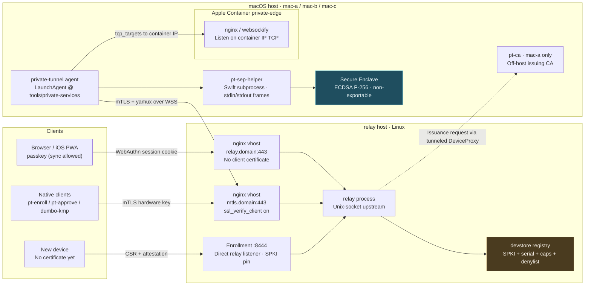
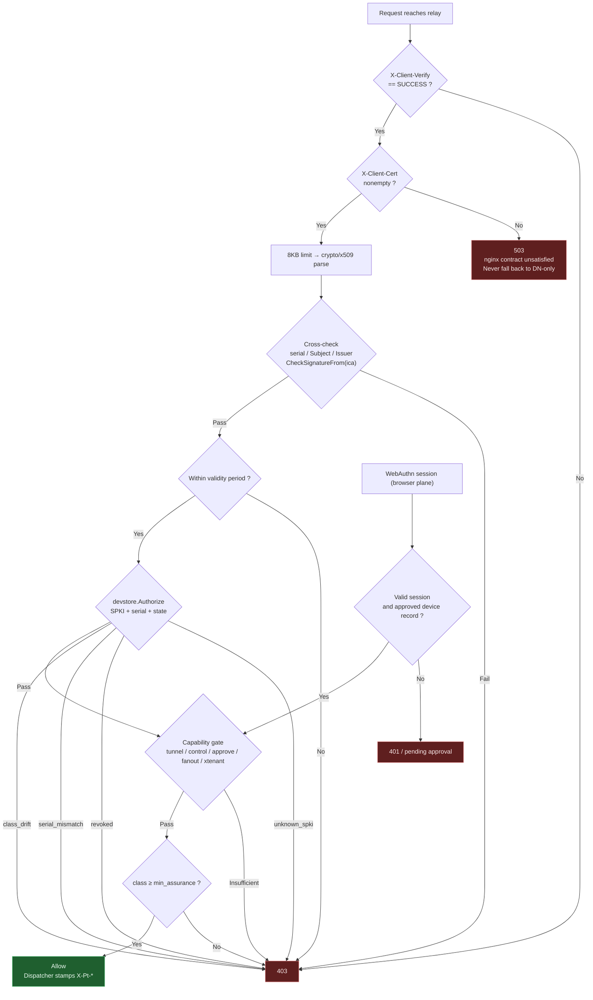
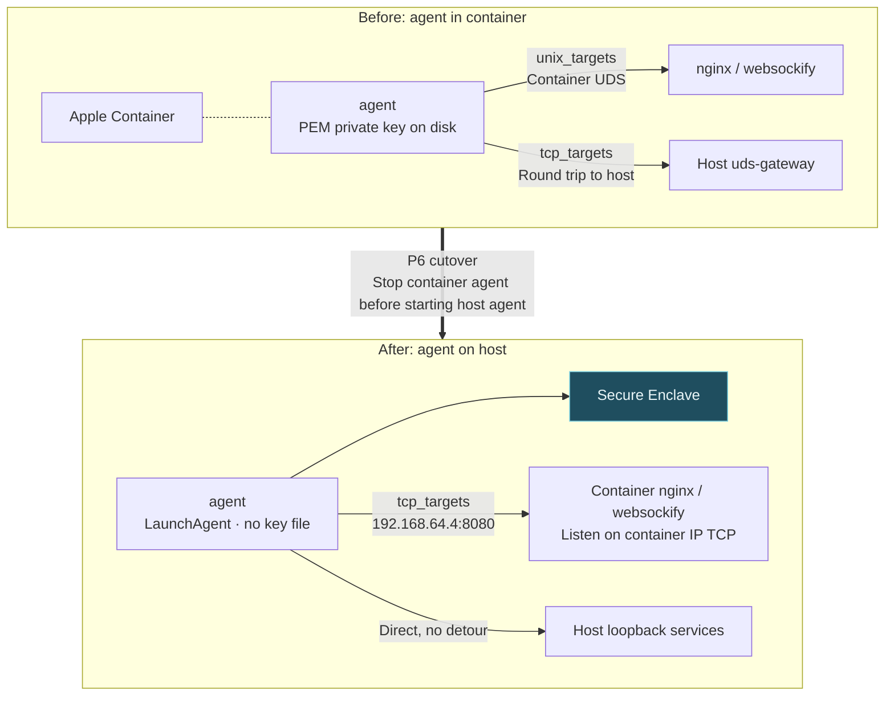
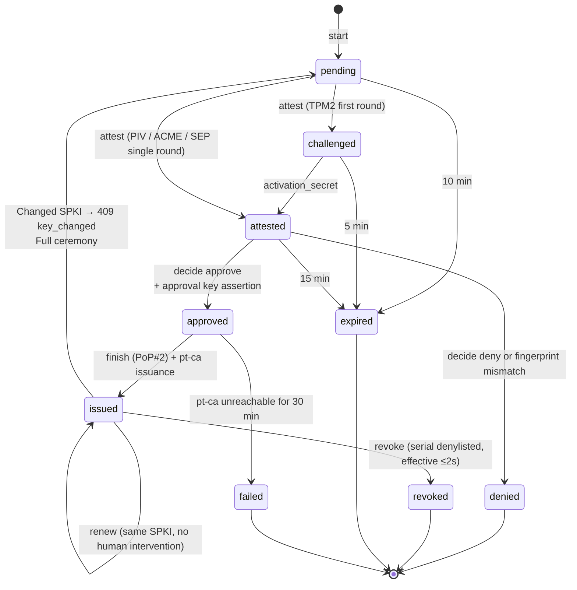

# private-tunnel Hardware-Rooted Identity Migration · Design Specification

> Privacy note: operational identities in this record are anonymized examples; see [public content policy](../../../PUBLIC_CONTENT.md). Technical outcomes and acceptance limits are unchanged.

**Date:** 2026-08-13
**Status:** Design finalized; P0 awaits confirmation of one rule change in §3.1
**Scope:** `private-tunnel/`, `private-edge/`, `tools/private-services/`, `remote-agent/`, `iterm-web/`
**Historical convention:** The original used Chinese for conclusions and reasoning, retaining English for code/paths/protocol names. This archival translation renders the prose in English.

---

## 0. One-Sentence Conclusion

Replace the trust model of “an offline-CA-signed 825-day PEM leaf certificate + a DN string” with three things:

1. **Private keys become `crypto.Signer`**, existing only in hardware (Apple SEP / Windows TPM 2.0 PCP / YubiKey PIV); Go never obtains key bytes;
2. **Issuance becomes an attested enrollment ceremony**: attestation + human confirmation on an already controlled device + hardware-signed approval transcript, with **the CA off the relay**;
3. **Authorization moves from certificate DN to a server-side device registry**: `SHA256(SPKI)` + serial + capability + revocation flag, checked on every request, with revocation effective within ≤2 seconds.

Browsers use a fourth, separate mechanism: **WebAuthn/passkey sessions + independent device-admission approval** (§4.3).

An honest statement up front: **on unmanaged Macs / iPhones, “non-exportable private key” means a client assertion plus human confirmation to the relay, not cryptographic proof.** Any document calling this “verified” is wrong.

---

## 1. Settled Constraints (User Decisions; Not Open for Debate)

| ID | Constraint | Implementation in this design |
|---|---|---|
| **D1** | Hardware keys are mandatory for **both user and agent identities**, with no software fallback; unsupported platforms are rejected | §3 platform targets; `min_assurance` policy |
| **D2** | macOS/iOS use Security/CryptoKit (Secure Enclave); Windows uses TPM 2.0 | §5 `internal/hwkey` |
| **D3** | Hardware keys cannot be exported or migrated | §2 classification; `--replace` replacement flow in §6.7 |
| **D4** | Adding a remote device requires confirmation on an **already controlled device** | §6 enrollment protocol; `/_pt/enroll/decide` |
| **D5** | Browsers move to WebAuthn/passkeys, **allowing cross-device sync** | §4.3; new `webauthn-synced` class |

D5’s relaxed synchronization rule is a prerequisite: research confirmed **Safari’s platform authenticator can create only iCloud-synced passkeys** (even MDM enterprise attestation stores them in the Managed Apple ID’s iCloud Keychain). The specification’s `devicePubKey` / `supplementalPubKeys` extensions were removed from WebAuthn L3 in 2024-08 (w3c/webauthn#2109). Without this relaxation, the browser path is impossible on Apple platforms.

The tradeoff must be explicit: **browser identity is rooted in the security of your Apple ID / Microsoft account, rather than this machine’s hardware**. The RP must not require `BE=0`.

---

## 2. Per-Platform: PROVEN vs ASSERTED (Highest Priority; Overrides Conflicting Sections)

| Platform / backend | Actually non-exportable? | Can relay **cryptographically verify** it? | Class label | Basis |
|---|---|---|---|---|
| Windows + TPM 2.0 (PCP KSP) | Yes | **Yes** (credential activation + `TPM2_Certify` + pubArea attributes + public-key binding) | `proven-tpm2` | TCG *TPM 2.0 Keys for Device Identity and Attestation* §6.1.2/§6.2 |
| YubiKey PIV (any OS, including Linux) | Yes | **Yes** (slot certificate → f9 → Yubico PIV Attestation Root, with public-key binding) | `proven-piv` | Yubico PIV attestation |
| Apple + MDM + ACME `device-attest-01` (`HardwareBound=true, Attest=true`) | Yes | **Yes** (chain to Apple Enterprise Attestation Root) | `proven-apple-acme` | Apple *Validating a Managed Device Attestation* |
| **macOS/iOS Secure Enclave (no MDM; this project’s primary path)** | **Yes** (structurally non-exportable SEP; private-key export returns `-4`) | **No. No public API remotely proves that a SecKey is in SEP** | `asserted-apple-sep` | No `SecKeyCreateAttestation`; App Attest on macOS reports `isSupported == false` (tested on 26.5) |
| **Browser passkey (synced)** | Private key stays in secure storage, but **syncs within the account by design** | No (synced passkeys do not support attestation) | `webauthn-synced` | See §1 |
| Host signer over TCP + token (container agent) | Private key is in host SEP, but **token is a bearer credential** | No | `asserted-token` (weakest, **does not count as hardware**) | §3.1 |
| File keys in containers / jetson | No | No | `software` (forbidden by D1) | — |
| Browser-imported `.p12` | **No; structurally impossible** | No | `software` (retired by this change) | SEP cannot import existing keys |

**Required verbatim UI / log / audit wording** (must not be shortened to “hardware protected”; original literals retained with English glosses):

- `proven-tpm2`: `已证明不可导出：TPM 2.0，pubArea fixedTPM+fixedParent+sensitiveDataOrigin 置位、restricted 清零，AK 经 credential activation 绑定 EK` — “Proven non-exportable: TPM 2.0; pubArea fixedTPM+fixedParent+sensitiveDataOrigin set, restricted clear; AK bound to EK through credential activation.”
- `asserted-apple-sep`: `未经证明：客户端声称密钥位于 Apple Secure Enclave。Apple 未提供任何可远程验证该声称的 API。本次信任来自 <approver device> 上的人工确认。` — “Unproven: the client asserts that the key is in Apple Secure Enclave. Apple provides no API for remotely verifying this assertion. Trust here comes from human confirmation on <approver device>.”
- `webauthn-synced`: `用户在场因子，非硬件绑定证明：该 passkey 可在你的账户内跨设备同步。设备准入由独立的台账审批把关。` — “User-presence factor, not proof of hardware binding: this passkey can sync across devices within your account. Independent registry approval controls device admission.”

### 2.1 Claims Disproved by Fact-Checking and Removed from the Design

| Previous claim | Finding | Action |
|---|---|---|
| “SEP supports only SHA-256 digests” | FALSE (SHA-1/256/384/512 all work in testing) | Signer dispatches by `opts.HashFunc()` |
| “SEP supports P-384 / RSA” | FALSE (P-384 undocumented; RSA structurally unsupported) | **ECDSA P-256 throughout** |
| “The agent is a launchd daemon, so SEP is unavailable” | **FALSE**: `tools/private-services/internal/plist/plist.go:56` writes to `~/Library/LaunchAgents` + `launchctl bootstrap gui/$UID`: a GUI-session LaunchAgent | §3.1’s cost was greatly overestimated |
| “Persistent SEP keys require an entitlement + provisioning profile” | True only for **Keychain persistence**. CryptoKit `SecureEnclave.P256.Signing.PrivateKey` + self-stored `dataRepresentation` (284 B blob) works with **ad-hoc signing, no bundle, no entitlement**, stable across processes, 6.84 ms signing | Use the blob path, §5.3 |
| `SecKeyCreateWithData(+kSecAttrTokenIDSecureEnclave)` restores SEP blobs | **FALSE and silently wrong**: ignores input and generates a new key (all-zero input also “succeeds”) | Explicitly forbid; add to code-review checklist |
| “Bind-mount a UDS into Apple Container for container-agent signing” | **Experimentally false**: guest `connect()` returns `connection refused` after virtiofs mount; `--publish-socket` works in the opposite direction (host listens, container is accessed) | Downgrade to `asserted-token`, §3.1 |
| “nginx can relax `ssl_verify_client` per location” | FALSE: directive contexts are only `http, server` | Separate server blocks required, §7.1 |
| “Replacing `ca_client.crt` with intermediate-only trust atomically retires old identities” | FALSE: clients sending the full chain still pass; intermediate-only trust without the partial-chain flag rejects **all** clients | Registry denylist becomes kill switch, §7.4 |
| “nginx `stream {}` can provide enrollment TCP passthrough” | **This project’s deployment script deletes it**: `deploy.sh:514-545` removes the stream block from `nginx.conf` by regex on each deploy | Relay directly listens on `:8444` for enrollment |
| “`cert-admin.sh revoke` revokes certificates” | **FALSE; ineffective**. The script itself says revocation only updates local registry status and implements no CRL/OCSP (`scripts/cert-admin.sh:17-19`); nginx also lacks `ssl_crl` | Make revocation effective first, §7.4 |
| “WebAuthn/passkeys prove non-exportability” | FALSE (sync + FIDO Credential Exchange export) | User-presence factor only, §4.3 |
| “jetson has usable fTPM” | **Disproved on hardware**: Jetson Nano (T210) has no `/dev/tpm*`, `/sys/class/tpm`, or `/dev/tee*`; NVIDIA fTPM is Orin-only; DTPM officially unsupported; system frozen at L4T R32 / Ubuntu 18.04 | §3.2 |
| “jetson is only an SSH jump host; disabling it has no effect” | **Outdated documentation** (`AGENTS.md:83`, `docs/root-runtime-context.md:13`): actually runs iterm-web (8080/8765) | Migrate services before disabling |
| Private OID arc `1.3.6.1.4.1.62831` | Someone else’s assigned PEN | Use registration-free `2.25.<uuid-decimal>` |

---

## 3. Platform Targets (Actual Cost of Full D1 Coverage)

Current facts: three Apple Container Linux VMs (mac-a / mac-b / mac-c) + one jetson, **all without SEP, TPM, or vTPM**. D1 requires hardware identities for all, so each needs a concrete destination.

### 3.1 Three Macs: Move Agents to the Host (Decided; Rule Revised)

Container agents cannot access host SEP. Choose between two paths:

| Approach | Class | Explanation |
|---|---|---|
| **Run agent as a host LaunchAgent, using SEP directly** (recommended) | `asserted-apple-sep` | Already supported in the repository: `tools/private-services/services.yaml:46-51` has a `private-tunnel-agent` entry and `deploy/agent-local.yaml` exists. Host agent proxies container services through the existing vmnet gateway |
| Container agent + host `pt-signd`, signing through gateway TCP | `asserted-token` | **Fails D1**: Apple Container can only bind-mount directories; crossing the boundary requires vmnet TCP, authorized by a token file = bearer credential, equivalent to what we are eliminating |

**Decision (2026-08-13)**: use the host LaunchAgent approach. Rule 4 in `private-tunnel/CLAUDE.md`
was revised accordingly: the old rule prohibited host-agent deployment; the new one requires host
agents to **register under `tools/private-services/`**, consistent with root CLAUDE.md rule 6 against
ad hoc launchd keepalive plists. Container services remain in private-edge and the host agent
accesses them. Container signer + token (`asserted-token`) is **no longer an end state**; brief
coexistence is permitted only during P6 cutover, but never run two agents on the same machine.

**New failure mode** for a host LaunchAgent: it runs in `gui/$UID`; before login (login window), there is no session → no signer → no tunnel, while repair needs that broken tunnel. Configure automatic login or accept this gap.

If using the transitional container signer, `pt-signd` must expose only `SIGN(purpose=tls, digest)`, reject `PurposeApprove`, rate-limit per second, audit every signature, and rotate tokens.

#### 3.1.1 Why Replacing UDS with TCP Does Not Solve It

Transport is entirely feasible, with an existing repository pattern: `tools/private-services/cmd/uds-gateway`
exposes host UDS as vmnet TCP (`__HOST_GATEWAY__:18787/18789` at
`private-edge/config/profiles/mac-b/uds-gateway.yaml:3,6`). **Authorization, not transport, is the problem.**

- UDS provides `SO_PEERCRED` / `LOCAL_PEERCRED`, letting the server check caller uid/pid and restrict signing to a particular process;
- TCP over the vmnet bridge has **no peer credentials to inspect**, so authorization degrades to a token file,
  a copyable file credential, precisely what this migration seeks to eliminate;
- `private-edge` is not the bridge’s only container (sample-dev / sample-build / buildkit also observed); any process
  able to reach `192.168.64.1:<port>` can request signatures.

**There is still a benefit**: the private key never leaves the Mac. A token thief must retain a foothold
on that Mac (or bridge) to sign; a PEM-key thief can sign anywhere forever. TCP signing therefore
provides **real defense in depth, but not D1 hardware binding**, and must be classified `asserted-token`.

| Approach | Attack surface | Meets D1 | Cost |
|---|---|---|---|
| A. TCP signer (vmnet gateway) | Any process on the bridge | ✗ | Possible today without container changes |
| B. `--ssh` vsock forwarding (only experimentally confirmed guest→host UDS channel) | Processes within this container only | ✗ (still no authentication, though much narrower) | Needs a container create flag that `private-edge/scripts/check-container-compatibility.py` **does not check**, so changing it silently has no effect; effective change requires recreating the production container, explicitly forbidden by `private-edge/AGENTS.md:33-38` |
| C. Move agent to host | Host process boundary | ✓ | Requires revising `private-tunnel/CLAUDE.md` rule 4 |

**Conclusion**: only C meets “no software keys.” A may serve as a transition until C lands.

#### 3.1.2 Accessing Container Services After Moving to the Host (Direction Reversal)

Today the agent runs inside the container and accesses container UDS directly through `unix_targets`:

```yaml
# private-edge/config/profiles/mac-b/agent.yaml.template:10-12
unix_targets:
  8080: /run/private-edge/nginx.sock       # iterm-web nginx
  6080: /run/private-edge/websockify.sock  # noVNC
```

Moving to the host breaks this path: host processes cannot access container UDS (virtiofs does not
carry UDS, experimentally verified). Direction reverses from “container process accesses host” to
“host process accesses container.” Two options:

| Mechanism | Explanation | Obstacle |
|---|---|---|
| **Make container services listen on TCP** (recommended) | nginx / websockify listen on TCP at the container IP (observed `192.168.64.4`); host agent uses `tcp_targets: 8080: <container-ip>:8080`. **Only change container configuration, not create arguments** | Resolve container IP reliably: follow existing dynamic `__HOST_GATEWAY__` resolution with `__CONTAINER_IP__`. **IP stability is unverified; test first in P6** |
| `--publish-socket` (Apple Container 1.2.0) | Observed semantics are “host client → container server,” the correct direction | Needs a create flag that `check-container-compatibility.py` **does not check**, so changes silently have no effect; recreating production containers to apply it is forbidden by `private-edge/AGENTS.md:33-38` |

Actual impact per machine:

- **mac-b**: two `unix_targets`, 8080 + 6080; change both;
- **mac-a**: only 8080 (`mac-a/agent.yaml.template:11`);
- **mac-c**: no `unix_targets`, only `tcp_targets`; **unaffected**.

After the move, `tcp_targets` pointing at `__HOST_GATEWAY__` (18765 / 22 / 5900 / 18770) should
point directly to host loopback: these were round trips back to the host, and the detour becomes unnecessary.

### 3.2 jetson: **Decommissioning Decided** (2026-08-13)

Read-only hardware probe (`ssh jetson`): Jetson Nano Developer Kit / T210 / L4T R32.7.6 /
Ubuntu 18.04.6 / kernel 4.9, **no TPM or TEE**. NVIDIA fTPM is Orin-only, implemented as an
OP-TEE TA; T210 runs TLK and **will never have it**. Current identity is a 227-byte software EC
private key on disk (`CN=example-device, O=example`, expires 2028-08-31).

No viable hardware root under D1. **Decision: remove jetson from the tunnel identity boundary and
decommission it.** Reject the YubiKey PIV option (hardware purchase + physical access, breaks
`CGO_ENABLED=0` cross-compilation at `deploy-agent-jetson.sh:20`, depends on 2018 `libpcsclite`)
and the downgrade-to-downstream-target option.

**Decommissioning checklist** (P6; individually verifiable):

| # | Action | Location |
|---|---|---|
| 1 | Stop/disable agent and clear `/opt/private-tunnel/` | jetson host |
| 2 | Delete forwards to jetson on both Macs (otherwise dead targets remain) | mac-a: `agent.yaml.template:26,29` (`0.0.0.0:2223` → jetson); mac-b: `agent.yaml.template:19,22` (**`0.0.0.0:2222`** → jetson). mac-b’s `2223` points to **mac-c**; do not delete the wrong entry |
| 3 | Remove from relay virtual-network device table | `private-tunnel/deploy.sh:159,166,175`, `examples/relay.yaml:17` (`.14` address) |
| 4 | Delete deployment artifacts | `deploy/agent-jetson.yaml`, `deploy-agent-jetson.sh`, `deploy/private-tunnel-agent.jetson.service` |
| 5 | Destroy local key material and mark revoked in registry | `private-tunnel/certs/agent-example-jetson.{key,csr,ext,crt}` (`.crt` is currently 0 bytes; the 227-byte `.key` remains) |
| 6 | Correct obsolete documentation | `AGENTS.md:83`, `docs/root-runtime-context.md:13` (both say “SSH jump host only,” contrary to reality) |

**Decommissioning removes two things; confirm acceptance or relocation:**

1. **iterm-web running on jetson** (nginx + sessions-server, `allowed_ports: [8901, 8080, 8765]`
   plus one `unix_targets` entry). The repository’s “SSH jump host only” statement is wrong; decommissioning stops the service;
2. **Tunneled SSH to jetson** (one `0.0.0.0:2223` forward each on mac-a and mac-b); afterward,
   only LAN or local access remains.

**Important sequencing note**: before P0’s device registry is deployed, “delete jetson from configuration
and shut it down” **does not revoke its identity**. The certificate remains cryptographically valid
(`cert-admin.sh revoke` is ineffective; no CRL). Any copy of that 227-byte private key can reconnect,
register as `jetson`, and even **silently eject** the legitimate online agent (`internal/relay/server.go:281-284`).
**Actual decommissioning occurs in P0**: exclude jetson from `devices import`, so the device gate rejects it.

### 3.3 Windows

`internal/hwkey/pcp_windows.go`, pure Go through `ncrypt.dll` (`golang.org/x/sys/windows`), ECDSA P-256, **no usage auth** (avoid global anti-hammering shared with BitLocker/Hello locking the user’s disk encryption). Set `NCRYPT_UI_POLICY` only on approval keys.

**Support must be limited to Win11 / Win10 21H2+ / Server 2022**: EC key creation through PCP KSP on Win10 ≤21H1 / Server 2016 / Server 2019 RTM returns `NTE_NOT_SUPPORTED`. RSA instead collides with TLS 1.3’s mandatory RSA-PSS and incorrect salt lengths in some TPM firmware. **No algorithm is both available and safe on old Windows.**

---

## 4. Three Identity Planes

The migration creates three identities **sharing one registry and one `VerifiedPeer` authorization structure**, differing only in authentication.

### 4.1 Agent Identity (Machine, mTLS)

Host macOS agents (SEP) / future Windows agents (TPM2), through the `mtls.<domain>` vhost with `ssl_verify_client on`. Capabilities limited to `{tunnel, network, service_egress, logupload}`.

**Remove `control` / `approve` / `fanout` / `xtenant`**: a standalone improvement. Today `internal/relay/dispatch.go:27-47` has no `Kind` check, giving an agent certificate **identical** HTTP permissions to a human certificate.

### 4.2 Human Native-Client Identity (mTLS)

`pt-enroll` / `pt-approve` / dumbo-kmp desktop client, also through `mtls.<domain>`, with hardware keys, `Kind=user`, and optionally `control` / `approve`. **Approvals can originate only here** (§6.4).

### 4.3 Browser Identity (WebAuthn Session, Sync Allowed)

D5 introduces this plane at `relay.<domain>:443`, **without client certificates**.

**Separate authentication from admission**: this preserves D4 while allowing synced passkeys:

```
passkey assertion  →  proves “this person” (syncable, webauthn-synced)
        ↓
device record      →  proves “this device was approved”
                       (first-seen fingerprint = pending;
                        confirmation on an approved device required)
        ↓
long-lived session cookie
```

A synced passkey passes the first gate, **not the second**: a new Mac signed into the same Apple ID receives credentials but still needs approval from an approved device before receiving a long-lived session. D4’s “confirm new devices” requirement therefore holds.

Details:

- **RP ID**: `relay.<domain>`. `deploy.sh:441-442` still contains migration regex `~^[a-z0-9]+-relay\.<domain>$`; keep it **only on the mTLS vhost**, or the RP ID scope must expand to the registrable domain.
- **Registration policy**: `authenticatorAttachment=platform`, `residentKey=required`, `userVerification=required`. **Do not check BE/BS** (D5 permits sync), and **no AAGUID allowlist** (Chrome-profile passkeys lack a verifiable attestation root; such an allowlist only trusts self-assertions forgeable by modified clients).
- **Library**: `github.com/go-webauthn/webauthn`; **pin the version** for v0.x. Store flags as **raw protocol values**, not decoded booleans, following library guidance.
- **Session**: `__Host-pt_session` cookie, `Secure; HttpOnly; SameSite=Lax; Path=/`; opaque server session ID bound to a registry device record; sliding 12-hour TTL, absolute 30-day maximum.
- **Two known iOS PWA pitfalls** (account for them in UX): (a) Safari requires a user gesture for `navigator.credentials.get()`, and conditional mediation consumes the only gesture; (b) **standalone PWAs have their own cookie partition**, so Safari sessions do not transfer after installation; repeat the assertion inside the installed PWA.

**Additional benefit**: WebKit bug 158345 (WebSocket omits client certificates, NEW since 2016) is a longstanding risk for WSS-heavy `/s/iterm/` (ttyd), `/s/novnc/`, and dumbo-web. Cookie authentication **eliminates this entire issue**.

---

## 5. Go Package Layout / `crypto.Signer` / Build Tags / cgo

### 5.1 Package Layout

```
private-tunnel/
├── internal/hwkey/                # Private-key abstraction; imported only by client/CA binaries
│   ├── hwkey.go                   # Key / Provider / registry / Open / Create
│   ├── require/                   # Blank import triggers compile-time rejection (§5.4)
│   ├── applesep_darwin.go         # //go:build darwin — pure Go, Swift subprocess
│   ├── pcp_windows.go             # //go:build windows — pure Go, syscall ncrypt.dll
│   ├── piv.go                     # //go:build pt_piv — cgo, go-piv/piv-go
│   ├── remote.go                  # //go:build pt_remote_signer — asserted-token
│   └── fake.go                    # //go:build pt_testkey — in-memory ECDSA for CI
├── internal/attest/               # Pure-Go verifiers, no cgo; shared by relay and pt-ca
│   ├── verdict.go                 # Class / Verdict / public-key binding (invariant I2)
│   ├── tpm2.go  piv.go  appleacme.go  sep.go
│   └── roots/                     # Embedded Yubico / Apple / TPM vendor roots
├── internal/enroll/               # Enrollment ceremony: protocol / state / transcript / audit
├── internal/webauthn/             # Browser session layer (RP, credential storage, cookie)
├── internal/devstore/             # Server device registry + serial denylist
├── internal/pki/                  # Certificate profiles / OID arc / CRL (pt-ca only)
├── internal/tlsutil/signer.go     # ClientTLSFromSigner
├── cmd/pt-ca/                     # Off-host CA (on operations Mac)
├── cmd/pt-enroll/  cmd/pt-approve/
└── cmd/pt-sep-helper/             # Swift subprocess, built separately
```

### 5.2 Abstraction

```go
type Key interface {
    crypto.Signer            // Public() must be *ecdsa.PublicKey with Curve == P256
    Label() string
    Backend() Backend        // apple-sep | windows-pcp | piv | remote-signer | fake
    Purpose() Purpose        // tls (background-capable) | approve (user presence every time)
    Attest(nonce []byte) (*Attestation, error)
    Close() error
}

type Provider interface {
    Backend() Backend
    Available() (bool, string)                 // string explains the reason when false
    Create(label string, p Purpose) (Key, error)
    Open(label string, p Purpose) (Key, error)
    Delete(label string) error
}

var ErrNoBackend = errors.New("hwkey: no hardware key backend available on this platform")
```

Use `GetClientCertificate` for TLS (renew certificates without disconnecting), and **pin the signature algorithm**:

```go
SupportedSignatureAlgorithms: []tls.SignatureScheme{tls.ECDSAWithP256AndSHA256}
```

Without pinning, problems arise: `MinVersion` is TLS 1.2, and below 1.3 Go does not bind curve to digest. It may select the peer’s preferred `ECDSAWithP384AndSHA384`, passing a 48-byte digest to a P-256 signer. Apple SEP tolerates this; **Windows PCP KSP returns `TPM_20_E_SIZE`**.

**ECDSA P-256 throughout**, for three independent reasons: Apple SEP supports only P-256; Windows TPM-backed RSA may randomly fail TLS 1.3 RSA-PSS handshakes depending on firmware; Apple ACME `HardwareBound` accepts only `ECSECPrimeRandom` 256/384.

### 5.3 Apple SEP: Swift Subprocess, No cgo

**No Keychain persistence**: `kSecAttrIsPermanent=true` + `kSecAttrTokenIDSecureEnclave` without `com.apple.application-identifier` entitlement returns `-34018`; ad-hoc signing with `keychain-access-groups` causes kernel SIGKILL (observed exit 137). That path makes `go build` insufficient for deployment.

**Use the CryptoKit blob path** (experimentally verified): `SecureEnclave.P256.Signing.PrivateKey` + self-stored `dataRepresentation` (284 B), restored across processes with ad-hoc signing, no bundle or entitlement, stable public key, successful mutual TLS 1.2/1.3 handshakes, signing p50 **6.84 ms**.

- `cmd/pt-sep-helper` (Swift, universal), communicating through **length-prefixed parent/child stdin/stdout frames**, not Unix sockets. **No socket means no blind-signing oracle**; lifetime follows parent, with no peer-credential authorization needed.
- accessControl: `.afterFirstUnlockThisDeviceOnly` + `.privateKeyUsage`. **Forbid `.biometryCurrentSet`** (reenrolling Touch ID destroys the key). Add `.userPresence` for `PurposeApprove`, prompting Touch ID on every approval.
- Locked-screen tests: **creation** with `.whenUnlockedThisDeviceOnly` returns `-25308`; `.afterFirstUnlockThisDeviceOnly` allows creation, signing, and full mTLS handshakes while locked.
- Store blob at `~/Library/Application Support/private-tunnel/keys/<label>.sepblob` (0600). **It is not the private key**: another Mac cannot decrypt it, implementing D3’s non-migratability.
- **Forbidden**: any `SecKeyCreateWithData(..., kSecAttrTokenIDSecureEnclave, ...)`.
- This is **undocumented Apple behavior**, subject to OS changes, an accepted risk (§9).

### 5.4 Hard Compile-Time and Runtime Rejection

```go
// internal/hwkey/require/deny.go
//go:build !( darwin || windows || pt_piv || pt_testkey )
package require
const _ = pt_hardware_key_backend_unavailable_for_this_platform  // Intentionally undefined
```

CI must grep the **exact identifier** (the compiler does not produce a plain-language explanation). Under D1, **there is no `pt_softkey` escape hatch**: software-key builds are no longer possible.

**Authority resides on the server** (invariant I1): client build tags and runtime rejection prevent mistakes only. D1 is actually enforced by `pt-ca` refusing CSRs that fail attestation policy, and relay returning 403 for identities below `users.<u>.min_assurance`.

| Binary | Target | cgo |
|---|---|---|
| `relay` | linux/amd64 | **CGO_ENABLED=0**, and **never imports `internal/hwkey`** (CI checks with `go list -deps`) |
| `agent` / `pt-enroll` / `pt-approve` (macOS) | darwin/arm64 | CGO_ENABLED=0 (SEP through Swift subprocess) |
| Same (Windows) | windows/amd64 | CGO_ENABLED=0 (pure-Go NCrypt syscall) |
| `agent` (jetson, only if YubiKey option selected) | linux/arm64 | **CGO_ENABLED=1 `-tags pt_piv`** + `aarch64` cross-toolchain |
| `pt-sep-helper` | darwin universal | Swift, separate build step |

**Critical constraint**: `internal/attest` must be pure Go. `piv.Verify` in `go-piv/piv-go` is in a cgo-gated package that relay cannot import, so **handwrite pure-Go PIV attestation verification** (certificate chain + Yubico private extensions `1.3.6.1.4.1.41482.3.*`).

---

## 6. Enrollment + Approval Protocol

### 6.1 Three Transport Planes

| Plane | Listener | Client certificate | Purpose |
|---|---|---|---|
| **mTLS** | nginx `mtls.<domain>:443` → relay Unix socket | `ssl_verify_client on` | Agent tunnels + human native clients + approval endpoints |
| **Browser** | nginx `relay.<domain>:443` → same relay socket | None (cookie/WebAuthn) | PWA, static assets, device proxy |
| **Enrollment** | **Relay process directly listens on `0.0.0.0:8444`** | None (client uses SPKI pin) | New devices without certificates |
| Local control | `/run/private-tunnel/enroll.sock` (0600 root) | — | `bootstrap`, break-glass |

Three reasons to bypass nginx for enrollment: `deploy.sh:514-545` deletes `stream {}` on every deployment; a new vhost needs confirmation of LE wildcard coverage (this repository does not run certbot; certificates are externally managed, unverified); relay-side TLS termination provides RFC 5705 channel binding, and the QR’s SPKI pin prevents phishing even if a public CA misissues for relay.<domain>.

**Moving relay upstream to a Unix socket** directly fixes an existing vulnerability: `scripts/smoke-relay-services.sh:4-10` is an executable spoofing PoC. Any process reaching `127.0.0.1:9443` can claim any user identity.

### 6.2 State Machine

```
(none) ──start──▶ pending ──attest──▶ [challenged] ──▶ attested ──decide:approve──▶ approved
                    │                                    │                          │
                    └──10m──▶ expired                    └──deny──▶ denied(terminal) └──finish──▶ issued
                                                                                                   │
                                                                          renew ◀──────────────────┴──▶ revoke(terminal, serial denylisted)
```

| Parameter | Value |
|---|---|
| `PendingTTL` / `ChallengeTTL` / `ApprovalWindow` / `CollectWindow` | 10min / 5min / 15min / 5min |
| `LeafTTL` | **30 days**, `RenewAt` = <20 days remaining (±10% jitter) |
| `DeviceTTL` / `BootstrapTokenTTL` / `SerialOverlap` / `RevokePropagation` | 365 days / 15min, single-use / 5min / **≤2s** |

Thirty days, not seven: the CA is on an operations Mac and cannot issue while `pt-ca` is offline. A 30-day lifetime with T+10d renewal gives **20 days of offline tolerance**. The denylist provides real-time revocation instead of waiting for expiry.

### 6.3 Endpoints

1. `POST https://relay.<domain>:8444/e/v1/start` (SPKI-pinned, no client certificate)
   Carries `{user, device, kind, backend, csr, platform, client_nonce, bootstrap_token?}`.
   Server checks: rate limit → `ValidID` and user exists in `cfg.Users`

   > **Do not design rate limits by IP.** Clients sit on a LAN behind a NAT gateway; relay sees the gateway address, not device addresses.
   > IP limits are either ineffective (the whole LAN shares one source IP) or harmful (one device locks out the whole office).
   > Limit by **bootstrap token / pending session / user**: 10 attempts per user per hour, at most three concurrent pending records,
   > one use per bootstrap token. Keep only a generous per-IP global fallback against tokenless flooding, sized for
   > “everyone on a LAN,” not “one device.”
   > Likewise, handshake-rejection forensics must use SPKI, serial, SNI, and timestamps rather than source IP. → **CSR self-signature passes** (PoP #1) → ECDSA P-256 public key → Subject exactly `CN=<device>, O=<user>`, with **no client-supplied extensions**.
   Generate `enroll_id` (128-bit, single-use), `server_nonce`, `spki_hash = SHA256(SPKI DER)`, `fingerprint = base32(spki_hash[:10])` (e.g. `K7QN-4M2X-9WTA`, 60 bit) + five-word mnemonic, `channel_bind = SHA256(ExportKeyingMaterial(...))`.
   The new device **displays its fingerprint on its own screen**.

2. `POST /e/v1/attest` (two TPM rounds, one for PIV/ACME)
   `internal/attest/tpm2.go` checklist; **reject if any check fails**: magic == `TPM_GENERATED_VALUE` → type == `TPM_ST_ATTEST_CERTIFY` → AK signature valid → **recomputed `Name = AlgID(nameAlg) ‖ H(pubArea)` equals `attested.certify.name`** (without recomputation it is forgeable; copying WebAuthn validation is **insufficient**, as it does not require checking `fixedTPM`) → `TPMA_OBJECT` has `fixedTPM`/`fixedParent`/`sensitiveDataOrigin` set and `restricted` clear → **pubArea public key == CSR SPKI** (invariant I2; `go-attestation` does not do this for you) → correct `activation_secret` (proves AK and EK share a TPM) → **EK uses an EKPub allowlist** (pin `SHA256(EKpub)` in the registry during approval).
   Use an allowlist rather than a vendor root chain because “Not all TPMs have EKCert” (Microsoft’s wording); Hyper-V/Azure/VirtualBox commonly lack them, and Intel PTT / AMD fTPM need access to `ekop.intel.com` / `ftpm.amd.com` (likely blocked on this network).
   `internal/attest/sep.go` **does no “verification”**; it records the assertion and always returns `asserted-apple-sep`.

3. `GET /_pt/enroll/pending` (mTLS plane): returns `choices` (real value + two CSPRNG decoys, shuffled; number matching resists approval fatigue).

4. `POST /_pt/enroll/decide` (mTLS plane): **core of D4**, §6.4.

5. `POST /e/v1/finish` (enrollment plane): includes `proof` (verified with CSR public key, PoP #2); a leaked `enroll_id` alone is useless. After issuance, the client **writes only certificates to disk, with no key file**.

6. `POST /_pt/enroll/renew`: renew directly for the same SPKI; **changed SPKI is not renewal**. Return `409 key_changed` and require the full ceremony.

7. `POST /_pt/enroll/revoke`: requires `control` capability + approval-key signature; **refuse HTTP revocation of a user’s last `approve`-capable device**.

### 6.4 Two Independent Approval Factors

A `decide` request includes an `assertion` covering this transcript:

```
SHA-256( "pt-enroll-approve-v2" ‖ relay_id ‖ enroll_id ‖ spki_hash(32B) ‖
         user ‖ device ‖ decision ‖ canonical(capabilities) ‖ class ‖ server_nonce )
```

- **Factor one**: mTLS request from a device with `approve` in the registry;
- **Factor two**: `assertion` signed by the device’s **approval key**, a **different** SEP/TPM key from the TLS key, `PurposeApprove`, requiring user presence and Touch ID / Hello / PIV touch each time.

Factor two means even a fully compromised container agent or host signer cannot approve: approval keys never appear on any signer socket/TCP service and are usable only by the `pt-approve` subprocess with user presence.

Mandatory server prerequisites: `Kind == user` (agent certificates cannot approve) → same O (no cross-tenant approval) → `approver.device != pending.device` (no self-approval) → **approver record created more than five minutes ago** (blocks “enroll one, immediately enroll ten” amplification) → **fingerprint mismatch immediately returns `409` and sets terminal `denied`** (attack evidence, not a typo; fail closed) → class below `min_assurance` → `403`.

**Browser approval** (D5 version): the PWA approval page uses a **WebAuthn assertion over the same transcript** (`challenge` is the transcript digest); factor one is supplied by session cookie + device record. Synced passkeys may approve, but **the approving device itself must have an approved registry record**.

### 6.5 First-Device Bootstrap (Non-Bearer)

```bash
ssh relay "sudo pt-relay bootstrap --user example --device mac-b \
           --capabilities tunnel,service_egress,control,approve --ttl 15m"
```

The CLI then **blocks and polls**, prints fingerprint/verdict when the new device becomes `attested`, and **requires the operator to type the first eight fingerprint characters**. Automatic approval using only a bearer token is unacceptable (this project’s operations terminal itself is accessed through `/s/iterm/`). From the second device onward, require the normal ceremony; the ambient-authority window admits exactly one device.

### 6.6 CA Off the Relay

`pt-ca` runs on the operations Mac (mac-a), a normal loopback HTTP service registered as that device’s `ca` service. Relay opens a stream via existing `Registry` + DeviceProxy: **no new transport, listener, or firewall surface**.

`pt-ca` **independently revalidates three things rather than trusting relay’s word**: attestation verdict (runs `internal/attest` itself, including I2 public-key binding), approver-assertion signature (using its own public-key table), and CSR Subject/extension profile.

Thus **compromising relay does not permit arbitrary identity issuance**: the attacker still needs Touch ID on a real user device. This is the core improvement over candidate designs.

Offline fallback: while `pt-ca` is unavailable, requests remain `approved`, retry every 30 seconds for 30 minutes, then become `failed` (retryable from the start). Break-glass: offline root manually signs a seven-day emergency leaf (`pt-ca emergency-issue`).

### 6.7 Hardware Replacement / Damage Recovery

D3’s non-migratability means **new hardware = new identity**. Require `pt-enroll --replace <device>` (new SPKI, full ceremony) after Mac erase/reinstall, backup restoration, TPM clearing, motherboard replacement, or YubiKey loss.
Server semantics: `decide` contains `"replace": true`; **in one transaction**, revoke/denylist the old serial and audit both old and new SPKI hashes.

**Fleet invariant** (relay-enforced from P5): every user has at least two devices with `approve`.

---

## 7. relay / nginx Changes

### 7.1 Ingress: Relay Terminates Machine mTLS Directly; nginx Retains Browser Traffic

> **A dedicated decision memo supersedes this section**:
> `../plans/2026-08-13-relay-direct-tls-ingress.md` (historical reference; not included in this repository).
> Summary:
>
> - **Machine ingress** (`muster.<domain>`, set to `muster.linsheng.dev:7443`, 1:1 DNAT to host 7443) is directly listened to and terminated by new independent service **musterd** (`muster/` module),
>   checking the device registry in `VerifyConnection`: unregistered devices never reach even one HTTP byte of parsing.
>   The server certificate is **private-CA-signed**, not LE, so relay still never touches an LE private-key byte.
>   Preserve verbatim the systemd hardening premise “relay needs no certificate files,” adding `InaccessiblePaths=/etc/letsencrypt` for kernel enforcement.
> - **Browser ingress** (`relay.<domain>`) **stays on nginx:8443 unchanged**. Port 8443 cannot be reused: public 443/80
>   serve the ZTE management UI, and 8443 is the sole external path for the main site and ntfy; changing it takes down two unrelated sites.
> - **Do not split nginx’s stream block or edit `deploy.sh:514-537` and `:539-554`**. SNI passthrough was rejected;
>   see memo §3 (nginx cannot bind 443 in both http and stream; `nginx -t` succeeds but runtime fails).
> - **Execution principle: add, do not replace**. New ingress coexists with `8443 → nginx → 127.0.0.1:9443`.
>   Migrate agents one at a time (mac-c → mac-b → mac-a; mac-a last because only it is physically reachable locally).
>   Discuss retiring the old path only after stable end-to-end operation. Implement coexistence as **another listener in the same process**,
>   not a second systemd unit (`Registry` and `NetworkRouter` are in-process memory; two processes create split brain).
> - The original “two nginx vhosts + `X-Client-Cert` header contract” below **still applies only to browser ingress**.
>   Machine ingress no longer has a header contract; relay directly holds `*x509.Certificate`.

#### 7.1.1 Original Approach (Retained for Comparison): Two nginx Server Blocks

`ssl_verify_client` supports only `http, server` contexts and **cannot vary per location**; separate browser and machine traffic by vhost.

```nginx
# ---- Machine ingress mtls.<domain> ----
ssl_client_certificate /etc/private-tunnel/ca_chain.crt;   # root + ica-hw
ssl_verify_client      on;
ssl_verify_depth       2;
ssl_crl                /etc/private-tunnel/pt.crl;         # Defense in depth, not primary mechanism
proxy_set_header X-Client-Cert   $ssl_client_escaped_cert; # New, about 2 KB
proxy_set_header X-Client-Serial $ssl_client_serial;
proxy_set_header X-Client-Verify $ssl_client_verify;
proxy_set_header X-Client-S-DN   $ssl_client_s_dn;
proxy_pass http://unix:/run/private-tunnel/relay.sock;
server_name mtls.<domain> ~^[a-z0-9]+-relay\.<domain>$;    # Migration regex only here

# ---- Browser ingress relay.<domain> ----
# No ssl_verify_client; pin all X-Client-* to constants and clear all X-Pt-*
proxy_set_header X-Client-Verify "NONE";  proxy_set_header X-Client-S-DN "";
proxy_set_header X-Client-Cert   "";      proxy_set_header X-Client-Serial "";
proxy_set_header X-Pt-User "";  proxy_set_header X-Pt-Device "";
proxy_set_header X-Pt-Service ""; proxy_set_header X-Pt-Port "";
proxy_pass http://unix:/run/private-tunnel/relay.sock;
```

Route ownership (from `internal/relay/route.go` + `server.go`):

| Route | Plane |
|---|---|
| `/_tunnel`, `/_network` | **Machine** (`KindAgent` already enforced, `server.go:251-253`/`:303-306`) |
| `/_pt/logs/<ns>/<device>` | **Machine** (remote-agent uploads with an agent certificate) |
| `/_pt/enroll/pending|decide|revoke` | **Machine** (native approver) + browser (PWA approval, WebAuthn assertion) |
| `/s/<svc>/`, `/s/<svc>/d/<device>/`, `/_fan/`, `/_pt/push/*`, `/_pt/devices*` | **Browser** |

**Unverified; test before implementation**: whether relay’s LE certificate can add `mtls.<domain>` SAN; whether nginx accepts a second server block reusing the certificate; whether redirecting the three Mac agents to a new hostname requires certificate reissuance.

### 7.2 Rewrite Identity Evaluation (`internal/relay/identity.go`)

```go
type VerifiedPeer struct {
    User, Device string
    Kind         Kind          // From registry; no longer inferred from CN==O
    SPKI         [32]byte
    Serial       *big.Int
    Class        attest.Class
    Caps         CapSet
    Via          AuthMethod    // mtls | webauthn-session
}
```

mTLS path, ordered and fail-closed at every step: `X-Client-Verify == SUCCESS` → **nonempty `X-Client-Cert`** (missing → **`503 nginx identity contract not satisfied`**, never silently fall back to DN-only after an nginx rollback) → 8 KB limit → `crypto/x509` parse → cross-check serial/Subject/Issuer and `CheckSignatureFrom(ica)` → validity period → policy OID yields `Class`, capability extension yields capabilities → **`devstore.Authorize(user, device, spki, serial)`** (record exists, `state==active`, matching SPKI, matching serial or within five-minute overlap set, not denylisted, matching class). Failures have distinct audit codes: `unknown_spki` / `revoked` / `serial_mismatch` / `class_drift` / `device_unknown`.

WebAuthn sessions produce the same `VerifiedPeer` (`Kind=user`, `Class=webauthn-synced`, `Caps` from device record), so `route.go` / `proxy.go` / `connector.go` / `devices.go` / `whoami.go` / `fanout.go` / `static.go` / `push.go` **need no changes**: they only read Dispatcher-stamped `X-Pt-User`.

Capability gate (closes three holes at once): `/_tunnel`→`tunnel`; `/_network`→`network`; `/_pt/whoami|devices|logs/`→`control`; `/_fan/`→`fanout`; `/_pt/enroll/*`→`approve`/`control` and `Kind==user`; cross-tenant connector→`xtenant:<target>`.

`handleTunnel` (`server.go:246`) must check the registry **before** `reg.Register`: today an unknown/revoked CN can register and **silently eject** a legitimate online agent (`server.go:281-284`).

### 7.3 Device Registry `internal/devstore`

Persist `<state_dir>/devices/records.json` + `denylist.json`, atomic `tmp + rename`, 0600 (reuse the mature pattern at `internal/relay/pushstore.go:24-63`). Fields: `user, device, kind, class, backend, spki_hash, current_serial, prev_serials[], capabilities[], ek_pin, webauthn_credentials[], state, approver{...}, expires_at, last_seen, revoked_at, revoke_reason`.

Two-second mtime cache + serial-keyed LRU; **read failures must fail closed**.

Why not `relay.yaml`: systemd has `ProtectSystem=strict` + `ReadOnlyPaths=/etc/private-tunnel`, and `install.sh` reinstalls `relay.yaml` on every deploy, erasing runtime writes. Relay also has **no config hot reload** (`cmd/relay/main.go:27-45` handles only SIGINT/SIGTERM). **Back up the registry: losing it loses revocation capability.**

### 7.4 Three Revocation Layers

| Layer | Mechanism | Latency |
|---|---|---|
| **Primary** | `devstore` denylist checked on request hot path | ≤2 s, no restart/reload |
| Session | Synchronously close device yamux session and remove virtual-network address on revocation | Immediate |
| Defense in depth | Regenerate `ssl_crl` + `nginx -s reload` (one fixed sudoers command) | Seconds to minutes |

**None exists today**: `cert-admin.sh revoke` only moves files and edits a local TSV. Build this foundation before hardware migration.

### 7.5 PKI

```
offline root  CN=private-tunnel-root-2026   (EC P-256, 10y, pathlen:1, keyCertSign|cRLSign)
  └─ ica-hw   CN=private-tunnel-hw-ca-2026  (EC P-256, 1y, pathlen:0, nameConstraints)
```

Under D1, **do not issue `ica-soft`**. `internal/pki/issuer.go` enforces the leaf profile (discard all client CSR extensions): Subject only `CN=<device>, O=<user>`; critical `KeyUsage=digitalSignature`; `EKU=clientAuth`; `CA:FALSE`; no SAN; `certificatePolicies` carries class; private extensions carry capabilities and spki_hash; random 128-bit serial; validity `now-5m .. now+30d`.
Use **registration-free** `2.25.<uuid-decimal>` as OID arc (generate once, hard-code forever).

### 7.6 Existing Vulnerabilities That Must Be Fixed Alongside (Hardware Is Useless Otherwise)

| Vulnerability | Location | Fix |
|---|---|---|
| Agent certificates have full human permissions | `internal/relay/dispatch.go:27-47` (no `Kind` check) | Capability gate, §7.2 |
| Any agent can select arbitrary `target_user` across tenants | `internal/relay/connector.go:50-58` + `config.LocalForwardConfig.TargetUser` | **Delete field**, bind strictly to source O |
| Daemon prefers human certificates | `remote-agent/internal/relaycert/relaycert.go:36-48` + `user-*.crt` glob in two publish scripts | Remove preference and glob fallback |
| **CSWSH**: browser WebSocket raw hijack has no Origin check | `internal/relay/proxy.go:105-123` | Origin allowlist |
| **CSWSH**: gorilla upgrader `CheckOrigin` always true | `internal/relay/server.go:224-237` | Real `CheckOrigin` |
| **CSRF**: no global protection (currently relies on mTLS immunity) | All POSTs, including `push.go:62`, `log_upload.go:46-56` | Fix **before** cookies ship |
| Loopback identity spoofing | `scripts/smoke-relay-services.sh:4-10` (executable PoC) | Unix-socket upstream, §6.1 |

⚠ The last three are **blockers**: cookie authentication instantly turns CSWSH/CSRF from “masked by mTLS” into “exploitable.” Fix before WebAuthn lands.

---

## 8. Invariants

- **I1 (Server enforcement)** Client build tags / runtime rejection prevent mistakes only; `pt-ca` refusal and relay `min_assurance` actually enforce D1.
- **I2 (Public-key binding)** Every attestation must verify **attested public key == CSR SubjectPublicKeyInfo**. Without this, attestation is decorative.
- **I3 (Registry authorization)** Authorization keys are `SHA256(SPKI)` + serial, not DN or nginx’s `$ssl_client_fingerprint` (SHA-1, changes on renewal).
- **I4 (CA off relay)** Relay is internet-facing; do not place signing keys there.

---

## 9. Known Impossibilities / Risks

### 9.1 Cryptographic Impossibilities (Not Scheduling Issues)

1. **On unmanaged Macs / iPhones, relay cannot verify that a key is really in Secure Enclave.** No public `SecKeyCreateAttestation`; App Attest on macOS reports `isSupported == false` (tested on 26.5). Real proof requires MDM + ACME `device-attest-01`, but that key belongs to the OS, not our process. **Apple’s trust anchor is a human on another controlled device, not cryptography.**
2. **App Attest can never become a TLS client certificate** (only `generateKey`/`attestKey`/`generateAssertion`; no `SecIdentity`, CSR, or TLS binding; Apple servers must be online).
3. **WebAuthn / passkeys cannot assert non-exportability** (sync + FIDO Credential Exchange export; Microsoft explicitly says synced passkeys do not support attestation). D5 accepts this; browser identity stays `webauthn-synced` forever.
4. **Attestation is an assertion at key creation, not a TLS session property.** nginx `ssl_verify_client` has no attestation semantics. Proof reaches relay only if the issuer binds `attested_pubkey == CSR_pubkey` at issuance.
5. **`proven-tpm2` also does not prove** `noDA`, PIN requirement, user presence, or a clean machine. Malware already on the machine can still make TPM sign. Hardware keys increase **exfiltration cost**; they do not bind credentials to a person.

### 9.2 Unresolved Architectural Gaps

6. **Root on relay still means complete compromise.** Unix sockets stop non-root local processes, but root can access the socket and modify nginx/registry. The only mitigation is a CA on the operations Mac **independently verifying approval signatures**.
7. **The token for a container agent using a host signer is a bearer credential**, not hardware binding. The real solution is a host agent (§3.1), requiring revision of `private-tunnel/CLAUDE.md` rule 4.
8. **Bootstrap download has an unresolved chicken-and-egg problem**: `publish-user-bootstrap.sh:173-217` uses `user-*.crt` mTLS to download binaries (with a glob fallback silently accepting stale certificates). A fresh machine needs a certificate to download the tool that obtains one. Hardware migration leaves no preinstallable key. **P5 must switch to unauthenticated, signature-verified distribution** (detached release signature + pinned publishing public key). This design states direction, not implementation.
9. **`pt-ca` on an operations Mac cannot issue/renew while offline.** Twenty-day offline tolerance mitigates rather than removes this; drill `emergency-issue`.
10. **Two sources of truth**: services/ports in `relay.yaml`, devices/capabilities/revocation in the registry, until unified.
11. **Relay parses attacker-influenced X.509 on the request hot path.** Mitigations: nginx prevalidates chains; use only `crypto/x509`; 8 KB maximum; pure Go, no cgo.

### 9.3 Operational / Availability Risks

12. **Lost hardware = permanent identity loss.** Mac erase/reinstall, backup restoration, TPM clearing, motherboard replacement, or lost YubiKey cannot be recovered. If a user’s only `approve` device fails, only `ssh relay` break-glass remains. Test `--replace` as rigorously as normal enrollment.
13. **Host LaunchAgent login gap**: before login, no GUI session → no signer → no tunnel, while repair needs that broken tunnel.
14. **SEP blobs rely on undocumented Apple behavior** (end-to-end tested, but no guarantee; OS upgrades may change it). Existing Developer ID `89LGY6BD53` also makes CLI `codesign` fail with `errSecInternalComponent` (signing key needs an unlocked GUI Keychain), repeatedly affecting CI/headless deployment.
15. **SEP signing is 6.84 ms (~145 signatures/second)**, once per handshake; reconnect storms or disabled session resumption have perceptible cost.
16. **Windows algorithm constraints** (§3.3): support only Win11 / Win10 21H2+ / Server 2022.
17. **VMs and some hardware fail attestation outright**: Hyper-V vTPM / Azure VM / VirtualBox commonly lack EK certificates; Intel PTT / AMD fTPM need vendor internet endpoints (likely inaccessible here). EKPub allowlisting avoids this at the cost of one manual confirmation per machine.
18. **iOS PWA cookie partitioning**: Safari sessions do not transfer into installed PWAs; repeat the assertion after installation.
19. **`internal/devstore` is new critical persistent state**: losing it loses revocation capability; back it up and fail closed on read errors.
20. **Every new external port adds a reachability dependency for NAT clients.** Clients are on LANs behind NAT-only gateways; outbound ports are restricted resources. Current agent access to `:8443` proves only **that port** works. Test every new port (e.g. separate enrollment `:8444`) from every client network. SNI-multiplexing planes over an already validated port avoids this entirely.
21. **jetson decommissioning has unverified prerequisites** (§3.2); test each before proceeding.

---

## 11. Architecture Diagrams

### 11.1 Target Architecture (After Migration)



Key point: **private keys exist only in the `SEP` node**. The agent requests signatures through the
framed subprocess protocol; signature values leave, keys never do. `pt-ca` is off the relay host;
issuance requests return to the operations Mac through the existing tunnel.

### 11.2 Enrollment + Approval Sequence (D4 Enforcement Path)

```mermaid
sequenceDiagram
  autonumber
  participant D as New device
  participant E as Enrollment :8444
  participant R as relay + devstore
  participant A as Enrolled approval device
  participant C as pt-ca · operations Mac

  D->>D: Generate P-256 key in hardware<br/>SEP / TPM2 / PIV
  D->>E: start · CSR + platform + client_nonce
  E->>E: Verify CSR self-signature (PoP#1)<br/>Subject must be CN=device, O=user<br/>Reject all client-supplied extensions
  E-->>D: enroll_id + fingerprint + server_nonce
  Note over D: New device displays its fingerprint<br/>K7QN-4M2X-9WTA

  D->>E: attest · attestation blob
  alt TPM2 needs two rounds
    E-->>D: credential activation challenge
    D->>E: activation_secret
  end
  E->>R: verdict = proven-tpm2 / proven-piv / asserted-apple-sep
  R->>A: Web Push + SSE (notification only; cannot approve)

  A->>R: GET /_pt/enroll/pending (mTLS)
  R-->>A: Choose 1 of 3 fingerprints + verbatim class wording
  Note over A: Human compares new device's fingerprint<br/>approval key prompts Touch ID
  A->>R: decide · approve + assertion (covers transcript)
  R->>R: Self-approval/cross-tenant/5-min amplification/fingerprint mismatch → fail closed

  D->>E: finish · proof (PoP#2)
  R->>C: CSR + verdict + approver assertion
  C->>C: Independently verify attestation, approval signature, CSR profile
  C-->>R: Leaf certificate (30 days)
  R-->>D: cert + chain (client writes only certificates, no key file)
```

**Compromised relay does not imply identity issuance**: in steps 18–20, `pt-ca` independently verifies approval signatures; the attacker still needs Touch ID on a real user device.

### 11.3 Per-Request Authorization (mTLS Plane)



Both authentication paths **converge on the same `VerifiedPeer`**, so downstream `route.go` / `proxy.go` / `devices.go` / `whoami.go` need no changes.

### 11.4 macOS Agent Migration: Direction Reversal



Impact: **two `unix_targets` on mac-b (8080 + 6080), one on mac-a (8080), zero on mac-c**.
Container IP stability is the only unverified prerequisite for this step.

### 11.5 Enrollment State Machine



---

## 10. Related Files

- Plan: [2026-08-13-private-tunnel-hardware-identity.md](../plans/2026-08-13-private-tunnel-hardware-identity.md)
- Current mTLS design: `../plans/2026-04-15-mtls-security.md` (historical reference; not included in this repository)
- Container boundaries: `../plans/2026-07-10-private-edge-apple-container-migration.md` (historical reference; not included in this repository)

---

## 12. v2 Pivot (2026-08-17, User Decision): Relay Becomes an Untrusted Rendezvous

Three user decisions supersede the relay-centric model in §6/§7 (muster’s M1–M3 implementation remains in the tree until the full v2 path works):

1. **Do not use self-signed/private-CA certificates as trust roots**. `muster.linsheng.dev` uses ordinary
   Let's Encrypt TLS (already covered by `*.linsheng.dev`); every client validates the outer layer with standard WebPKI.
2. **Move the authorization ledger into the agent** (`authorized_keys` model): each agent maintains
   its allowed device SPKIs; relay has no ledger, CA, or client certificates.
3. **Make mTLS end to end**: inner mTLS between device ↔ agent (TLS 1.3 + SEP hardware keys + mutual
   SPKI pinning), with relay blindly forwarding ciphertext only. yamux runs inside, with streams opened
   **in both directions** (multiplexing + agent-initiated reverse push).

Stronger security property: **relay compromise = denial of service only**. It cannot see plaintext,
impersonate either side, or admit devices. Previously §6.6’s “relay compromise does not permit identity
issuance” depended on independent CA verification; v2 removes issuance entirely. Certificates are only
TLS-required key containers (self-signed, century-long validity, no trust-chain semantics); verification
compares SPKI fingerprints against the ledger. Remove 30-day leaves, renewal endpoints, CRLs, and CA-offline fallbacks.

New enrollment: the agent owner confirms device fingerprints (reusing `enroll.Fingerprint`) through
`muster-agent authorize` on the agent (local physical control = strong factor). Devices TOFU-pin agents
(print fingerprint + interactive first-connect confirmation + persistence, then mandatory pinning).
The old M3 transcript/approval-key mechanisms remain in the tree for future remote approval reuse.

Relay retains only per-agent registration tokens (prevent name takeover, stored hashed). Theft allows
only DoS/name squatting: devices pin agent SPKI, so an impersonator cannot pass the inner handshake.

Implementation: `muster/internal/{rendezvous,innerchan}` + `cmd/muster` (device CLI) +
`muster-agent authorize`. A certbot deploy-hook copies the outer LE certificate into the user directory (musterd runs as a user).
